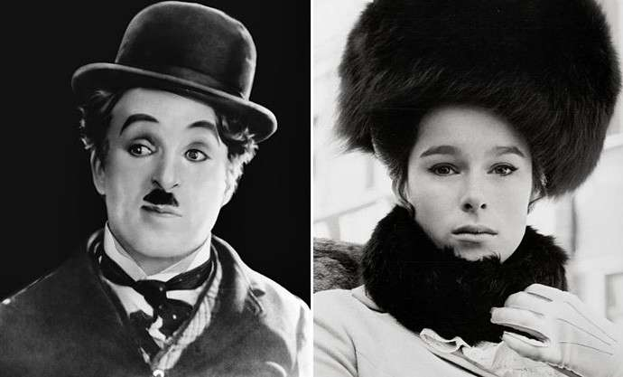
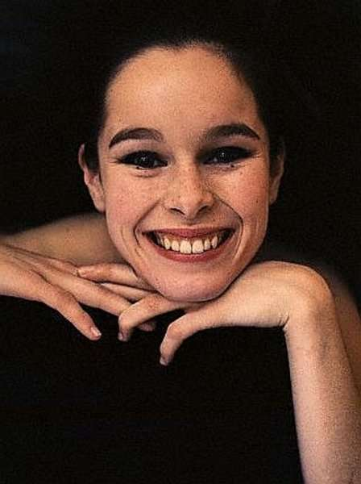

# Чарли Чаплин, охин Джеральдинадаа бичсэн захидал

Джеральдина, агуу жүжигчний охин, дэлхийн кино од, кино урлагийн түүхэнд үнэлшгүй хувь нэмэр оруулсан жүжигчин эмэгтэй юм. Тэртээх 1965 онд, кино урлагт дөнгөж хөл тавих үедээ, 76 настай ааваасаа энэхүү захидлыг авсан байдаг.

Охин минь! Одоо шөнө дунд болж байна. Миний бяцхан цайзын, зэвсэгт дайчид маань, дүү нар нь, ээж чинь ч мөн, бүгд унтацгааж байна. Энэ өрөөнд орох замдаа, унтаахай шувуухайнуудаа сэрээчих шахлаа. Чи, надаас ямар хол байна вэ? Чиний дүр төрх, нүдний минь өмнө байнга байдаг. Чиний зураг, дэргэд минь ширээн дээр байна, мөн зүрхний минь дэргэд байна. Чи минь, үлгэрийн Парисын, Елисейн тал дах театрын агуу тайзнаа бүжиглэж байгаа, гэхдээ би, одоо энэ шөнийн нам гүмд, чиний алхааг сонсож, нүд чинь өвлийн шөнийн од мэт гялтганан буйг харж сууна. Чи баярын шөнө, гэгээлэг нэгэн жүжгийн, татар хаанд олзлогдсон, гоо үзэсгэлэнт перс бүсгүйн дүрд тоглож байгааг чинь мэдэж байгаа. Гоо үзэсгэлэнгээ гайхуулан бүж! Од шиг бай, гэрэлт! Хэрэв хүмүүсийн баяр талархал чамайг согтоон, өргөсөн цэцэгний үнэрт толгой чинь мансуурвал, тэр үедээ захидлыг минь уншиж, сэтгэл зүрхээ сонсоорой. Джеральдина, би чиний эцэг, би, Чарли, Чарли Чаплин. Би чамайг бага байхад чинь, орны чинь дэргэд суун нойрсож буй гүнж, унтдаггүй лууны тухай үлгэр ярьж хичнээн шөнийг өнгөрүүлсэнийг мэдэх үү. Нойр хүрч, нүд минь анилдахад, “ яваа ч нойр минь! –охины минь мөрөөдөлд бүү саад бол” гэж хэлдэг байлаа. Би чамд олон арван үлгэр ярьдаг байсан ч өөрийнхөө үлгэрийг яриагүй ээ. Энэ үлгэр бол, Лондоны ядуу хорооллуудад дуулж бүжиглэдэг өлсгөлөн алиалагчийн тухай, өөрийн минь тухай үлгэр юм. Орон гэргүй, өлсгөлөн, цээжинд нь далай шиг их бахархал буцалдаг ч, шидэж өгөх зоосыг түүхдээ доромжлолын өвдөлтийг мэдэрдэг тэнэмэл алиалагчийн түүх байлаа. Чиний овог, 40 гаран жил хүмүүсийг инээлгэсэн, өөрөө үүнээсээ олон уйлсан хүний нэр билээ. Хорвоо ертөнц зөвхөн бүжиг хөгжимөөр дүүрэн байдаггүй. Зовж зүдэрсэн хүмүүст тус болж байгаарай. Метро, автобусаар аль болох зорчиж, явган алхаж хот оронтойгоо танилцаж байхыг хичээгээрэй. Миний гэр бүлийн хэн ч, доодост дээрэнгүй байхыг би зөвшөөрөхгүй. Хэрэв, чамд, өөрийгөө бусдаас дээр гэсэн мэдрэмж төрж эхэлвэл, тайзаа орхиж, хотын захын хорооллуудад очиж амьдралтай нь танилцаарай. Тэнд, чамаас ч хөөрхөн, чамаас ч сайхан хөдөлгөөнтэй, бахархал дүүрэн бүжигчид, тайзны гэрэлтүүлгийн оронд сарны гэрэлд бүжиглэж байдгийг мэдэж аваарай. Миний чамд илгээдэг франкны, 3 франк тутмын нэг нь бусад хэрэгцээтэй хүмүүст зориулагдах ёстой. Тэр хүмүүс эргэн тойронд чинь байгаа, ядуус юм. Өөрийн зүрхийг алт, үнэт эдлэлд худалдагдахаас хамгаал. Хамгийн том бриллиант бол нар гэдгийг мэдэж ав. Эцэг, хүүхдүүд хоорондоо сэтгэлийн тэмцэл хийж байдгийг би мэддэг. Бодол санаагаараа надтай дайт, охин минь. Би хүлцэнгүй хүүхдүүдэд дургүй. Энэ шөнө гайхамшгийн шөнө. Миний хэлэхийг хүссэн бүгдийг чи минь ойлгох гайхамшиг, ид шидийн шөнө байгаасай гэж хүснэм. Джеральдина! Аав нь хөгширч байна. Хэзээ ч юм, тоглолтын цагаан даашинзаа гашуудлын өмсгөлөөр сольж өмсөн шарил дээр минь чи, ирэх болно. Би чиний сэтгэлийг өвтгөмөөргүй байна. Чиний судсаар миний цус урсан буй. Цус минь гүйхээ больж, намайг үгүй болсон ч аав, Чарлигаа хэзээ ч бүү мартаарай. Би, сахиусан тэнгэр шиг байгаагүй, харин, хүн байхын төлөө үргэлж эрмэлзэж ирсэн. Чи ч мөн тийм байхыг хичээгээрэй. Үнсье, охин минь. Аав нь. 1965 он, 12 сар.
