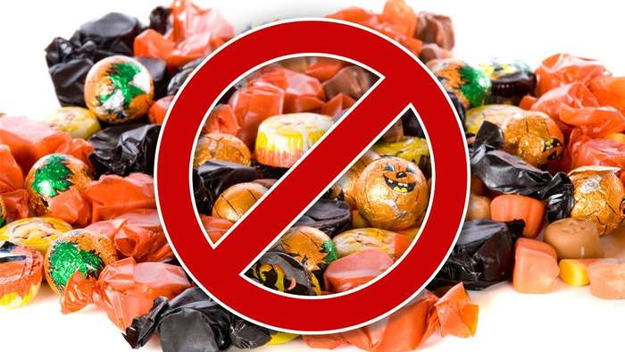
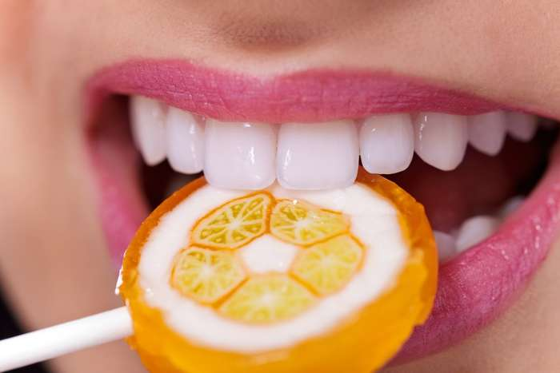

# Чихрийг архи, тамхитай зүйрлүүлж болно

Хүний амьдралын хэр хэмжээ дээшлэхийг дагалдан янз бүрийн чихэр, чихэрлэг амттаныг хүүхэд томчуудгүй өдөр тутам хэрэглэж байгаа билээ. Чихэрлэг зүйл нь нэг талаараа хүний бие махбодод шим тэжээл нөхөж, биеийг тамиржуулах, чухал элементийн нэг боловч нөгөө талаар чихэрлэг зүйл хэтэрснээр хүний биед маш олон сөрөг үр дагаврыг бий болгож байдаг. Чихэрлэг зүйлсийг хэтрүүлэн хэрэглэхийг архи ууж, тамхи татахтай зүйрлүүлж болох юм. Жишээ нь:

Чихэрлэг бүтээгдэхүүнийг идсэнээр бие доторх B1 багасч, мэдрэл ба булчин махны хөдөлгөөний чадвар буурдаг. Үүнээс болж хүний яс хэврэгшиж амархан хугарч гэмтэнэ. \
Чихэр нь ходоодоор дамжин тун түргэн цусанд орж ходоодны багтаамжийг ихэсгээд цатгалан байдалтай болгодог. Үүнээс болж янз бүрийн амин дэм, уургийг багаар хүлээж авснаас шим тэжээлийн дутагдалд ордог. \
Чихрийн бактер задруулсны улмаас хүчил үүсгэдэг. Энэ хүчил нь шүдний пааланг гэмтээдэг. Чихэр нь яс ба шүдний кальцийг багасгадаг учир чихэр их иддэг хүүхэд болон насанд хүрсэн хүний шүд хорхойтох өвчин их тохиолддог. \
Ердийн үед хүний бие дэх чихрийн хэмжээ 0,008-0,1 –ийн хооронд байдаг. Хэт их чихэр идсэнээс цусан дахь чихрийн хэмжээ ихэсч, илүүдэл чихрүүд нь эсийн дотор өөх хэлбэрээр хадгалагддаг. Иймээс хүн таргалдаг байна.
