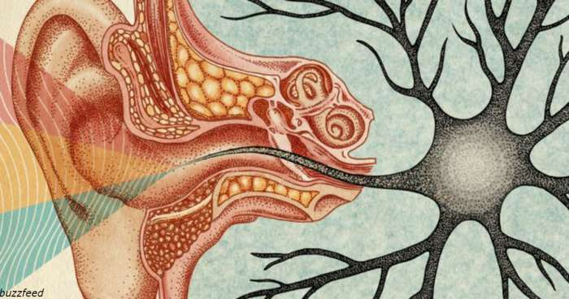

# Чимээ аниргүй байдлын увидас

Чимээ аниргүй байдал нь хоосон орон зай бөгөөд харин энэхүү хоосон орон зай нь оюун ухаан сэрэхийн нигуур гэж Будда айлдсан ажээ. Чимээ шуугиан, тархинд гэрлийн хурдаар чихээр дамжин хүчтэй үйлчилж стрессийн дааврыг өсгөдөг гэж шинжлэх ухааны үндэслэлтэй нотолсон бөгөөд хааяахан таарах чимээ аниргүй байдлыг хүн өөрийн эрхгүй дотроо үнэлж байдгаас, тэрхүү хэсэгхэн үе нь хүнд тав тух аятай байдлыг мэдрүүлж байдаг гэж үзжээ. Энэ хормууд хүний онгодыг хурцалж, бие, сэтгэлийг сэргээж, оюун ухааныг хөгжүүлж байдаг байна. Мөн чимээ шуугиант орчин хүний биеийн бодисын солилцоонд нөлөөлж, бие организмын процессуудыг дарангуйлдгаас уур уцаар, бухимдал төрүүлж байдаг аж. Тиймээс, чимээгүй орчин, дуугүй байх, чимээгүй байх үеийг, ядарсан тархи, биеийг сэргээх, хүнийг өвчилөлөөс эдгээх боломж гэж үзэж байна. 2011 онд явуулсан Дэлхийн эрүүлийг хамгаалах байгууллагын судалгаагаар, баруун европын 340 сая иргэд дуу чимээний үйлчилээс болж наснаасаа эрт хорвоог орхидог гэсэн дүгнэлт гарчээ. Эхний үед эрдэмтэн судлаачид, чимээ аниргүй байдлын үр нөлөөг судлаагүй бөгөөд харин дуу чимээний хүнд нөлөөлөх үйлчилэлийг судлах явцдаа чимээ аниргүй орчины гайхалтай нөлөөллийг нээсэн аж. Судалгаанд хамрагдагсдад, чанга дуу чимээ, хөгжмийн аялгууг ээлжлэн сонсгох үед завсарлага хоорондын хоёр минутын чимээгүй үе, тархинд, тайвшруулах үйлчилэлтэй хөгжмийн аялгуу, эсвэл урт удаан хугацааны нам гүм байдлаас илүүтэй гайхалтай амралт өгч байгаа сонирхолтой байдал ажиглагдсан бөгөөд чимээ аниргүй, дуугүй байх үед тархи сэргэж, дуу чимээтэй үед алдагдсан чадваруудаа эргэн сэргээж байдаг болох нь нотлогджээ. Эртний сэтгэгч, гүн ухаантнууд, нам гүм байдал нь тархийг сэргээдэг,мөн өөрийгөө мэдрэхэд хүргэдэг, түүнчилэн дуугүй байх нь бие сэтгэлийг тэнцвэржүүлдэг байгалиас заяагдсан эдгээгч чанартай болохыг мэдэж, үргэлжид ашигладаг байсныг өнөөгийн шинжлэх ухаан ийнхүү нотолсон байна. Энэхүү энгийн чимээ аниргүй, нам гүм байдал нь, эмчилгээ мэт увидастай, энэ чанар нь, орчин үеийн дуу шуугиант орчлонд амьдран буй бидэнд ихээхэн чухал болохыг мэдэж байхад илүүдэхгүй буйзаа.

