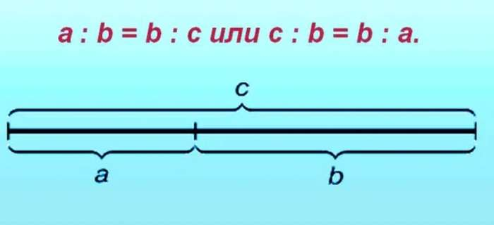

# Далд ухамсрын тусламжтай хүссэндээ хүрэх “Алтан хэсэг” арга

Бодитоор биелэгдэх боломжтой зүйлс болох, сайн ажилд орох, гадаад үзэмжээ сайжруулах, зан байдлаа өөрчилөх, аятайхан хүнтэй танилцах, зорьсон зүйлээ биелүүлэх зэрэг хүслүүдэд маань бидний өөрсдийн далд ухамсар туслах өндөр чадвартай байдаг гэнэ. Харин, сая доллар сугалаанд хожих, нуурын эрэг дээр олон давхар хаустай болох гэх мэтийн аз, хугацаа шаардлагатай хүслүүдэд тусалдаг эсэх нь эргэлзээтэй ч, тусалдаггүй гэж мөн хэлж болдоггүй. Амжилтад хүрсэн олон хүмүүс тухайн үедээ бүтэшгүй гэмээр хүслүүд тээж явсаар түүнийгээ олж авсан байдаг. Далд ухамсар буюу дотоод ертөнц дөх байр байдал нь хүний гадаад ертөнцийг бүрдүүлдэг гэдэг. Харин одоо, далд ухамсартайгаа ажиллах гайхалтай, ихэд дэлгэрсэн нэгэн аргатай танилцуулья. “Алтан хэсэг” гэдэг нь, хэрчимийг ижил бус урттай хувааж, хэрчимийн бага хэсэгийн их хэсэгтэй харьцах харьцаа нь, их хэсгийн нийт хэрчимтэй харьцах харьцаатай адил байх математикийн ойлголт юм. Энэ ойлголтын энэхүү харьцаа үл тайлбарлагдах нууцлаг шалтгаанаар хүний тархинд нөлөөлж байдаг бөгөөд бид, өөрсдөө мэдэхгүйгээр, ихэнхи тохиолдолд яг энэхүү орон зайг сонгож, тэр хэсгийг давуу, хамгийн сайн гэж тооцож байдаг байна. Жишээ нь, олон зэрэгцсэн сандлууд байгаад нэгийг нь сонгож суу гэвэл, “Алтан хэсэг”-ийн зарчимаар өөрөө ч мэдэхгүй тэр хэсгийг сонгож байдаг гэнэ. Үүнийг, зураач, уран барималчид, архитекторууд, ер нь уран бүтээлчид, хүний сонгох, харааг хамгийн их татах, анхаарах “Алтан хэсэг”-ийн орон зайг тооцон бүтээлдээ ашиглаж байдаг гэнэ. Сүүлийн үед, маркетингд ихээхэн ашигладаг болж, бүр супер маркетууд ч хүртэл, бараа бүтээгдэхүүнээ өрөхдөө тавиурын “Алтан хэсэг”-т аль болох байрлуулдаг болоод байгаа аж. Энэхүү математик аргачлалыг далд ухамсартайгаа ажиллахад хэрхэн ашиглах вэ? Хүсч буй зүйлээ 27 үгээр бүрдүүлэн илэрхийл. Хүсч буй зүйлийн гол цөм үг зөвхөн 17-дох үг байхад л болоо. Хэрэв, утгын хувьд ганц үгээр бичиж болохгүй байвал, 16, 17, 18 –дах үгсэд байршихаар бич. Яг энэхүү гурван үг “Алтан хэсэг”-т байрлах юм. Үүнийг унших, бодох, хэлэх, сонсох /дуу хураагуурт бичиж сонсох/ үед, эдгээр үгс далд ухамсарт шууд итгүүлэн үнэмшүүлэх үйлчилэл үзүүлж, гайхалтай нөлөөлөх чадвартай байдаг тул далд ухамсарын түвшинд сөргөлдөх боломжгүй өөрчилөлт явагдан, бидний хүчин зүтгэлийн оролцоогүйгээр амьдрал өөрчилөгдөж эхэлдэг аж. Энэ бол ид шид биш, харин бодсоноо биелүүлэхийн тулд хийгдэх ёстой зүйлс нь, өөрийн хүслээр, бэрхшээхгүй гүйцэтгэгдэж эхэлдэгтэй холбоотой. Өдөрт 30 минут үүнд зарцуулах үр дүнтэй гэдэг бөгөөд далд ухамсартайгаа ажиллах, өөрийгөө итгүүлэн үнэмшүүлэх энэхүү арга маш хүчтэй байдаг тул, дараа нь харамсахаар зүйл дээр хэрэглэхийг хориглодог. Засахын аргагүй алдаа болдог гэнэ. Хэрэв, энэ аргыг хэрэглэхээр, туршаад үзэхээр шийдсэн бол, хэсэгхэн хугацаа гаргаж 27 үгнээс бүтсэн, 16, 17, 18 –дах үгс дээр хамгийн их хүсч буй зүйлийг тань илэрхийлэх үгс таарахаар утгачлан бичихийг дахин сануулья. Хүслээ биелүүлэхийн тулд, хэн нэгэнд хандаж гаднаас тусламж дэмжлэг авах түвэгтэй зүйл хийхийн оронд, харин, өөрийн дотоод ертөнц, далд ухамсартаа итгээд үзээрэй. Хүн бүр хүссэнээрээ, амжилт дүүрэн амьдрах болтугай гэсэн сайхан ерөөлөөр өндөрлөе!

