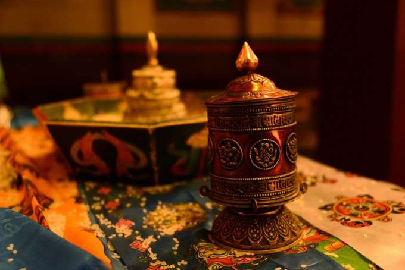
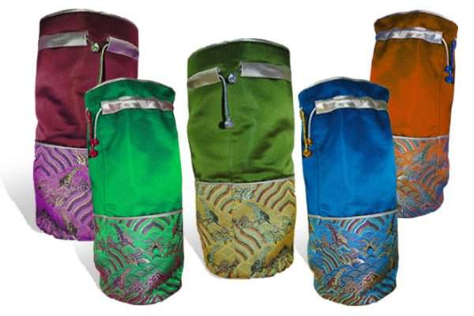

# Даллага авахуулах зан үйл

Даллага авахад айл гэрийн буян хишиг булгийн ундрага лугаа оргилно. Монгол түмний ёс заншлын нэгэн чухал хэсэг нь хувь хүн, хамт олон, айл өрх “Буян хишгийн даллага” авахуулах нь гал голомтоо тахих ёсны зан үйл билээ. Даллага авах, хурайлах зэрэг нь даллан дуудаж инагш ирүүлэх гэсэн үгийн нэгэн утга бөгөөд “Даллах” нь “Даллага”, “Хурайлах” нь “Урин дуудах”-н нэр юм.

Хувь хүн, хамт олны сүлд хийморь, ажил үйлс өөдрөг, өрх айлын ноён нуруу тэгш, эд адгуурс, эрхэм баялаг, мал хөрөнгө нь арвижин дэлгэрч буян хишиг нь булгийн ундарга мэт оргилж байхын бэлгэдлийг шингээсэн “Даллага авахуулах ёс” нь юу санасан есөн хүслээ хангуулан есөн ес наян нэгэн шид бүтээлийг өөрийн орчиндоо жигд бүрдүүлэхийн бэлгэдлийг давхар агуулдаг эрхэм ёслол билээ.

#### Даллагын уутыг бэлтгэх

• Даллагын уутыг хар, хар хөх өнгөнөөс бусад, есөн өөр өнгийн даавуу, торгоор уртааш нь гувалжин, дөрвөлжин, дугуй ямар ч хэлбэртэй оёж хийж болох ба харин ёроолыг дугуй хэлбэртэй, дотортой хийх нь зохимжтой.\
• Уутны амсрыг хумиж, гүйлгээ утсаар нээж хаахад хялбар байвал сайн. \
• Хэмжээ нь бага гарын мөнгөн аяган дотор нь орохуйц, арвай будаа хийхэд нэг кг орох багтаамжтай байна.

#### Даллагын уутанд байх /хийх/ зүйл

• Давхар уутны ёроол юмуу хажуу бөөрөнд есөн эрдэнэ (алт, мөнгө, шүр, сувд, оюу, номин, тана, ган, зэс) хийнэ. \
• Уутанд “таван зүйл шим” болох – Арвай, улаан ба хөх тариа, шар, цагаан будаа. \
• Малын таван зүйл шим болох – Ааруул, ээзгий, цөрөм, хурууд, бяслаг (тэгэхдээ маш хуурай) \
• Таван тансаг идээний дээж болох – Хуурай цай, давс, хужир, үзэм, хатуу бурам. \
• Эд эдлэлийн есөн зүйл чимэг болгож – Хоргой торгоны өөдөс, утас зэргийг даллага авч байгаа ламаар шүншиглүүлэн уутанд хийнэ. \
• Мөн дээд гурван үр болох – Ар-үр, бар-үр, жур-ур, доод гурван үр хэмээх –Арвай, сарвай, жамбарай байна. \
• Зөвхөн гэрийн эзэн өөрөө авсан төрсөн нутгийнхаа усны чулуу тахилгат уулын чулуунаас хийж болно. \
• Гэртээ лам урьж даллага авахуулахаас гадна сүм хийдэд очиж даллага авахуулдаг. Тэгвэл даллагын- уутандаа даллагын сум зүүнэ. Гэрийнхээ үүдэнд ирэнгүүт сумаа үүд рүүгээ харуулдан даллаж авсан идээн дээрээ тавьж гэрт орно. \
• Даллагын саванд мөнгө төгрөг, үнэт эдлэл хийж болохгүй. Явцын дунд түүнээ авч хэрэглэх тохиолдол гарахаас гадна үнэт эдлэл, мөнгө төгрөгт хомголзох сэтгэл, шуналын дэв хорогддог учир 81 шидийш бузартуулж гарлагын үүд нээгдэнэ гэж үзэж цээрлэнэ. \
• Даллагын уутанд нойтон чийгтэй гурилан зүйл, цагаан идээ хийвэл хөгцрөх муудах, өт хорхой эрвээхий идэх учир цээрлэнэ. 

#### Даллагын уутны дүүрсэн болон бурханы өмнөх хуучин дээж идээг яах вэ!

Даллагын уут дүүрч, бурханд тавьсан идээ хуучирлаа гэж бодъё, Тэгвэл шүншигтэй идээ, эд зүйлээ уут сав, бурханыхаа өмнө үлдээгээд, ялангуяа өөрийнхөө сүлд гарагт тухайн жилийнхээ буян хишгийн зүгт гарч уул овоонд тавгийн идээ маягаар засаад арц хүж уугиулан өргөнө. Ийнхүү өргөсөн идээг будааг идсэн хорхой шавьж, жигүүртэн шувуу, ан амьтан таны буян хишгийг хүртсэнээр ээл ивээл, ач тус нь танд болон гэр бүлд цаглашгүй буян оршооно гэсэн үг юм.
