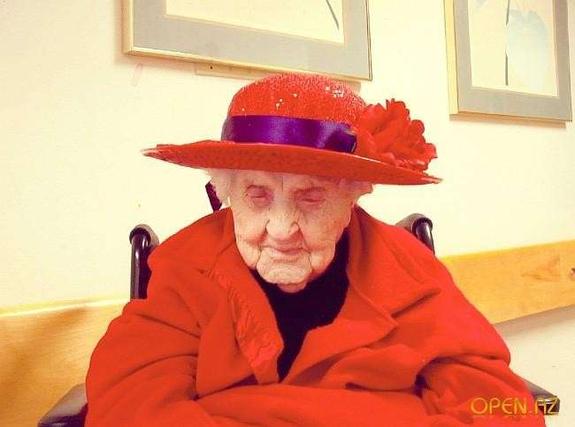
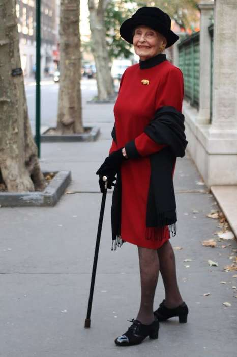

# Дараах зүйлийг долоо хоногт нэг ч атугай уншиж байхыг зөвлөжээ

90 настай эмэгтэй Регина Бретт, амьдралын туршлагаасаа ийнхүү хуваалцаж байна. Тэрээр 45 настайдаа мөн ийм зөвлөмж гаргаж байжээ. Тэр үеийн зөвлөмж, үүнээс нь нэг дахин бага байсан аж.

Амьдрал шударга биш, гэхдээ л үнэхээр сайхан шүү. Эргэлзэх үедээ урагшаа нэг алхсан нь дээр байдаг. Амьдрал, өс хонзон мэт дэмий зүйлд зарцуулахын аргагүй богино байдаг. Чамайг өвдөхөд ажил чинь халамжилж асрахгүй, харин ах дүү төрөл садан, найз нөхөд чинь халамжилдаг. Өр зээлээ цаг хугацаанд нь төлдөг бай. Хүссэн ч хүсээгүй ч, бүх зүйлд ялагч байж чадахгүй гэдэгтэй эвлэр. Хэн нэгэнтэй хамт уйлахад сэтгэл дотор онгойдог. Эхний цалингаасаа эхлэн цалин бүрээсээ, багаар ч бай мөнгө хурааж байгаарай. Өнгөрсөн амьдралаа өршөөснөөр, одоогийн амьдрал сайжирна. Өөр бусад хүмүүс, амьдрал дээр юу ч амсаж байж болох, түүнийг нь мэдэхгүй байж өөрийнхөө амьдралыг бүү жиш. Аливаа нууц харилцаанаас болгоомжил. Нууц зүйл сайныг өгдөггүй. Бүх зүйл хоромхон зуур өөрчлөгдөх магадлалтай. Уртаар гүнзгий амьсгал, тайвширна. Гоё, хөөрхөн, ашигтай гэж нэрлэж болохооргүй эд зүйлсээсээ харамсахгүй сал. Саад, бэрхшээл, бүр үхээгүй үлдэж чадсан бэрхшээлүүд ч хүртэл хүнийг хүчирхэг болгож байдаг юм. Хэзээ ч аз жаргалтай хүүхэд насаар амьдарч болно. Гэхдээ энэ хоёрдох хүүхэд нас өөрөөс чинь шалтгаалдаг. Лаа байнга асааж бай, сайхан цагаан хэрэглэл, дотуур хувцас хэрэглэж байгаарай. Аливааг бэлтгэхдээ илүү бэлтгэж бай. Хэрэг болдог. Зоримог хувцасла. Өтөл насанд өнгө өнгийн хувцас өмсөж чадахгүй. Сексийн хамгийн чухал эрхтэн бол тархи. Чиний аз жаргалын төлөө чамаас өөр хэн ч хариуцлага хүлээдэггүй. Бүхнийг, бүх зүйл дээр өршөөдөг бай. Чиний тухай хэн нэгэн юу гэж бодох нь хамаагүй. Бүү санаа зов. Цаг хугацаа бүхнийг элээдэг гэдэг. Сайн тохиолдол, муу тохиолдол аль аль нь өөрчлөгднө. Өөрийгөө хүндээр хүлээж авч хэрэггүй. Гайхамшиг ид, шидэд итгэдэг бай. Бурхан, чамайг, чи, түүнд ямар нэг юм хийж өгсөний чинь төлөө бус, өөрөө Бурхан учраас хайрладаг. Амьдралыг айхтар судлаад хэрэггүй. Чи өөрөө хичнээн хийж амжиж байна, түүнийгээ хийж тайван амьдар. Хөгширөх нь, залуугаараа үхэхээс хавьгүй дээр учраас өтөл насаа үнэл. Өөрт чинь утга учиртай санагдаж байгаа бүх зүйл, чиний хайртай хүмүүс, мөн дуртай зүйлтэй чинь холбоотой байдаг. Өдөр бүр агаарт гарч, зугаалан алхаж бай. Гайхамшиг энд тэндгүй таарна. Хэрэв өөрсдийн асуудлыг овоолоод бусдынхтай харьцуулвал, бусад хүмүүсийн овоолоостой асуудлуудыг хармагцаа өөрийнхийгөө буцаан шүүрэн авах нь тодорхой байдаг. Атаархал хамгийн тэнэг зүйл. Чамд хэрэгцээт бүх зүйл байгаа. Буулт хийж сур. Ямартай ч хамаг сайхан зүйл урд маань байдаг гэдэгт итгэ. Бие чинь тавгүй байсан ч, хувцаслаад гар, хүмүүстэй уулз. Гоёмсог туузаар ороож, цэцэг зангидан чимээгүй ч гэсэн, амьдрал бол агуу сайхан бэлэг юм.
