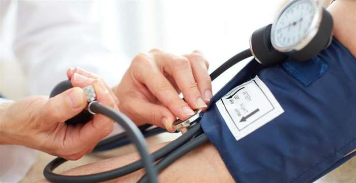

# Даралт ихсэх үеийн анхны тусламж

Даралт огцом өгсөх үед, зөв амьсгалах нь тустай байдаг.\
Цусны даралт өгсөхөд, 2-3 минутын турш, амьсгаагаа гаргах бүртээ 7-9 секунд амьсгалаа түгжих. 30 нэгжээр даралт буурдаг\
Дурын тайвшруулах зориулалттай эм уух\
Цонх салхивчаа нээн, цэвэр агаар оруулах\
Даралтны эм хэрэглэдэг бол түүнийгээ давхарлаж уух\
Хагас эсвэл бүрэн хэвтээ байдалд хэвтүүлэх\
Mайван, зөөлөн өнгөөр сатааруулах аястай ярилцах
