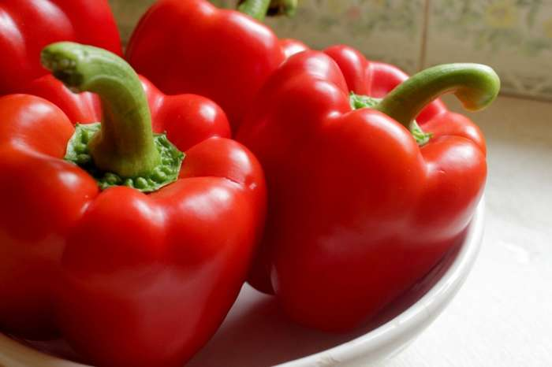
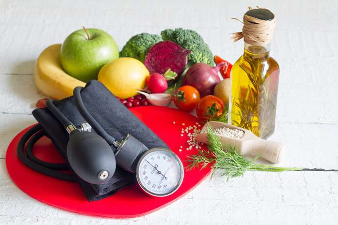

# Даралт ихсэх өвчний үед тустай хүнснүүд

Даралт ихсэх өвчинөөр манай дэлхийн сая сая хүн өвддөг, маш түгээмэл өвчин болоод байгаа юм. Энэхүү өвчин, зүрхний дутмагшил, зүрхний шигдээс, цус харвалт, бөөр өвчилүүлэх зэрэг ноцтой өвчинүүдэд хүргэх эрсдэлийг дагуулж байдаг. Өндөр даралтыг, хоол хүнсний тусламжтай бууруулж, мөн энэ өвчинөөс салж болдог бөгөөд өндөр даралттай хүмүүст хамгийн хэрэгцээтэй С амин дэм, Е амин дэм, кали, магни, омега-3, фолийн хүчилийн агууламж өндөртэй дараах хүнсүүдийг хэрэглэж байхыг зөвлөдөг.

#### Улаан өнгөтэй амтат чинжүү.

С амин дэмийн агууламжаараа рекорд тогтоодог. Өдөрт идсэн 2 ширхэг улаан амтат чинжүү, бүхэл өдрийн хэрэгцээт С амин дэмээр хангадаг.

#### Овъёосны агшаамал.

Селен болон эслэгээр баялаг тул даралттай хүмүүс өглөө бүр идэх хэрэгтэй. / “геркулес” нэрээр гадуур худалдаалагддаг/

#### Хулууны үр.

Организмыг цинкээр хангадаг тул, зүрхний шигдээсээс хамгаална. Өдөрт 20 грамм хангалттай байдаг.

#### Какао.

Судасны ханыг сайжруулдаг. Илчлэг ихтэй тул, долоо хоногт 1-2 аяга хэрэглэх хэрэгтэй.

#### Тослог багатай сүү.

Кали, магни, кальци, бусад амин дэмүүдээр баялаг байдаг. Даралттай хүмүүс өдөрт 3 аяга уухыг зөвлөдөг.

#### Хар шоколад.

Зүрхний булчинг бэхжүүлдэг. Антиоксидантуудаар баялаг тул, даралтыг буулгадаг. Хэтрүүлэн хэрэглэж болохгүй.

#### Миндаль /самар/

. Цусан дах холестериныг бууруулдаг.

#### Хулд загас.

Омега-3 агуулдаг. Даралт буулгана. Долоо хоногт 3 удаа 100-150 гармм хэрэглэхийг зөвлөдөг. Эдгээр нь, даралт бууруулах, хэмжээнд нь барихад хамгийн хэрэгцээтэй хүнснүүд ажээ.
