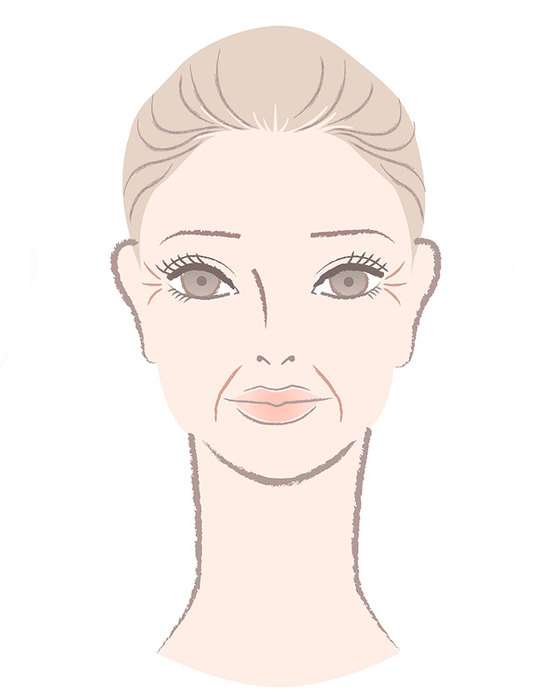
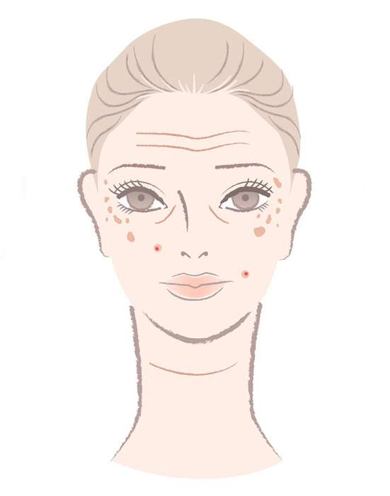
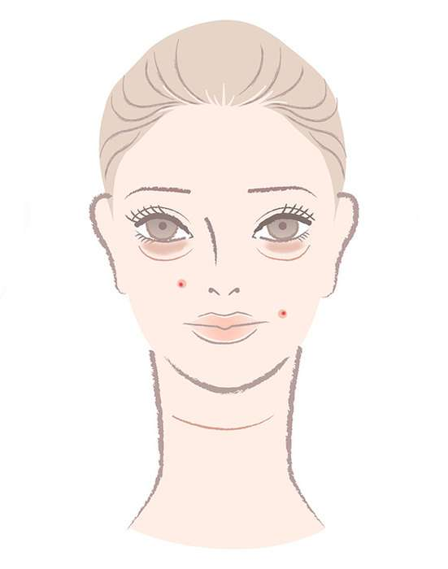
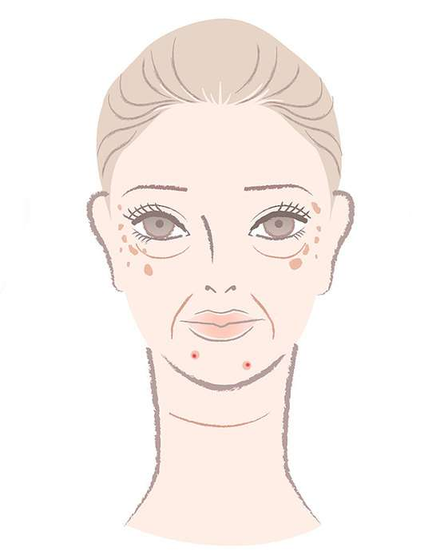

# “дарс” “чихэр” ”сүү” “глютен”-с шалтгаалдаг арьсны шинж тэмдэгүүд

Арьс, гоо сайхны эмч Нигма Талиб, арьсны хөгшрөлтийн шинжийг, хоол хүнсний хэрэглээтэй нь холбож үзэн, олон хүнийг хамруулсан судалгаа явуулснаар, хоол хүнс нь хүн тус бүрт янз бүрээр үйлчилдэг болохыг тогтоожээ. Хүн тус бүрт, дарс, сүү, чихэр, глютений орцтой хүнснээс аль нэг нь таардаггүй болохыг тодорхойлоод, арьсны хөшрөлтийн шинжийг 4 төрөлд хуваасан аж. Уг таардаггүй хүнсийг нь тодруулж, тухайн хүний хооллолтоос хасахад арьсны бүтэц илт сайжирч, залуужиж байжээ.

Хүн өөрсдийн дуртай, мөн өргөн хэрэглэдэг хүнснүүдээс болж нүүр сэлхийнэ, үрчлээ тогтно, нүдний доорх уутанцар үүснэ гэж огтхон ч боддоггүй, бүр тааварладаг ч үгүй учраас, доктор Талиб чухам юунаас болж арьс хөгширч байгааг мэдэхэд туслах дараах хувилбаруудыг санал болгосон ажээ. Та өөрийгөө анхааралтай толинд хараад дараах хувилбаруудын шинжүүдтэй харьцуулан ямар бүтээгдэхүүн танд таарахгүй байгааг мэдэж болох юм.

#### Хувилбар–1

-нүдний гадна буланд үрчлээ ихтэй\
-арьс улаавтар, судаслаг\
-арьсны нүхжилт өргөссөн\
-арьс гуужимтгай\
-хамрын самсаанаас уруулруу үрчлээ үүсч байгаа\
-уруулын хоёр талын буланд үрчлээтэй\
Эдгээрээс 4 ба түүнээс дээш таарч байвал таны арьсны “дайсан” бол алкоголь. \
Хэн нэгэн оройн хоолны дараа дарс хэрэглэх хэвшилтэй, зарим хэсэг нь үдэшлэг зугаалга дээр ууж идчихээд ямар нэг нөлөөгүй явж байдаг л даа, гэхдээ энэ таных яав ч биш гэдгийг ойлгоорой. \
**Цаашид яах вэ?** \
Та, хоёр долоо хоног бүх төрлийн спиртлэг зүйлээс татгалзаад, дараа нь ¼ дүрэм буюу нэг порц дарсыг 4 порц ундаа, ус бол бүр сайн даруулан хэрэглэж байх хэрэгтэй.

---

#### Хувилбар-2

-духны хэвтээ үрчлээс үүссэн\
-дээд зовхи унжих хандлагатай\
-арьс суларсан\
-нүд гархилах\
-батгатай\
-нөсөө толботой\
Эдгээрээс 4 ба түүнээс дээш таарч байвал таны, “дайсан” чихэр. \
Хэрэглэж буй чихэрлэг зүйлс тань маш муу шингэснээр цусан дах сахарын түвшинг барихын тулд организм тань чихэр нэхэж байдаг байна. Арьсаа хөгшрүүлэхгүйн тулд энэ хэрэглээгээ яаралтай багасгах хэрэгтэй. \
**Цаашид яах вэ?** \
Аажмаар багасга. Цайнд хоёр халбага хийдэг бол нэг болго. Хоёр долоо хоногийн дотор чихрийн хэрэглээгээ 2 дахин, сарын дотор 4 дахин багасгаж насан туршдаа энэ хэмжээгээ барь. Арьс тань, танд “баярлалаа” гэж, та ч хамт баярлах болно.

---

#### Хувилбар-3

-нүдний доод тал сэлхийдэг\
-нүд, нүүр хавагнадаг\
-батга\
-арьс толигор биш\
-арьс өөтэй\
Эдгээрээс 4 ба түүнээс дээш таарч байвал таны арьсны “дайсан” бол сүү. \
Эрдэмтэн судлаачид, сүүг зөвхөн хүүхдийн организм шингээдэг гэсэн дүгнэлтийг хийцгээдэг боловч одоохондоо нэг шийдэлд хүрээгүй байгаа гэж үздэг. Томчууд дассан зүйлээ хэрэглэн ирснээр хэзээ ч сэргэхгүй уршигтай хөгшрөлтөд хүрэх зүйлээ хийж байгаагаа өөрсдөө ч мэддэггүй ажээ. Хүн сүү хэрэглэхгүйгээр кальци, уургаа авах төрөл бүрийн бүтээгдэхүүнүүд гарсан нь олзуурхууштай билээ. \
**Цаашид яах вэ?**\
Зүгээр л гурван долоо хоног сүү хэрэглэхээ больчих. Энэ хооронд арьсанд тань гарах сайн өөрчлөлтүүд таныг урамшуулаад өгнө. Цаашид хааяа өөрийгөө эрхлүүлэх маягаар хэрэглэж болох юм.

---

#### Хувилбар-4

-нөсөө толбо ихтэй сааралтсан арьс\
-эрүүний хавьд батгашилтай\
-унжсан хацар\
-хөөнгө\
-давхар эрүү\
Эдгээрээс 4 ба түүнээс дээш шинжүүд таарч байвал, таны “дайсан” глютен. \
Олонхи хүмүүсийн организм улаан буудай, хөх тариа арвайнд их хэмжээгээр агуулагддаг цавуулаг нэг төрлийн уурагт маш мэдрэг байдаг байна. Энэ зүйл таарахгүй байхад дархлаа дарамтлагдаж, пигментийн эд эс устдаг бөгөөд арьс өнгөө алдаж нөсөө толбо үүсч, дааврын систем өөрчлөгдөн хөөж хавагнах, хөгшрөх шинжүүд бий болдог ажээ. \
**Цаашид яах вэ?**\
Орчин үед гурил гурилан бүтээгдэхүүнүүдэд “глютений агууламжгүй” гэсэн тэмдэглэгээ бүхий бүтээгдэхүүн үйлдвэрлэх шаардлага тавьдаг болсон. Тиймээс хүнс авахдаа шошгон дээрх бичилтийг уншиж сурах хэрэгтэй болно. Мөн талх, гоймон гурилын хэрэглээгээ багасгах болох нь
