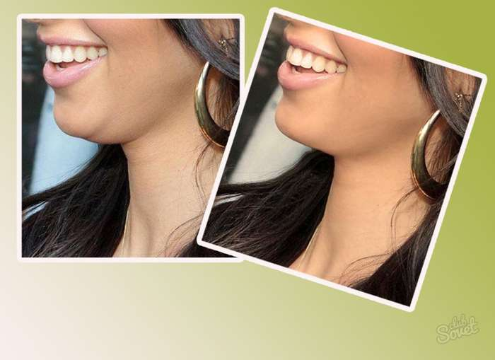
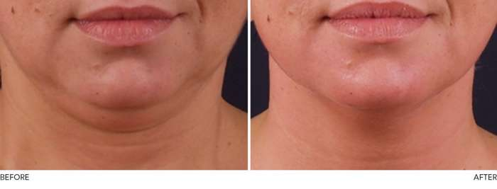

# Давхар эрүүнээс ангижрах арга

Давхар эрүү, олон хүний хувьд асуудал болж байдаг. Таргалалт, нас, ген, ясны бүтэцийн өөрчлөлт, турах, буруу байрлалтай хэвтэх, нүүр толгойны байрлалын зуршлууд зэргээс болж давхар эрүү үүсдэг. Ингээд, гэрийн нөхцөлд, давхар эрүүнээс салах үр дүнтэй аргуудаас танилцуулъя.

- Е амин дэм. Энэ амин дэмээр баялаг хоол хүнс хэрэглэх хэрэгтэй бөгөөд ногоон өнгийн ногоонууд, элэг, самранд их хэмжээгээр агуулагддаг. Мөн Е амин дэмийн тосон уусмалыг эрүү хүзүүндээ түрхэж өгөх хэрэгтэй. \
- Өндөгний цагаан. Өндөгний цагаан, суларч унжсан арьсыг татах үйлчилгээтэй. 2 ширхэг өндөгний цагааныг, 1 халбага сүү, 1 халбага зөгийн бал, 1 халбага нимбэгний шүүстэй хольж, үүнийгээ духнаасаа доош хүзүүний уг руу түрхнэ. Хэвтээ байрлалд хийгээрэй.15-20 минутын дараа бүлээн усаар угаана. \
- Ногоон цай. Ногоон цай илүүдэл жин хаяхад тустай, тиймээс, өдрийн турш ногоон цай уугаарай.\
- Амтат гуа, алимны шүүс, энэ хоёр шүүсээ холиод хөвөнгөөр түрхнэ.
