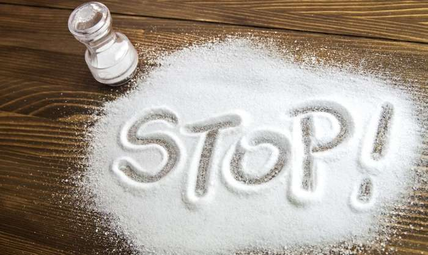
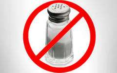

# Давс ихэдвэл судас хэврэгшинэ

Дэлхий нийтээрээ хүлээн зөвшөөрсөн хүний эрүүл мэндэд хамгийн тохиромжтой давсны хэрэглэх хэмжээ нь өдөрт 5гр гэж үздэг. Европын нэлээд олон улсад зүрх судасны өвчингүй хүмүүст судалгаа явуулсны дунд өдрийн хэрэглэх давсны хэмжээ нь 5гр-аас доош байсныг судлан илрүүлжээ.

Хоол хүнсэндээ давсыг зөв зохистой хэрэглэх шаардлагатай. Давсыг хэтрүүлэн хэрэглэж болохгүй. Ялангуяа настайчуудын биед давс дутагдахгүй учир настай хүмүүс давс багатай хоол хүнс хэрэглэж байвал зохино.\
*Сүүлийн үед эмч судлаачдын баталснаар давс их хэрэглэдэг хүмүүсийн судас хэврэг болж, зүрхний булчинд гэмтэл учруулна гэжээ. Япон улсын умард далайн арлын иргэд эрт үед давсалж хадгалсан загас идэх зуршилтай байжээ. Мөн хоолны давсыг өдөрт 30 гаруй граммыг хэрэглэдэг байж. Үүний дүнд тэд “хавдар үүсэх вант улс”, мөн “тал харвалтын вант орон” гэсэн нэр хочтой болжээ. Дараа нь хөргөгч гарснаас хойш тус орны ард иргэд загасаа давслан хадгалахаа больсноор мөн давс их хэрэглэхээ зогссоноор, хавдар болон харвалт өвчний үүсэлт илэрхий буурсан байна.* \
Энэ бүхнээс үзэхэд давс бол зүрх судасны өвчин, тархины цус харвалт зэрэг өвчнийг үүсгэх, хүндрүүлэх гол нөхцөлийн нэг тул давсыг бага хэмжээгээр хэрэглэх нь зүйтэй. Гэвч давс огт хэрэглэхгүй байж болохгүй. Шим тэжээлийн судалгаанаас үзэхэд нэг хүний өдрийн хоолны давс нэг гр-аас доошилж болохгүй гэж тогтоожээ.
