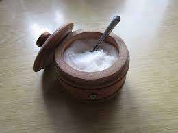

# Давсны ид шид

Давсыг алдсан энерги, аураг нөхөх, сэргээх чадвартай гэдэг бөгөөд алс хол явахдаа биедээ авч явах нь, хамгаалалт болж өгдөг гэнэ. Давсыг ашиглан хамгаалалт хийх аргуудыг танилцуулъя:

-атаархал, муу хэл амнаас хамгаалахын тулд, ширээн дээрээ жижиг задгай саванд давс хийж тавих хэрэгтэй.\
-гэр орон, өрөө тасалгааныхаа энергийг цэвэр байлгахын тулд, орой 11-12 цагийн хооронд хайруулын тавганд ёроолыг нь бүрхэхээр нимгэн давс хийгээд 1 орчим ширүүн гал дээр халаана. Энерги бохиртсон байвал халааж буй давсан дээр хар толбонууд гарч ирдэг.\
-уг халааж байгаа давс чимээтэй, буудаж үсэрч байвал хараал хэл ам байна, аюултайг заах бөгөөд орой бүр энэ үйлдлээ, зүгээр болтол нь хийх хэрэгтэй.\
-давс мөн нойр хүрэхгүй байх, хар дарах зэрэгт тустай. Мэлхий, хилэнц, загас, ихэр, жинлүүр хумхын ордынхон, 3 чимх давсыг аягатай усанд найруулаад орныхоо хөл, толгойд тавьж унтах, хонь, үхэр, арслан, охин, нум матрынхан, мөн орныхоо хөл, толгойд задгай жижиг савтай давс тавьж унтахад сайн амардаг гэнэ. Өглөө нь уг зүйлсээ асгах ёстой.\
-хоол ундаа давслах үедээ сайн зүйл бодож хийхэд сайн шингэдэг байна.
