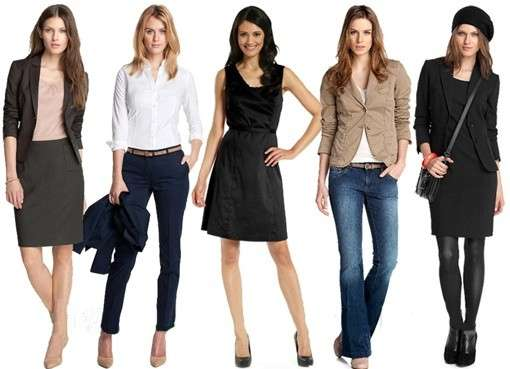
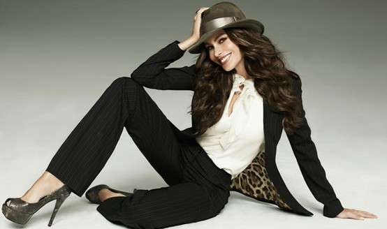
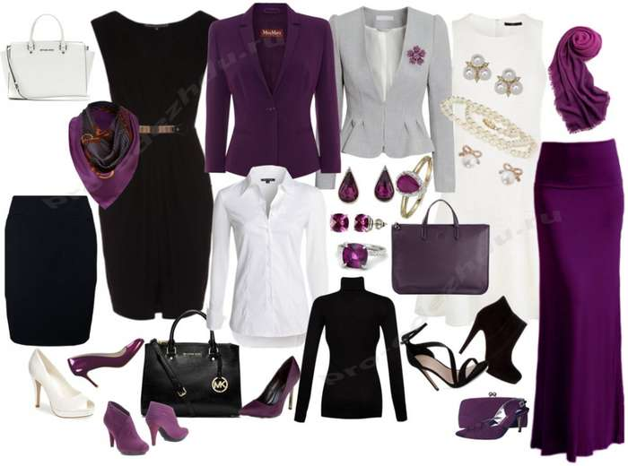

# Дэгжин, эрхэмсэг харагдуулах 7 алтан дүрэм

“Элегант” буюу “дэгжин” гэсэн үг нь, латин хэлний “сонголт” гэсэн үгнээс гаралтай бөгөөд дэгжин, эрхэмсэг хувцасладаг эмэгтэй хүн хувцасны сонголтдоо ихээхэн анхаарч байдгийг харуулдаг. Ийм эмэгтэйчүүд, хэзээ ч бодолгүйгээр, хам хум, ямар нэгэн, хөнгөмсөг харагдуулах, бусдын анхаарлыг татах хувцас өмсдөггүй. Дэгжин, эрхэмсэг хувцаслалт нь, өнөөдрийн загварын хандлагаас илүү эрхэм дээд хувцаслалт юм. Энэ хувцаслалт, загвар болоод сэтгэлд нийцдэг зүйлс болон ихээхэн дундыг баримталсан загвар, нарийн тансаг хийц, чанар дээр ихэнхидээ суурилдаг.

1. Энэхүү дэгжин гэсэн үгийн дор, зөвхөн хувцаслалт биш, хүний биеэ авч явах байдал, харилцаа, дотоод ертөнц хүртэл багтаж байдаг. Мөн, үс засалт, хумс засалтыг төгс сайхан байлгах хэрэгтэй.\
2. Хамгийн их бодож сонгосон, бүх зүйлийг хослуулсан хувцаслалт нь дэгжин хувцаслалт юм. Үүнд, цаг гарган бэлддэг. Шулуун загвартай, нэг өнгөтэй, захны гүн ухлаадастай, нарийн цөөхөн босоо зураастай хувцас, нимгэн ороолтны хослол хүнийг өндөр харагдуулдаг бол, нэг өнгийн өмд, гутал хөлийг урт харагдуулдаг. Хар өнгийн хувцас, эд зүйлстэй, сүүн өнгө сайхан зохицно гэх мэт. Мөн хувцаслалтад 2, 3-с илүү өнгө орох ёсгүй гэдгийг санах хэрэгтэй. Сонгодог загварын хослолын хүрэм, биеийн хамгийн өргөн хэсгээс алганы хэмжээний дээш богино байх, хэрэв, юбка өвдөгнөөс дээш урттай бол, харин хүрэм нь, гарын алганы хэмжээтэй урт байх ёстой гэсэн дүрэм байдаг. Түүнчилэн, гэрэлтдэг материалтай хувцасны дотор талд заавал биений өнгөтэй дотуур хувцас өмсөх хэрэгтэйг мартаж болохгүй.\
3. Хувцас сонгож өмсөх гол нөхцөл нь, биеийн онцлог, галбирын давуу талуудыг товойлгож өгөхөд оршино. Жишээ нь, торгомсог, гэгээлэг өнгөтэй цамц нь, төгс арчилсан, сайхан арьстай нүүр царайг шаарддаг бол, энгийн загвартай, нэг өнгийн хувцас нь, хувцас хэрэглэлийн суурь болоод зогсохгүй, ихэнхи тохиолдолд аятайхан харагдах давуу талыг өгдөг. Мөн бие галбир болон нүүр царайны төрхийг давтсан хувцас өмсөхийг хэрэггүй гэдэг. Дугуй царайтай бол, дугуй ээмэг зүүх, дугуй захны ухлаадастай хувцас өмсөх хэрэггүй.\
4. Хувцаслалтдаа, гоёл чимэглэлийн зүйлийг сонгохдоо анхааралтай байх хэрэгтэй. Ялангуяа, гүн ухлаадастай захтай, богино хувцас өмсөх үе хамгийн эрсдэлтэй. Учир нь, хувцасны дээд доод төгсгөлийн хэсэг хамгийн түрүүнд нүдэнд өртдөг тул, эдгээрийн зах төгсгөл хэсэг, биеийн өргөн, тарган хэсэгт байхаас болгоомжилдог. Мөн хувцасны хормой хир богино байна төдий чинээ намхан гутал өмсөх, хувцас хир урт байна, өндөр гутал өмсөх хэрэгтэй гэсэн дүрэм байдаг.\
5. Дэгжин төрхийг бүрдүүлэхэд, нүүр будалт мөн чухал зүйл юм. Хэрэв, нүдээ тод, зоримог будсан бол, уруулаа зөөлөн тод бус өнгөөр будах эсвэл өнгөгүй гялалзсан будаг түрхэх нь зохимжтой гэдэг. Харин уруулаа тод будсан бол нүдээ, завсрын өнгийг ашиглан будахыг зөвлөдөг байна.\
6. Дэгжин эмэгтэйчүүд сайхан үнэр ханхлуулах нь зүйн хэрэг. Дуртай сайхан үнэртэн хэрэглэдэг.\
7. Дэгжин эрхэмсэг төрхийг, аксессуарын амжилттай хослол улам товойлгон өгдөг. Бүрх малгай, ороолт, цүнх, бээлий, бүс зэргээс хоёрыг нь ижил өнгөөр хослуулах нь сонгодог загварт, өвөрмөц сайхан төрхийг нэмж өгдөг байна. Хослуулсан тод өнгийн, хоёр төрлийн аксессуарыг, /жишээ нь, малгай, гутал/ өрөө тасалгаанд нэгийг нь тайлах болсон тохиолдолд, бүс нэмж хэрэглэх хэрэгтэй /малгай, гутал, бүсний хослол/. Түүнчилэн малгай, гутал, бүс, бээлий адил байж болно.

---

Аксессуаруудыг сонгохдоо:\
-Олон өнгөтэй ороолтыг нэг өнгийн хувцсанд, нэг өнгийн ороолт, алчуурыг олон өнгөтэй материалтай хувцасанд зориулан авах\
-Тод бүс, бие галбирыг богино харагдуулна\
-Нүдний шилний цайвар өнгийн рам нүдний хоорондын зайг холтгоно, харин бараан рам нүдийг хооронд нь ойртуулж харагдуулдаг\
-Энгэрийн зүүлт, царайг тодотгох зориулалттай, харин хүзүү цээжинд анхаарал татахад зориулагддаггүй. Тиймээс, зүүгээд, нүүр царайнд хэрхэн нөлөөлж байгаад илүү анхаарах ёстой\
-Аксессуарууд нь, үргэлж, хувцаснаас тань илүү үнэтэй байх ёстойг анхаараарай.\
Хүний гадаад төрх нь, нэг төрлийн нэрийн хуудас бөгөөд дэгжин эрхэмсэг төрх нь, хүний гадаад байдал, дотоод ертөнцийн жинхэнэ зохилдлогоог харуулж өгдөг гэдгийг мартаж болохгүй аж.
