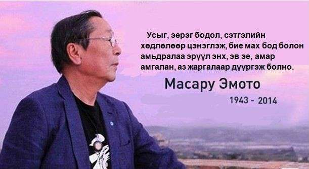
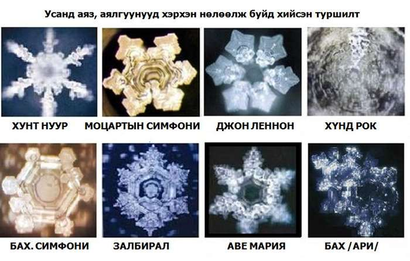

# Дэлхий дээрх хамгийн аюултай хор

Хамгийн аюултай хор гэхээр, хүмүүс могой, хилэнцэт хорхой, хорт аалзны хор гэх байх.

Гэтэл, “мэдээллийн хор” эдгээрээс ч илүү хортой болох талаар, Японы эрдэмтэн Масару Эмото, судалгааны дүгнэлтээрээ ном гаргасан нь дэлхий нийтийг шуугиулсан бүтээл болсон билээ. Үг болон үзэж харснаас үүсэх, бодлын хүчний тухай сүүлийн үед маш их бичигдэх болсон. Үг, бодлоор аягатай ус, савтай будаа хэрхэн өөрчлөгддөгийг бид мэднэ. Бидний бие организм 80% уснаас бүтдэг. Хэрэв дотроосоо ялзарч, муудъя гэвэл нижгээд сөрөг муу үгийг хэлээд байхад л гүйцэх гэнэ. Бодол бодит болдог гэдгийг мартаж болохгүй нь. Өнөөдөр, та, өчигдрийн бодсон алдаатай, алдаагүй бодлууд дотроо амьдарч, өнөөдрийнхөө бодол дотроо маргааш амьдарна. Бодол-бол өвчин, ядуурал, ганцаардал, айдас, азгүйтэл эсвэл аз жаргал, амжилт, эрүүл энх, баялаг, итгэл, хайр эдгээрийн аль альныг ургуулж чадах “үр” юм. Тиймээс, сөрөг мэдээлэл, муу муухай зүйлсийг харуулсан кино, бичлэг, мэдээ мэдээлэл зэргээс татгалзах хэрэгтэй юм байна. Иймэрхүү зүйлийг үзэж харж, сонсох нь хүнд, танин мэдэхүй, ухаарлын ямар ч ашиг байдаггүй. Цаг тухайн мэдээллийг авах хэрэгтэй гэж зарим нь маргаж болох юм. Гэтэл, хэрэв дэлхий сөнөнө гээд зарлачихсаныг мэдээгүй байж байвал, сүүлчийн хором хүртлээ айх айдасгүй, жаргалтай байж байгаад сөнөнө. Бас л давуу тал биш үү.

Иймд, 5 мэдрэхүйгээрээ ямагт сайныг хүртэж амьдарцгаая. Илүү аз жаргалтай байх боломж бидний гарт байна гэдэгт итгэл дүүрэн амьдраарай.
