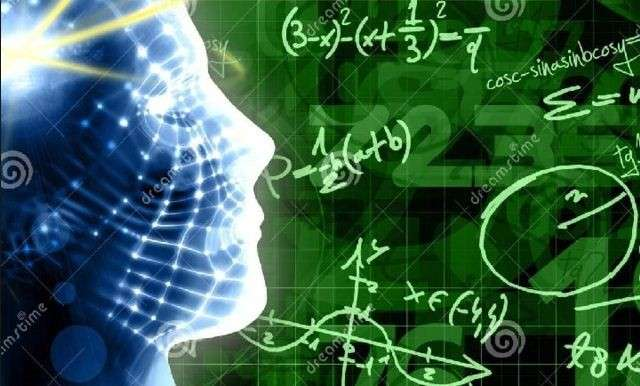

# Дэлхийн бүх сурагчидын тавьдаг асуултад хариулсан гайхамшигтай тайлбар

Нэг удаа математикийн хичээл дээр, багш нь, математикийн хичээлийн талаар чөлөөтэй асуулт тавих боломж олгожээ. Сурагчид, -“Бидэнд, энэ синус, косинус, интеграл, алгебр, геометр хэзээ хэрэг болох юм? Ямар ашигтай юм?” гэх маягийн асуултуудаар багшийгаа булж өгөв. Харин багш нь, математик хичнээн чухал талаар 5 шалтгааныг тайлбарлан амыг нь хаажээ.

#### 1. Математик, өөрийн алдаагаа хүлээн зөвшөөрөхөд сургадаг

Зөвхөн алдаагаа зөвшөөрөөд зогсохгүй, урагшлах, бодож чадаагүй бодлогоо бодох, шийдэх эрмэлзлэл тэмүүлэл өгч байдаг. Жишээ нь, самбар дээрх тэгшитгэл зөв бодогдсон гэж нэг нь бодож байхад, нөгөөх нь буруу гэж бодно, цагийн дараа, энэ хоёр байр сууриа сольчихсон аль альныхаа бодолтыг зөвшөөрөхгүй зөв шийдлийг хоёул хайж байдаг. Энэхүү гайхалтай нөхцөлийг математик л гаргаж ирдэг ба бараг өдөр бүр ийм асуудал тулгарч байдаг. Энд, “Дахин бүхнийг эхнээс нь эхэлж, өөр замыг эрж хайх, мөн гаргасан алдаандаа талархан, энэхүү алдаа, зөв замаар явах чиглэлийг өгдөг” гэдгийг нотолдог амьдралын хамгийн үнэн хууль үйлчилдэг.

#### 2. Математик, логик сэтгэлгээнд, мөн үнэн, зөв үгсийг сонгоход сургадаг

Тодорхой үнэн бол, бүх математикчидийн гол чанар. Бүх нэршил томъёо, тохиолдлууд маш тодорхой тодорхойлолтуудтай байдаг. Пифагорын теорем, гейметрийн дүрсүүдийн тодорхойлолтуудыг зүгээр нэг цээжлүүлдэггүй. Сурагчид, эдгээр нь хэзээ хэрэг болохыг нь мэдэхгүй эргэлзэж байдаг. Гэтэл, ач холбогдолд нь огт эргэлзэхгүйгээр дуржигнатал хэлдэг ийм үгс амьдрал дээр байдаггүй бөгөөд хүний оюун бодлыг тодорхой руу, мөнхөд дуудах дуудлага болж байдаг. Хайр, аз жаргал гэж юу вэ? гээд асуугаад үзээрэй. Хүн болгон өөр өөрийнхөөр янз бүрээр хариулдаг. Тэгэхээр, тодорхой үнэн тодорхойлолттой зүйлс хир олон байдаг бол?

#### 3. Математик, аливааг урьдчилан харах чадвар олгодог

Бодлого бодох нь шатар тоглохтой адил учираас, болгоомжгүй, буруу алхам нь засашгүй алдаанд хүргэж, туршлагажуулж байдаг. Маш жижиг алдаа буюу зөвхөн нэг тэмдэг алдаж тавьснаар мухардалд орж, хүссэндээ хүрэх тооцоо чинь талаар өнгөрч, дахин эхлэхээс өөр аргагүй байдалд ордог тул, маш нягт нямбай, анхааралтай, хариуцлагатай болгодог.

#### 4. Математик, өрөөлийнхөөр биш өөрөөрөө байхад тусалдаг

Урд нь зөвд тооцогдож байсан олон теорем, дүрэм, аксиомууд, өнөөдөр үгүйсгэгдэж байна. Энэ нь, хэрэв та өөрөө л учир начрыг нь олоогүй бол, ямарч алдар нэртний үзэл бодолд сохроор итгэж болохгүйг харуулдаг. Эрдэмтэд үүнийг “эрүүл оюуны ажиглалт” гэж нэрлэж байгаа бөгөөд яг үүнд математик сургаж байдаг юм.

#### 5. Математик хэзээ ч бууж өгөхгүй байхад сургадаг

Хэрэв чи энэ бодлогыг бодож чадахгүй бол, өөр хэн нэгэн заавал үүнийг бодно. Яагаад түрүүлж бодож болохгүй гэж? Энэ бодол үргэлж толгойд эргэлдэж байдаг. Тиймээс, математик цуцашгүй зүтгэл, эрмэлзэлд сургаж байдаг.
