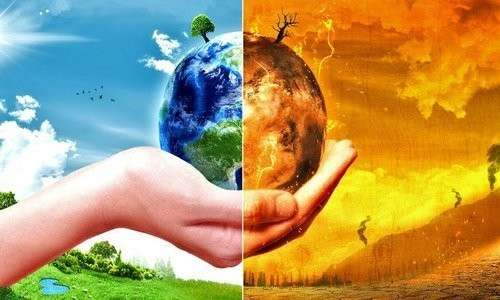
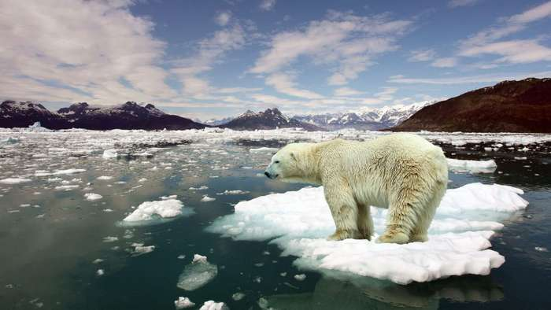
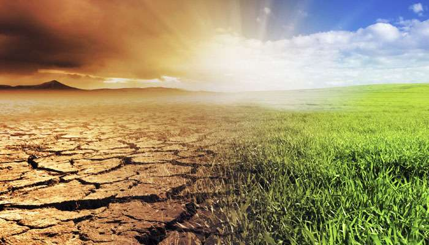

# Дэлхийн дулаарлын тухай баримт, төөрөгдөл, цуурхал

Сүүлийн 20-д жилийн турш шинжлэх ухааны хүрээнд, дэлхийн атмосферт хүний үйл ажиллагааны үр уршгаар хүлэмжийн хийн агууламж ихэссэнээс дэлхийн дулаарал явагдаж байна гэсэн хандлага хурцаар тавигдаж байна.

Шинжлэх ухааны дэлхийн дулаарал гэж нэрлэх энэхүү дулаарал нь ихэвчлэн далай тэнгисээс гардаг гэж үздэг байсан бөгөөд 1900 оноос хойш дэлхийн дундач температур 0.74%-р нэмэгдэж, үүний 60% нь 1980-2010 оны хооронд явагдсан ажээ. Үүнд хүний үйл ажиллагаа буруутай гэсэн асуудал хурцаар тавигдаж байна.. \
Энэхүү дулаарлын болзошгүй шалтгаан:\
Олон улсын судалгааны групп 2007 онд хүний үйл ажиллагаанаас болж байна гэж үзсэн. \
Мөн 2013 онд хөгжингүй орнуудын эрдэмтэд судлаачид хүний үйл ажиллагааны үр уршигаас болсон гэж үзэх бүрэн боломжтой гэж танилцуулав. \
Дэлхийн дулаарлын болзошгүй үр дагаврууд, дэлхийн газар орон бүрт янз бүрээр нөлөөлнө гэж үздэг. Хамгийн гол аюултай үр дагаврыг хур тундасны хэмжээний өөрчлөлт, далайн түвшин нэмэгдэх, үүнтэй зэрэгцэн цөлжилт явагдах асуудалтай холбон үзэж байна. Мөн далай тэнгисийн усанд исэлдэлт явагдах, байгалийн гамшигт үзэгдлүүд олшрох, температурын горимын өөрчлөлтөөс болж зарим биологийн төрлүүд мөхөх зэрэг асуудлууд гарч болохыг түүнчлэн эдгээр асуудлуудад африк, азийн зарим бүс нутгууд нэрвэгднэ, зарим газрууд хүн амьдарч болохооргүй нөхцөлд хүрнэ гэсэн таагүй зүйлс шинжлэх ухааны түвшинд яригдаж байна. Эдгээрээс манай улсын хувьд, ган гачиг, ойн түймэр, зун хэт халснаас агааржуулагчид зарцуулах цахилгааны зардал ихсэх, экологийн тэнцвэрт байдал алдагдах зэрэг эрсдэлүүд гарах магадлалтай байгаа ажээ.

---

Дэлхийн дулааралтай тэмцэх Киотын протокол 1992 онд гарсан бөгөөд 2005 оноос хэрэгжиж эхэлсэн, 160-д орон энэхүү програмд оролцдог аж.\
Мөн зарим эрдэмтэн судлаачид, дэлхийн дулаарлыг сандрах зүйлгүй болдог зүйл л болж байна гэж авч үздэг бөгөөд аливааг хяналтдаа авах зорилготой улс төрийн үйлдэл, мөнгө татах арга гэж үзэх нь ч бий. Үүнийг Peter Wadhars-ны “мөс үүрд баяртай” ном болгон гаргасан нийтлэлийг 2012 оноос хойш Арктикийн мөс тэлж буй баримтаар үгүйсгэсэн байдаг.
