# Дэлхийн хамгийн үнэтэй хүнсний бүтээгдэхүүнүүд

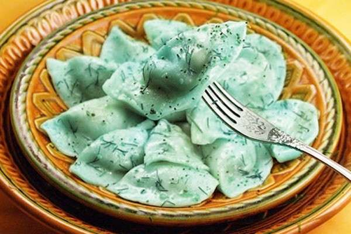

Амьдралдаа хүртэж амталсан зүйлсээс хамгийн ховор, хамгийн чамин, эсвэл хамгийн үнэтэй зүйлс оюун санаанд буун үлддэг. Тэр зүйлийн өнгө, үзэмж амт таалагдаагүй ч байсан үлддэг нь сонин. Хүний тансаглал, үнэтэй сууц, үнэтэй машин, үнэт эрдэнэс, ганган бренд хувцсаар дуусахгүй мөн хэдэн мянган долларын үнэтэй хоол идэхэд зориулагддаг. Ингээд дэлхийн хамгийн үнэтэй хоол, хүнсийг мэдээд авахад илүүдэхгүй биз ээ.

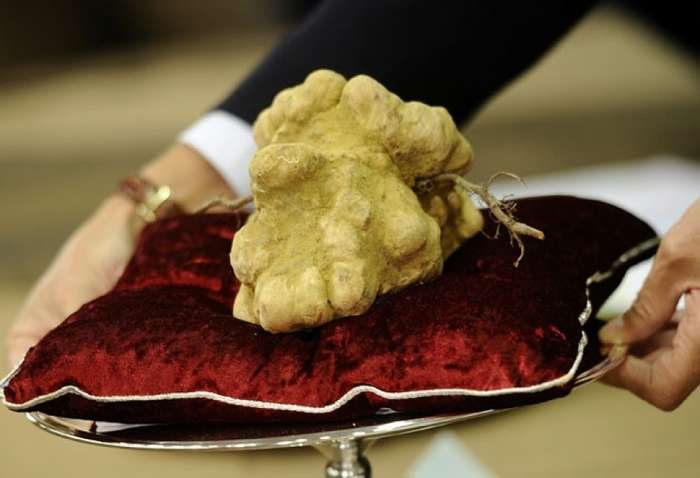

#### Хамгийн үнэтэй мөөг

Түүнийг трюфель гэдэг. Энэ мөөгний 1 килограмм нь 2000 еврогийн үнэтэй. Бүр түүнээс ч дээш болох үе байдаг гэнэ. Италийн цагаан трюфелийг хамгийн амттай гэдэг.

---

#### Хамгийн үнэтэй банш

Бронск дахь, “Golden Gates” оросын цагаачдад зориулсан ресторанд, тугал, хандгай, гахайн махны хольсон таташ дээр, гүний усны загас-бамбарны булчирхайг нэмснээр гэрэл багатай орчинд ногоовтор цэнхэр туяа цацруулж байдаг гайхалтай сайхан амттай 8 ширхэг банш 2400 доллар байдаг гэнэ.

---

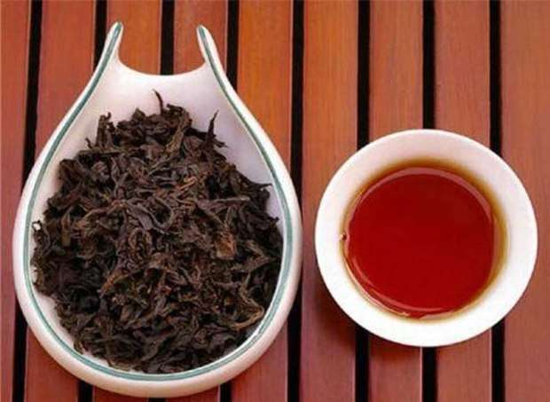

#### Хамгийн үнэтэй цай

Тяньсинь сүмийн ойролцоо ургадаг 350 жилийн настай 6 ширхэг бутны навчаас 500граммыг гаргаж авдаг Дахунпао буюу “том улаавтар хэвнэг” гэдэг энэ цай, 1 килограмм нь 685 000 долларын үнэтэй

---

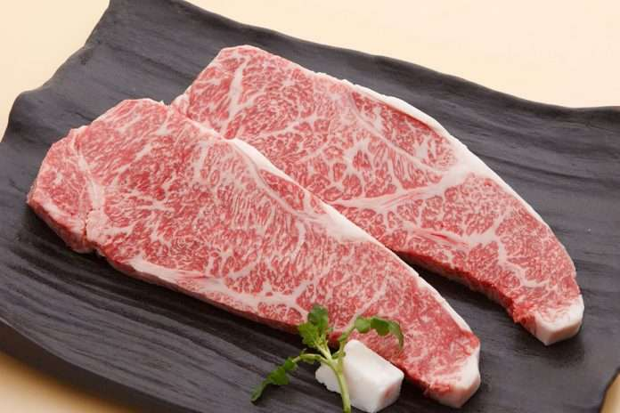

#### Хамгийн үнэтэй мах

Японы Вагиу хэмээх, маш хүндэлтэйгээр хандаж, хамгийн сайн өвсөөр хооллож, сакегээр арьсыг нь арчиж зүлгэн, пивоор усалдаг үхрийн махыг “гантиг-мах” гэж нэрлэх ба 1 килограмм нь 750-1000 долларын үнэтэй байдаг

---

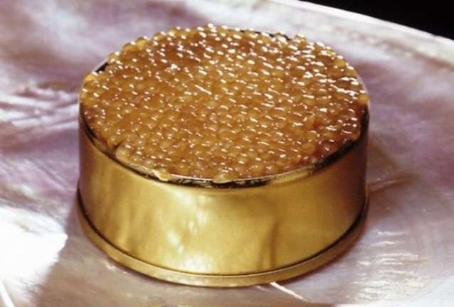

#### Хамгийн үнэтэй түрс

Иранаас ховорхон экспортлогддог, белуга-алвбиносын “Алмас” түрс, цэвэр алтан лаазанд савлагдсан байдаг бай 100 грамм нь 2000 доллар орчим байдаг

---

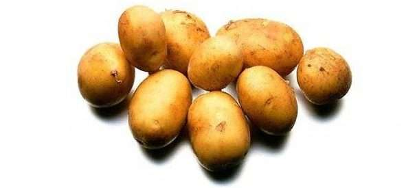

#### Хамгийн үнэтэй төмс

Атлантын далайн Нурмуатье арал дээр ургуулдаг энэхүү төмсийг зөвхөн далайн ёроолын ургамлаар борддог бөгөөд жилд 100 тонныг хурааж, хурааж авсан өдрөө зарагддаг. Аятайхан амт, бага хэмжээний ургац нь энэ сортыг 1 килограммыг нь 500 еврогоор худалдаалагдах боломж өгдөг.

---

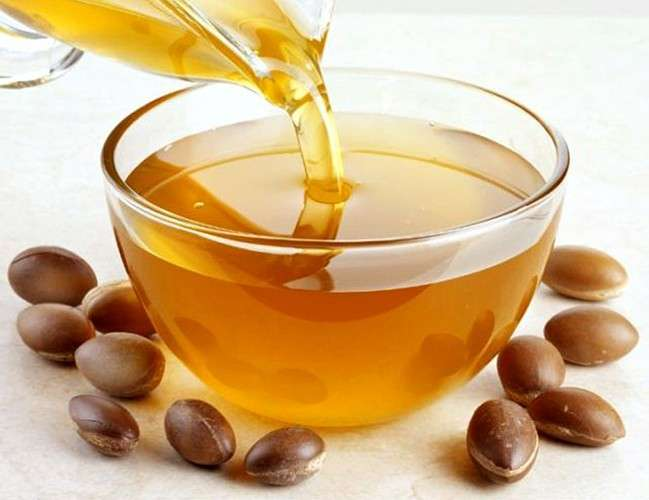

#### Хамгийн үнэтэй тос

Энэ бол арганы тос юм. Мароккод ургадаг бөгөөд, нутгийн ямааны хамгийн дуртай ургамал гэнэ. Хэрэв ямаа модон дээр гарчихсан байвал тэр мод аргания байдаг аж. оливтой их төстэй. 1 литр тос хийхэд 30 кг арган зориулагддаг бөгөөд 100 грамм энэ тос 250 евро байдаг.

---

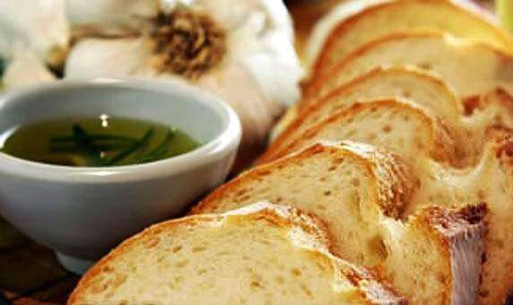

#### Хамгийн үнэтэй талх

Roquefort and Almond Sourdough Bread талх. Шеф-тогооч Paul Hollywood –ын А зэрэглэлийн гурил, “рокфор” бяслаг, дээд чанарын миндаль оруулан жигнэсэн гарын талх 25 долларын үнэтэй.

---

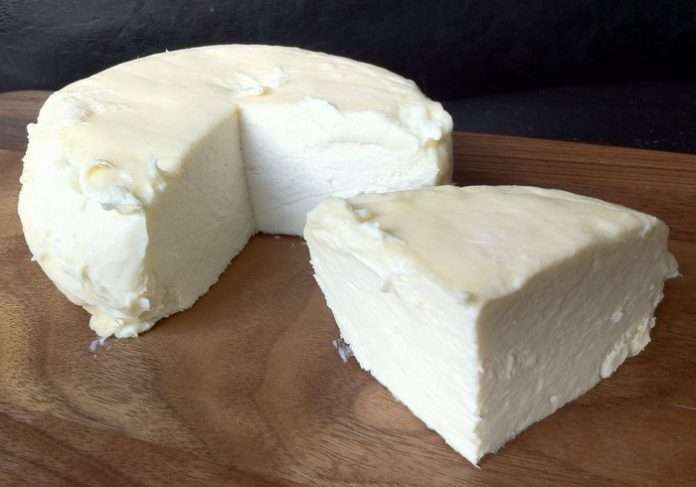

#### Хамгийн үнэтэй бяслаг

Pule сортын, илжигний сүүгээр хийсэн бяслаг 1 кг нь 1280 доллар.

---

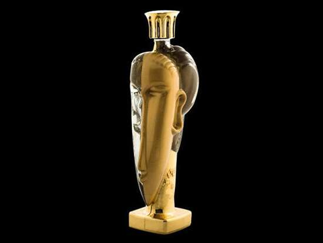

#### Хамгийн үнэтэй цэвэр ус

Acqua di Cristallo Tributo a Modigliani-цэвэр ус. Алдарт зураач Амедео Модильяни-н нэрээр нэрлэгдсэн энэ усны сав нь алтаар бүрэгдсэн монголжуу төрхийг харуулсан савтай байдаг. уг ус нь францын Фиджи арлын булгийн ус, Исландын мөсний хайлсан усыг хоёрыг хольсон байдаг. 1.25 грамм энэ савтай ус 60 000 долларын үнэтэй.

---

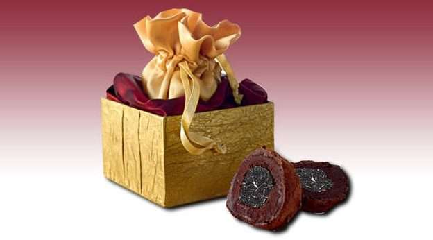

#### Хамгийн үнэтэй шоколад

АНУ-н Knipschildt Chocolatier фирмийн шоколад. 453 грамм буюу нэг фунт нь 2600 доллар.
