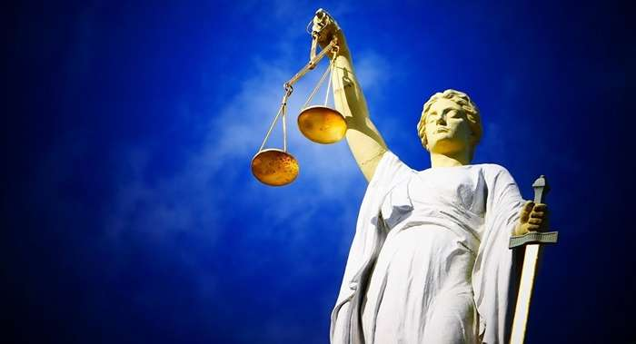

# Дэлхийн хамгийн шударга улсууд

Дэлхийн хамгийн шударга улсуудын эхний дөрвөн байрыг скандинавын орнууд эзэлж, эхний аравт Сингапур, Австрали, Шинэ Зеланд багтдаг байна. Скандинавын орнуудад хууль ёс бүрэн хэрэгжиж мөрдөгдөж байдаг болохыг, World Justice Project олон улсын байгууллага жил бүрийн судалгаагаар нотолж үр дүнг нь зарлаж байдаг. Нэгд Дани, хоёрт Норвеги ордог бөгөөд, Норвеги “журам дүрмийг үр дүнтэй мөрддөг” гэдгээрээ ялгарч байдаг. Гэтэл, энэ ангилалд Сингапур сүүлийн үед аваргалах болжээ. Учир нь маш хатуу журамтай, жишээ нь, бохь зажилахыг хүртэл хорьж, мөрдөлтийг нь хатуу хянаж байдаг гэнэ. Харин хойд европын орнууд, “авилгалгүй байдал”, “хууль журам батлахад иргэдийн оролцох оролцоо”, “нээлттэй засаглал” зэрэг ангилалуудаар шалгардаг. Мөн, хамгийн итгэмтгий европчууд хэмээн нэрлэгддэг. Microsoft компанийн хууль зүйн хэлтсийн дарга Билл Неуком шударга шүүхийн системийг үнэлэх төслийн хүрээнд тавьсан илтгэлдээ, хууль дээдлэх индекс бол үргэлжийн хүчитгэж байх ёстой зүйл бөгөөд хууль үр дүнтэй хэрэгжүүлэх асуудал нь, авилгалын түвшинг бууруулах, ядууралтай тэмцэх, ард иргэдийн эрүүл мэндийг хамгаалах, боловсролын түвшинг сайжруулах, мөн хүмүүсийг шударга бус байдал болон аюултай байдлаас хамгаалах зэрэг хүний эрхийн гол асуудлуудыг хөндсөн эрх зүйн орчинг бүрдүүлэхэд хамгийн чухал зүйл юм гэж онцлон тэмдэглэжээ. Хуулийг дээдлэн мөрддөг орнууд:

1. Дани

2. Норвеги

3. Швед

4. Финлянд

5. Нидерланд

6. Шинэ Зеланд

7. Австри

8. Германи

9. Сингапур

10. Австрали

