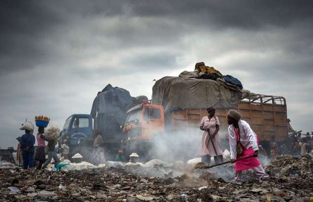

# Дэлхийн хамгийн ядуу орнууд

2018 оны байдлаар, дэлхийн хүн ам 7.6 тэрбум даваад байгаа билээ. Зөвхөн өнгөрсөн зуунд 4.35 тэрбумаар нэмэгдсэн байдаг. Оксфордын их сургуулийн мэргэжилтнүүдийн хийсэн саяхны судалгаагаар, дэлхийн хүн амын 76% буюу 5.4 миллиард хүмүүс амьдардаг 103 орны, 26.5% буюу 1.45 тэрбум хүн ядууралд нэрвэгдэн амьдарч байна гэсэн үр дүн гарчээ. Хамгийн ядууд тооцогдож буй орнуудын ихэнхи нь африк тивд байдаг. Үүний учир шалтгаан нь, тэдгээр улсуудын авторитар тогтолцоо, улс төрийн тогтворгүй байдал, төр удирдлагынхны хэт авилгал, хээль хахуульд автсан байдал, гэмт хэрэг гаралтыг хянаж чадахгүй байдал, байнгын хоорондын зэвсэгт тэмцэл мөргөлдөөн, байгаль экологийн хүндрэлтэй нөхцөлүүдтэй холбоотой байдаг байна. Дэлхийн банк, нэг хүнд ноогдох ДНБ 1 025 доллараас доош байгаа үзүүлэлт бүхий орнуудыг “хэт ядуу орон” гэсэн ангилалд багтаажээ. Харин хамгийн баян улс орнуудад энэ үзүүлэлт 12 475 доллар байгаа аж. Өнөөдөр 800 сая хүн өдөрт 1.25 доллараас бага мөнгөөр амьдарч байна. Үндсэндээ, дэлхийн хүн амын бараг тал хувь энэ заагаас багахан дээр буюу 2.25 доллараар хоног төөрүүлэн амьдардаг. Харин, манай монголын ард иргэд өдөрт, нэг хүн нь 1.25 доллар буюу 3 350 төгрөгөөс ч доогуур хэрэглээтэй амьдардаг гэж хэлж болно. Байрны мөнгө, түлшний мөнгө, унааны мөнгө, хувцас хэрэглээ өөр бусад зарлагыг тооцвол үүнээс ч дор гарах юм. Харин, дээр дурдагдсан ядуурлын гол шалтгаануудын ихэнхи нь манай улсад байгаа ч, эдгээр хамгийн ядуу орнуудын тоонд ороогүй нь гайхалтай. Газрын доорхи баялаг, ашигт малтмалын нөөцтэй хэдий ч, авилгал, гэмт хэрэг, эрх мэдлийн төлөөх тэмцлээ үндсээр нь устгаж чадахгүй байгаагаас хамгийн ядууд тооцогдож буй 10 улс:

1. Төв африкийн бүгд найрамдах улс

2. Ардчилсан Конго улс

3. Бурунди

4. Либер

5. Нигер

6. Малави

7. Мозамбик

8. Гвиней

9. Эритрей

10. Мадагаскар
