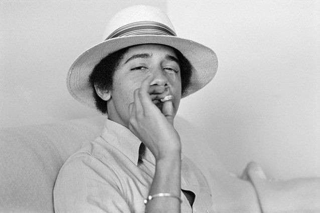
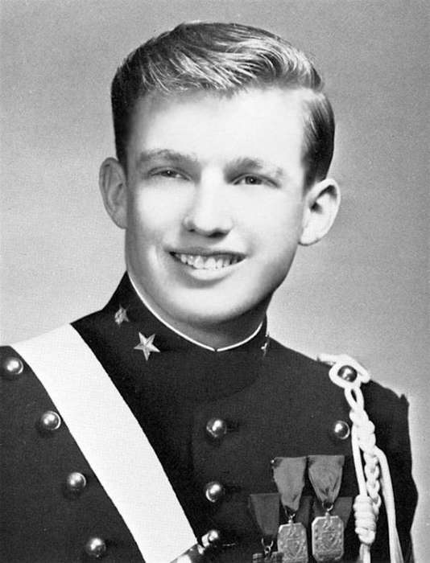
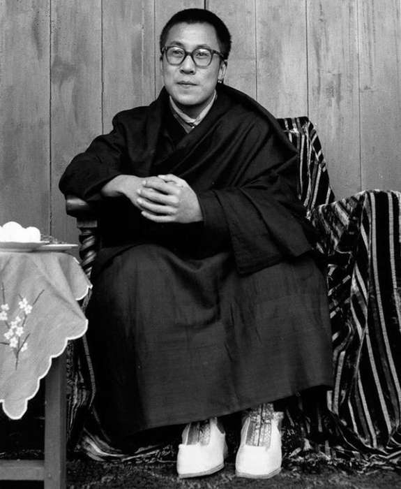
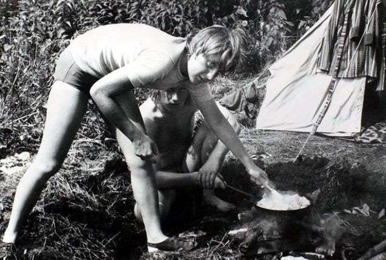
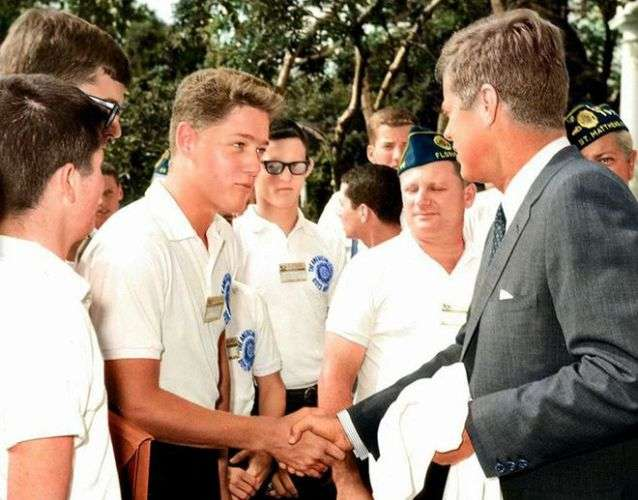
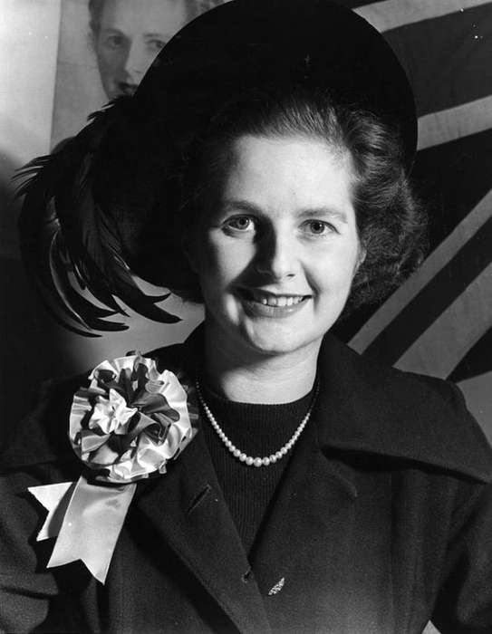
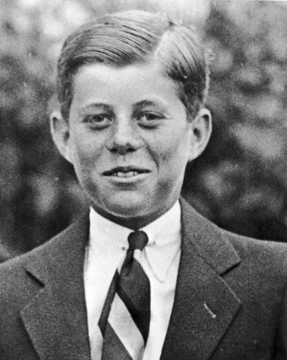
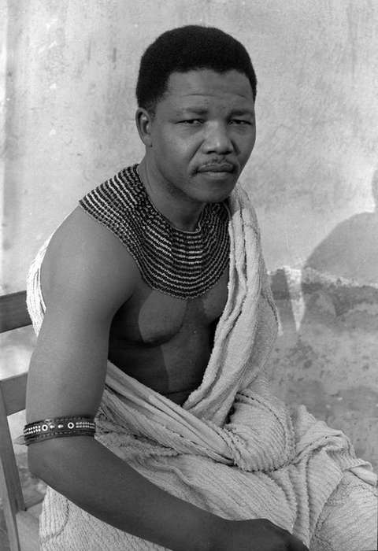
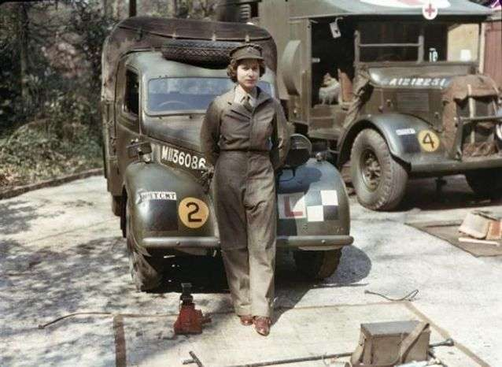

# Дэлхийн лидерүүдийн залуу төрх

Дэлхийн хэмжээний, хүчирхэг, өөртөө итгэлтэй, эрх мэдэлтэй, эдгээр лидерүүрүүдийн фото зургаар хадгалагдан үлдсэн хөгжилтэй, гэнэн залуугийн дүр төрх нь, итгэмээргүй, сонин, сонирхол татах юм.

Цэргийн академийн сонсогч Дональд Трамп. Нью-Йорк.

---

Залуудаа, Далай лам маань

---

Залуу Барак Обама.

---

Оюутан Ангела Меркель. 1973 он

---

Залуу Билл Клинтон, ерөнхийлөгч Джон Кеннедитэй гар барьж буй нь. 1963 он.

---

Ирээдүйн “Төмөр хатагтай” английн ерөнхий сайд Маргарет Тетчер

---

10 настай Джон Кеннеди.1927 он

---

Мандела Нельсон залуудаа. 1961 он

---

Английн ирээдүйн хатан хаан 18 настай Елизавета. 1945 он
