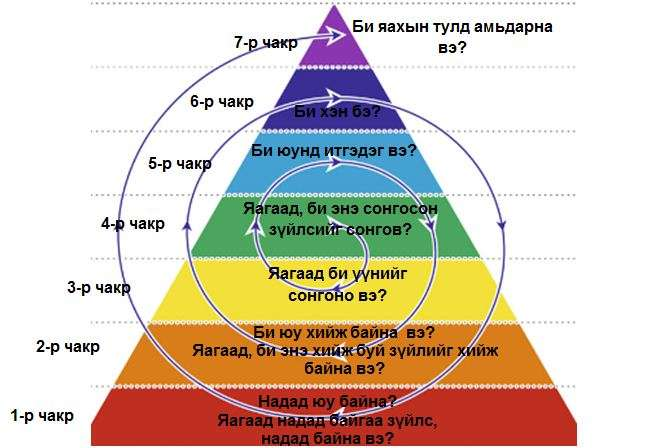

# Дилтсийн пирамид: Танд, одооны тань байр байдал, хүрээлэл, эд зүйлс хэрхэн бий болсоныг тайлбарладаг

Танд заримдаа, “Би яагаад ингэж амьдардаг юм бол?” эсвэл “Яагаад, надад эдгээр байгаа зүйлс л байдаг юм бол?” гэсэн бодол орж ирдэг үү? Хэрэв та, “Тийм” гэж хариулж байгаа бол, Дилтсийн пирамид, учирыг нь олоход тусална. Нейро-лингвист програмчилалын туршилт судалгааны ажилуудаараа нэрд гарсан мэргэжилтэн Роберт Дилтс, амьдралыг зураглах хялбархан загвар гаргажээ. Тэрээр, пирамидыг хөндлөн хувааж, 7 түвшин гаргасан бөгөөд түвшин тус бүрд тавигдах асуултууд шат ахисан байдлаар тавигддаг. Түүнчилэн эдгээр нь 7 чакртай уялдсан байдаг нь сонирхолтой. Жинхэнэ чин хүсэл маань, 4-р чакр буюу зүрхний чакраас гарч байдгийг энэ схем харуулна.

Пирамидын хамгийн доод түвшинд, “Надад юу байна?” гэсэн асуултын хариулт нь, таны санхүү, ажил, бизнес, орон байр, гэр бүл танил тал, хүрээллийг харуулна. Харин, “Яагаад надад байгаа зүйлс, надад байна вэ? гэсэн асуулт, үйл хөдлөлийг тань харуулах, хоёрдох түвшний “Би юу хийж байна вэ?” гэсэн асуулттай холбогддог. Танд байгаа зүйлс таны юу хийж буйгаас шууд шалтгаалдаг гэсэн үг. “Яагаад, би энэ хийж буй зүйлийг хийж байна вэ?” гэсэн асуулт, гуравдугаар түвшний “Яагаад би үүнийг сонгоно вэ?” гэсэн асуултын стратеги хариултад хүргэнэ. Энэ асуултаас, “Яагаад, би энэ сонгосон зүйлсийг сонгов?” гэсэн дөрөвдүгээр түвшний асуулт, дараагийн түвшний итгэл үнэмшлийг харуулах, “Би юунд итгэдэг вэ?” гэсэн асуултад хариулснаар “Би хэн бэ?” гэсэн өөрийн дотоод ертөнцөд чиглэсэн асуулт, түүнчилэн, “Би яахын тулд амьдарна вэ?” гэсэн хамгийн оргил асуултад хариулснаар, амьдралынхаа талаар, илүү ойлголттой, дүн шинжилгээ, дүгнэлт хийх боломжтой болдог байна. Энэ нь, тухайн түвшнүүдэд хариулах үеийн байдал хүндрэлүүдийг илрүүлдэг бөгөөд үйл хөдлөл, үйл ажиллагаа, амьдрал байдлаа өөрчлөхөд тустай байдаг. Одоо та, амьдралын аль түвшинд дороо эргэлдээд байгаа, эсвэл амжилт дүүрэн байгаагаа мэдэж авлаа. Засах өөрчилөх, өгсөх өргөн боломж таны гарт байгаа.
