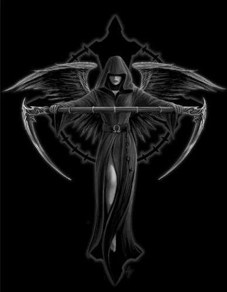

# Диваажинд хүрэх зам буюу эрлэгийн элчийн хадуур

Ард нь гэнэт хүн дуугарахад цочсон дархан, ууртайгаар, -“тогшиж орж ирж болсонгүй юу”, гээд, эргэснээ, өмнө нь зогсох хар өмсгөлт эрлэгийн элчийг хараад, цочсондоо, -“гүйцээ, миний төгсгөл үү?” гэж асуугаад, багаж хэрэгслээ цааш нь тавив.\
Эрлэгийн элч түүнд, -“би чамайг авахаар ирээгүй, харин миний хадуурыг ирлээд өг” гэхэд, дархан, айсандаа хөшчихсөн гараараа эв дүйгүйхэн хадуурыг авч ирлэж эхлэв. Ирлэх зуураа, өөрийн эрхгүй, -“би, өчнөөн амийг авсан энэ хадуурыг ирлэж байгаадаа итгэж чадахгүй нь, энэ дэлхий дээр энэнтэй зүйрлэх зэвсэг бий гэж үү” гээд хэлчихэв. Эрлэгийн элч зугуухан дөхөж ирээд -“та юу гэв ээ? Зэвсэг гэв үү?”, -“намайг хичнээн хүн алсан гэж бодож байна?” гэж хахирган дуугаар хашгирсанаа, хэсэг дуугүй болж, сулхан дуугаар –“хэрэв би нэг ч хүн алаагүй гэвэл чи итгэхгүй”, -“би хэзээ ч хүн алж байгаагүй, харин та нар, бие биенээ алдаг. Та нар, мөнгө хэмээх цаасны төлөө, бие биеэ үзэн ядаж хорссондоо, эрх мэдлийн төлөө бие биенээ алдаг. Бас, ашгийн төлөө хийгддэг хоол хүнс хэмээх зүйлсээсээ, мөн өөрсдийн зохиосон гаж буруу зуршлуудаасаа болж, буруу амьдарч, өвчин тусч үхэцгээдэг. Түүнээс биш би алдаггүй. Та нар намайг бүгд буруутгадаг” гэж хэлээд хэсэг дуугүй болсоноо хар юүдэнгээ буулгаад, -“намайг хар! Би, урд нь та нарын сүнсийг цэцэг барин, тосч аваад, нөгөө ертөнцийн диваажин, там, аль очих ёстой газруудад нь хүргэж өгдөг үзэсгэлэнтэй сайхан бүсгүй байсан. Тэгтэл би одоо ямар байна?”\
Шингэн буурал үс нь ийш тийш унжсан, үрчлээтэж сааралтсан зэвгэр царайгаа заан, -“та нар намайг ийм болгосон. Би эх нь хүүхдээ алахыг, ах нь дүүгээ алахыг, нэг хүн, нэг өдөрт, хичнээн зуугаар нь бусад хүмүүсээ алахыг хардаг. Би, энэ, болохгүй зүйл болж байгааг, ойлгож чадахгүй орилдог, уйлдаг. Хэн ч итгэхгүй. Ингээд би, гоё даашинзаа цус болгохгүйн тулд, хар юүдэнтэй өмсгөлтэй болсон. Юүдэнгээрээ би нулимстай нүүрээ нуудаг. Та нар, надад өөрсдийн нүглийг чихэж, намайг аймшиг болгосон ” гээд, хадуураа авч гарахдаа, -“диваажингийн зам, зэрлэг өвсөөр дүүрчихлээ, хадах хэрэгтэй” гэж хэлээд яаран явжээ.
