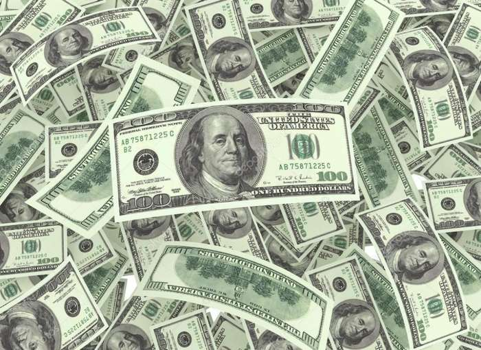
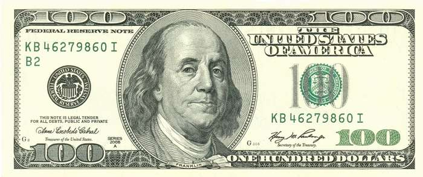
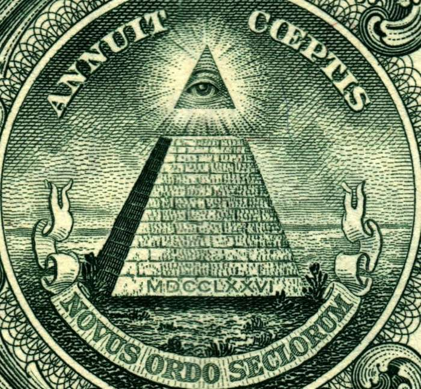

# Долларын нууцлаг билэгдэлүүд

Долларын өөр нэг нэрийг бакс гэх бөгөөд энэ үг бугын арьс гэдэг үгнээс гаралтай гэж үздэг. Хойд америкийн уугуул иргэд болох индианчууд бугын арьсаар наймаа солилцоо хийдэг байснаас үүсэлтэй гэнэ.

---

1990 оноос хойш хэвлэгдсэн долларын, дунд орших ерөнхийлөгчидийн хөргийг тойроод “The United States of America” гэсэн бичээс, зөвхөн томруулдаг шилээр харагдах хэмжээтэй бичигдсэн байдаг. Бас нэг хамгаалалт нь, 10-15 микрон полиэфир утсаар бичигдсэн мөнгөн дэвсгэртийн тоо байдаг аж. Мөн, гүйлгээнд эргэлдэж байгаа америк долларын 97%-д кокаины үлдэц нэвчсэн байдаг нь, хар тамхины наймаа доллараар хийгддэгтэй холбоотой гэнэ. Ихэвчилэн 5, 10, 20. 50-тын долларын дэвсгэртүүд үүнд өртсөн байдаг. Гэхдээ, кокайн долларт гүн нэвчсэн байдгаас хүний гарт нөлөө үзүүлдэггүй аж. Америк долларын ашиглагдах хугацаа, 1 доллар 22 сар, 5 доллар 16 сар, 10 доллар 18 сар, 20 доллар 24 сар, 50 доллар 55 сар, 100 доллар 89 сар байдаг. 1861 онд америкийн конгресс 60 000 000$ хэвлүүлэх захиалга өгөхөд, тухайн мөнгө хэвлэх үйлдвэрт ногоон будаг нь илүүдэлтэй байснаас ногоон өнгөтэй хэвлэгджээ. Доллар маш бөх мөнгөн дэвсгэрт юм. Түүнийг 4000 удаа нугалж, тэнийлгэж болдог. 1 долларын дэвсгэрт дээр, америкийн их тамганы хэсэг болох оройгүй пирамид дүрслэгдсэн байдаг бөгөөд дээд талд нь латинаар, “Annuit Coeptis” буюу “Тэр биднийг адисласан”, доор нь, “Novus Ordo Selcorum”-“Шинэ эриний дэглэм” гэсэн бичээс байдаг. Пирамидын дуусгаагүй оройд, масончуудын билэгдэл болох “Бүхнийг харагч мэлмий” байдаг нь, анхны ерөнхийлөгч Джордж Вашингтон, Тусгаар тогтнолын Тунхаглалыг зохиогчидын нэг Бенджамин Франклин нар масончууд байсантай холбон үздэг. Харин үүнийг, албан ёсоор, пирамид нь хөгжилийн суурь, мөн пирамид хүчний билэгдэл, оройгүй байгаа нь цаашдын хөгжил дэвшлийн төлөө хийгдэх ажил зайлшгүйг харуулдаг гэж тайлбарладаг. 2 долларын дэвсгэрт хамгийн сүүлд 2003 онд хэвлэгдсэн. Долларыг америкийн цаасан мөнгөн тэмдэгт гэж нэрлэдэг ч үнэндээ энэ дэвсгэрт цаасаар бүтээгддэггүй. 75%-ийн хөвөн, 25%-ийн маш нарийн торгон утсаар хэлхэгдсэн маалингаар хийгдсэн материал аж. Тийм дээ ч, джинсний халаасанд мартагдсан доллар нэг бус удаагийн угаалга даадаг нь харагдаж байдаг. Түүнчилэн, долларын дэвсгэрт дээр хэзээ ч, хар арьст америк улс төрч, нийгмийн зүтгэлтэнүүдийн хөрөг тавигдаж байгаагүй бөгөөд харин 1940-д онд шинжлэх ухаан, соёл, спортын алдартан хэдхэн хүний хөрөг зоосон мөнгөнд хэвлэгдэж байжээ.
