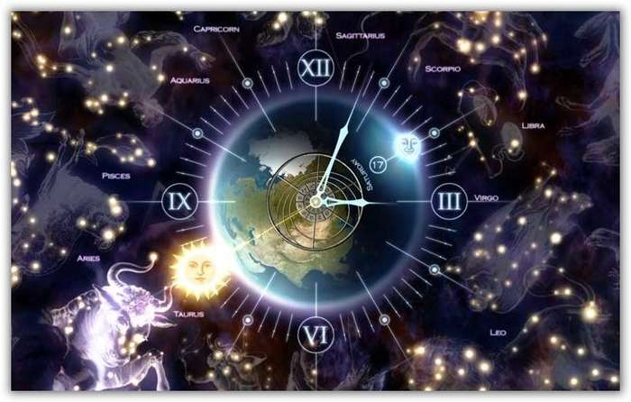

# Долоо хоногийн гаригаар шинжих нь

Долоо хоногийн ямар гаригт төрсөнөөс хүний тавилан, зан чанар хамааралтай байдаг бөгөөд тухайн төрсөн гариг нь хүний тухай олон зүйлийг хэлж чаддаг. Өдөр бүр нь, өнгө, чулуу, өвс ургамал, бурханлаг зүйлстэй холбоотой ба мөн эдгээрийг өөрт хэрэглэхэд суралцах хэрэгтэй байдаг байна. Долоо хоногийн долоон өдөр нь, зурхайн үндсэн долоон гаригтай холбоотой бөгөөд тухайн гаригийн хүч, бурханлаг чанараар тэтгэгдэж байдаг. Эрдэмтэн, судлаачид, долоо хоногийн гаригуудын нэршил, түүний тухай ойлголт маний эриний нэгдүгээр зуунаас эхтэй, түүнчлэн эдгээр гаригуудын нэр нь, эртний скандинав, грек, римийн бурхадын нэр гэж үздэг. Таны төрсөн гариг, таны талаар юу ярьна вэ?

#### Даваа гариг. Сарны өдөр.

Энэ гаригт төрсөн хүмүүс, сарны хүчээр тэтгэгдэж байдаг бөгөөд гайхалтай оюуны чадавхи, бусдыг ойлгох чадварыг өгдөг. Энэ өдөр төрсөн хүүхдүүд их эмзэг, түргэн зантай, бусдын үйлдэл, үйл хөдлөл, харилцаанаас хамааралтай, амархан урам нь хугарах хандлагатай байдаг. Хамгийн хүчтэй чанар нь, бусдын сэтгэлийг хуваалцах. Сар тэднийг дотроос зөөллөж байдгаас их зөөлөн хүмүүс. Сар, шөнөжин ажиглачихдагаас, нойронд муу байх хандлагатай. Хоол боловсруулах эрхтэн нь амархан хямардаг. Юутай ч, маш хүчирхэг, сэтгэлийн хөдөлгөөнтэй хүмүүс. Сар, өөрөө ид шид, нууцын ертөнц, тиймээс энэ өдрийг эмэгтэйчүүдийн нууцлаг байдал, оргүй хоосон чанар, мэргэн зүүд, зөн, аялал, үржил шимийн билэгдэл гэж үздэг. Энэ өдөр төрсөн хүмүүс:\
-шаламгай, үзэл бодлоо нууцалж чаддаг\
-маш мэдрэмтгий\
-үнэт зүйлс нь, гэр бүл, найз нөхөд\
-бусадтай яриа хэлцэл хийхдээ сайн, хүн юу хүснэ түүнийгээ авдаг гэж үздэг\
-бизнес удирдлагаар амжилтад хүрнэ

#### Мягмар гариг. Марс гаригийн өдөр.

Хүчирхэг Буд, энэ өдөр төрсөн хүмүүст гал халуун сэтгэл, хүч эрмэлзэл, урам зоригийг өгсөн. Энэ хүмүүс далайцтай хөдөлдөг, хүссэнээ авах, хүссэндээ хүрэх дуртай байдаг. Тэд, гаднаасаа анзаарагдахгүй ч гарамгай дайчид. Мөн, тэдний уриа, дайны Бурхан Марсын адил, эрх мэдлээ зарлан тунхаглах, түүнчлэн зоригтой байх. Хүүхэд байхдаа өөртөө найддаг, харин өсч том болоод бусдын санааг сонсох ёстой гэдгийг ойлгодог болдог. Тэд, урам зоригтой, онгод, сэтгэл зүрхээрээ амьдардаг хүмүүс. Энэ өдөр төрсөн хүмүүс:\
-их эрч хүчтэй,\
-сэтгэл татах увидастай, хүмүүс өөрсдөө түүнд тусалж байдаг\
-албан тушаал өсдөг\
-өөрийгөө хянах асуудал дээр, багахан шаналж байдаг\
-баян тансаг эд зүйлст дуртай, мөнгө хэмнэх асуудал хүнд тусдаг\
-шударга, өөрийн зөв гэж үзсэн зүйлээ л хийдэг\
-үнэн үгтэй, үүнээс болж бусад хүмүүс зайгаа барих хандлагатай\
-шүүмжлэлд дургүй

#### Лхагва гариг. Меркурий гаригийн өдөр.

Энэ өдөр, сэргэлэн зантай, хүчтэй, бодитоор бодож сэтгэдэг хүмүүс төрдөг. Сониуч, мөн бизнес, харилцааны төрөлхийн авъяастай. Өдөр бүр шинийг нээж соргогоор мэдэрч байдаг. Нэгэн зэрэг олон асуудлыг явуулж, шийдвэрлэх чадвартай учраас, ямар ч ажил дээр амжилтад хүрч байдаг. Амьдралдаа сэтгэл хангалуун амьдардаг. Хүчирхэг ухамсар сэтгэхүйтэй тул зөн билгийн нуугдмал чадавхитай. Энэ өдөр төрсөн хүмүүс:\
-шинэ зүйл амархан сурдаг, ажлаа маш сайн гүйцэтгэдэг\
-хувийн зохион байгуулалт дээр өөрт нь хүндрэлтэй байдаг\
-чөлөөтэй, шаламгай. Тайван байх үе чинь бусдад таалагддаг\
-бусдаас суралцах дуртай, хүмүүстэй харилцах дуртай үүнээсээ таашаал авч байдаг\
-хүмүүстэй учир зүйгээ ололцохдоо гарамгай\
-ажил алба, хамтран ажиллагсад нь үргэлж таалагдаж байдаг

#### Пүрэв гариг. Юпитерийн өдөр.

Энэ өдөр, төрсөн хүмүүсийг Бурхадын хаан Зевс адисладгаас буянтай, эрхэмсэг, өөдрөг, азтай байдаг гэдэг. Тэдний шударга үнэний төлөөх сэтгэл, бусдын хүндэтгэлийг татаж, тэдний хувьд аль нь сайн гэдгийг харуулж өгдөгөөс эрмэлзэх зүйл рүү нь чиглүүлж өгч байдаг. Энэ өдөр төрсөн хүмүүс сэтгэл татам, тиймээс өмнө нь олон боломжууд нээлттэй байдаг бөгөөд амжилтад хүрэх чадвартай, биеэ сайхан авч явдаг, үргэлж үнэнийг ярьж явдаг. Үүнээс нь болж асуудал гарах нь бий. Эдгээр хүмүүс, аз завшаан, амжилтыг авч чадах гайхалтай чадвартай гэдгийг дурдах нь зүйтэй. Үүнийх нь түлхүүр өөдрөг зан нь байдаг. Энэ өдөр төрсөн хүмүүс: \
-өөдрөг\
-бусдад хүндэтгэлтэй ханддаг, мөн бусдын хүндэтгэлийг хүлээж чаддаг\
-хэнээс ч хамааралгүй ажилладаг\
-төрөлхийн манлайлагч, оргилд хүрэхийн тулд хүнд бэрхээс айдаггүй\
-шүүмжилж байгаа хүмүүсийг таалдаггүй, гомддог\
-нэгэн хэмийн амьдралд дургүй\
-бусдын анхаарлыг татдаг /харизм/

#### Баасан гариг. Дурлал, гоо үзэсгэлэнгийн бурхан Венерагийн өдөр.

Энэ өдөр, илбийн мэт, бусдыг дагуулах увидастай хүмүүс төрдөг. Энэ чадвар нь өөрийн байгальлаг чанараа ухамсарласан цагт илэрч байдаг. авъяаслаг уран бүтээлчид. Ертөнцөд, гоо үзэсгэлэн, зохилдлогоог түгээгчид. Тэдний сүүдэр туссан газар бүрт гоо үзэсгэлэн цэцэглэдэг гэж ярьдаг. Тэд, өсөхийн хирээр, өөрийн хүчийг мэдрэн, хаанаас ч гоо үзэсгэлэн сайн сайхныг олж харж чаддаг болж байдаг. Сайхан зүрх сэтгэлтэй, бусдыг ойлгодог, бусдыг тайтгаруулах чадвартай хүмүүс. Сэтгэл ханамжаасаа эрч хүч авч байдаг. Энэ өдөр төрсөн хүмүүс: \
-гоо үзэсгэлэн, зохилдлогоог үнэлж чаддаг, мөн түүнийг бий болгохыг эрмэлздэг\
-бусдаас илүү бүтээлч\
-харилцааны үед сэтгэлийн хөдөлгөөнтэй\
-азгүйтлийг хүнд тусгаж авдаг, өнгөрсөн дурсамжууддаа шаналдаг\
-зөн совинтой\
-сэтгэл санааны, оюунлаг хүн\
-наснаасаа илүү ухаантай

#### Бямба гариг. Ид шидэт Сатурны өдөр.

Энэ хүмүүсийг ид шидийн хүчээр адислагдсан гэж үздэг. Эдгээр хүмүүс, олон төрлийн чадвартай, хөдөлмөрч, эрж хайснаа олдог, тэвчээртэй, ямар ч бэрхийг даван туулах чадвартай байдаг. хэрэв тэд, өөрсдийн байгалвлаг чанараа ухамсарлаж чадвал тэднийг юу ч зогсоож чадахгүй. Энэ өдөр төрсөн хүмүүс: \
-хүмүүсийн итгэл хүлээдэг. Мөн маш их үүрэг хүлээж байдаг\
- сэтгэл нь, өнөөдрөөр амьдрахгүй өнгөрсөн ба ирээдүйд амьдрах гээд байх магадлалтай\
-ухаалаг, шүүмжлэмтгий байх хандлагатай\
-өөрийн гадаад үзэмжээр бахархдаг, өөрийгөө сайхан арчилж байдаг\
-хэрэв асуувал, сөрөг сэтгэгдлээ илэрхийлнэ\
-өөртөө итгэлтэй,

#### Ням гариг. Нарны өдөр.

Энэ өдөр төрсөн хүмүүст Нар, Гэрлийн бурхан, агуу сэтгэл зүрх, нэр төрөө эрхэмлэх чанар, гарамгай сайн үйлс бүтээгч чанарыг өгчээ. Эдгээр хүмүүс, сайхан сэтгэлтэй ч, дуулгавартай биш, хэрэв үнэлдэг тохиолдолд өгөөмөр, мөн өөдрөг зантай, ямар ч тохиолдолд амьдралын сайханд итгэж байдаг. Нийтэч, гэхдээ дотнын найз цөөхөнтэй, их мэдрэг, тиймээс хайраар дутсан мэдрэмж тээдэг, маш тусч хүмүүс. эрч хүчээ цэвэр сайхан итгэлээсээ олж авдаг. Энэ өдөр төрсөн хүмүүс: \
-амьдралд өөдрөгөөр ханддаг\
-бусдад туслах нь таалагддаг\
-сэрдэмтгий\
-сэтгэл хөдлөлтэй, бусдын сэтгэгдэлд эмзэглэдэг\
-амархан урам хугарч, аливааг дуусгалгүй орхих хандлага гаргах нь бий\
-өдөр бүр ид шидтэй байж болдог, бүх зүйл өөрөөс нь шалтгаалдаг гэдгийг санаж явах хэрэгтэй.
