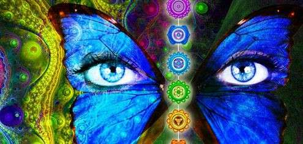
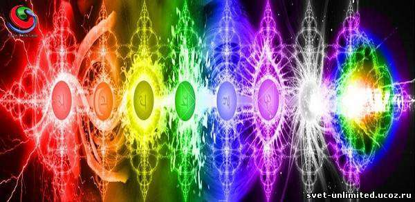

# Долоон хүрд ба тэдгээрийг нээх, идэвхижүүлэх аргууд

Бид эдгээр долоон хүрдүүддээ, ухамсартайгаар эсвэл ухамсарын бус түвшинд, хүссэн хүсээгүй нөлөөлж байдаг.

**Бодол, сэтгэл санаа**\
Бодол бол энергийн нэгэн хэлбэр бөгөөд эерэг бодол, бие дэх энергийн урсгалыг эрчимжүүлж байдаг болох нь шинжлэх ухааны түвшинд нотлогджээ. Бодол, сэтгэл санааны байдал бүр, хүрдүүдэд нөлөөлдөг болох нь мөн тогтоогдсон байдаг байна.\
**Нар**\
Нарны туяа, ургамлын навчинд туссанаар тухайн ургамал түүнийг шингээн авч, үр жимсэнд нь өнгөт энерги болон хуралддаг. Өдөр тутам, ургамлын гаралтай хүнсний бүтээгдэхүүн, хүнсний ногоо хүнсэндээ хэрэглэх, нар салхинд гарч байх зэрэг нь, 7 хүрдийг идэвхижүүлж байдаг аж. \
**Төсөөллийг ашиглах**\
Бодол нэгэнтээ энергийн хэлбэр учираас, төсөөллөөр 7 хүрдээ нээх мөн идэвхитэй байлгах боломжтой гэж үздэг. Тухайн хүрдэнд харгалзах өнгийг төсөөлөн хүрдүүдээ эрчимжүүлж болдог аж. \
**Байгалийн чулуу, эрдэсүүд**\
Эдгээр нь мөн тодорхой энерги агуулж байдаг. Хүний бие организмд чулууны бүтцийн адил талстлаг бүтэцүүд байдгаас, энергийг сайжруулах, мөн компьютерийн чип мэт үйлчилэл явуулах гайхалтай чадвартай байдаг. Гоёл чимэглэлийн чулуун эдлэл зүүх, орчиндоо байгалийн чулуу, эрдэсүүдийг байршуулах нь, бие организмаа эрч хүч, эмчилгээний үелзэлээр хангах боломжийг бүрдүүлдэг. \
**Өнгөжүүлсэн усны үйлчилэл**\
Ус нь, энерги, өнгө зэрэг олон зүйлийг дамжуулах чадвартай гайхалтай бодис юм. Өнгө оруулсан усанд орох, хэвтэж алжаал тайлах үед, сэтгэл санаа, бие организмд өнгөний хэлбэлзэлийн давтамж үйлчилдэг байна. Энэ үедээ үнэр эмчилгээний тосыг нэмж ашиглах үр дүнтэй арга ихэд дэлгэрсэн байдаг аж. Усыг өнгө оруулахдаа байгалийн гаралтай будгийг ашигладаг. \
**Үнэр эмчилгээ**\
Эфирийн тосыг тухайн ургамал, цэцгийн цэвэр, жинхэнэ шинж чанар, хүчийг агуулсан мөн чанар гэж үздэг. Эдгээр тоснууд, үнэрээр эмчилэх гойд шинж чанарыг агуулдаг. \
**Хөгжим, аялгуу, бүжиг**\
Хөгжим хүнд, эерэг сөрөг, аль алинаар нь үйлчилэх чадвартай. Хөжмийн долоон нот бүр, долоон хүрд тус бүрт үйлчилдэг. Дуу авиа хүний сэтгэл хөдлөл, бодол санаа, оюун ухаан, бие мах бодод нөлөөлдөг болохыг шинжлэх ухааны үндэслэлтэй тогтоосон байдаг. Таатай ая аялгуу хүнд нөлөөлж, хүн өөрийн эрхгүй хөдөлгөөнд ордог нь бүжиг юм. \
**Дуу чимээний өнгө, авиа** \
Бид, бие организмынхаа үелзэлийн давтамжид тохирсон авиа гаргаж чаддаг. Тогтмол, таатай авиа гаргах үйлдэл биеийн эрхтэнүүдийн үйл ажиллагааг сайжруулдаг бөгөөд авиа, дууны өнгөний бохирдол буюу уур хилэн, уур уцаартай үед өөрийн эрхгүй гардаг дуу авиа, эрхтэнүүдийг гэмтээж байдаг гэнэ. Орчиноо таатай, тааламжтай дуу чимээ, аяз аялгуугаар хүрээлүүлэх нь та өөрөө өөртөө зүйрлэшгүй тус хүргэж байна гэсэн үг аж. \
**Цэнэгжүүлсэн ус** \
Ердийн болон өнгөт шилэн аяганд ус хийж наранд тавьж уух нь, усны энергийг өнгөний энергитэй хослуулан хэрэглэх үр дүнтэй арга гэж үздэг. Хуванцар аяга, сав хэрэглэж болдоггүй. \
**Гэрэл ба нүд**\
Гэрэл, нүдээр нэвчин даавруудыг бие эрхтэнд хуваарилах гипофизийн үйлчилэл үзүүлдэг. Тухайн хүрдээ эрчимжүүлэхийн тулд эмчилгээний өнгөт шил зүүж ашиглах арга байдаг. \
**Засал чимэглэл, ая тух**\
Гэр орон, ажил, албан тасалгаагаа өөрт тааламжтай эерэг, зөөлөн өнгөөр будаж засах, гоёж чимэх, цэвэр цэгцтэй байх нь мөн хүрдүүдийг идэвхижүүлж байдаг. \
**Хувцас**\
Таны өмссөн хувцас нь, сэтгэл санаа, бодол энергийн түвшинд нөлөөлж байдаг. Гэрэл, хувцасыг нэвтлэн орохдоо, өнгөт энергийг идэвхижүүлдэг бөгөөд өнгөтэй тод өнгийн хувцас өмсөх нь, хүрдүүдэд эерэгээр нөлөөлөх боломжийг өгдөг байна.
