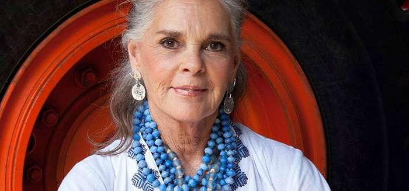

# Донна Эшворт: Хэтэрхий оройтсон хойно ойлгосон 10 зүйлс минь.

Тэрээр, “Бяцхан уулсын намтар”, “Газар дэлхийнхээ эсрэг”, “Аризона Триптих” зэрэг зохиол бичсэн нэртэй коммунист эмэгтэй бөгөөд өөрийн туулсан амьдрал туршлагаас ийнхүү хуваалцаж, 30-д насныханд хандан дараах зөвлөгөөнүүдийг өгчээ.

1/ Бид амьдралынхаа ихэнхи хэсгийг, дээд байгууллагаас тулгасан худал үзэл бодлыг баримтлах, дуулгавартай байхад зориулдаг. Харин үүнийгээ ойлгосон тэр өдрөөс жинхэнэ амьдрал эхэлдэг.\
2/ Та бүгдэд таалагдах албагүй. Өөртөө болон ойр дотхыхноо л анхаар. Бусад хүмүүс өөрсөддөө л анхаарна биз.\
3/ Өтлөттэй тэмцэх нь, салхийг барьж авах гэж оролдохтой адил. Байгаа байдал, дүр төрхдөө сэтгэл хангалуун байж сур. Бие мах бод өөрчилөгдөж эхлэх нь гарцаагүй зүйл, тэгээд ч үргэлж ийм л байсан. Хөгшрөлтөөс зугтах гэж хайран цагаа бүү үр. Түүний оронд харилцаа хандлагаа өөрчилж, түүнээс хамаг сайхныг нь олж харж сур.\
4/ Хэн ч төгс биш. Хэн ч хувь тавиландаа бүрэн дүүрэн сэтгэл хангалуун байж чаддаггүй. Үүнийг ухаарсан цагт, аливааг хооронд нь харьцуулах, шүүмжлэх зэрэг зовлон таригчуудаас чөлөөлөгддөг.\
5/ Аливааг зөв хийж байх үед хэн ч таны үйлдлийг анзаарахгүй, харин хазайх үед бүх хүн түүнийг хардаг. Үүнийг ойлгосон цагт, та, өөрийнхөө хувийн шалтгаанаар баримжаалсан үйлдлүүдийг хийж эхэлснээр, амьдарлаас илүү их таашаал авдаг болно.\
6/ Өөрийгөө шүүмжилэхэд хүн их хугацаа зарцуулж үрсэн байдаг. Хэр хурдан, сэтгэлээ агуулдаг бие хэмээх савтайгаа тохиролцоонд хүрч чадна төдий чинээ сайн. Таны бие гайхалтай чухал хэдий ч таныг илэрхийлэх зүйл биш.\
7/ Эрүүл мэнд хамгийн чухал зүйл, стресс, айдас болгоомжилол түүнийг устгадаг. Аз жаргал, эв эе хамгийн сайн эм.\
8/ Таныг, хэн? яагаад санан дурсах вэ? гэдэг л хөгшрөлтийн гол үзүүлэлт. Таны хайр, ухаалаг чанар ямар ч материаллаг зүйлсээс илүү урт удаанаар дурсагдах боломжтой.\
9/ Бид энд удахгүй. Хэрэв та салхи сөрөн яваа бол тэр нь сорилт болон хувирна. Амьдрал бол тэмцэл биш, харин адал явдал юм.\
10/ Үргэлж, бүр үргэлж хамгийн сайн оргилуун дарс хэрэглэж бай. “Хар өдөр”-т зориулан хуримтлуулснаа хэрэглэ. Хэнд ч тэр, маргаашийн өдөр тохиох эсэх нь баталгаагүй. Өнөөдөр бол бэлэг, тиймээс бид түүнийг одоо цаг хэмээн нэрлэж, “жинхэнэ, бодит” гэж хүлээн авдаг. Энэ өдөр, өнөөдрийг тэмдэглэлт өдрийн хэмжээнд хүлээн авч, аз жаргалтай байцгаа.
