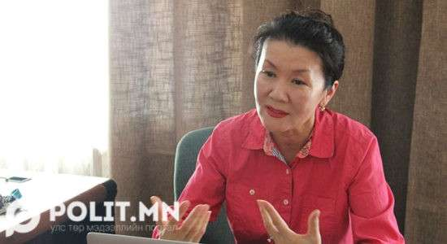
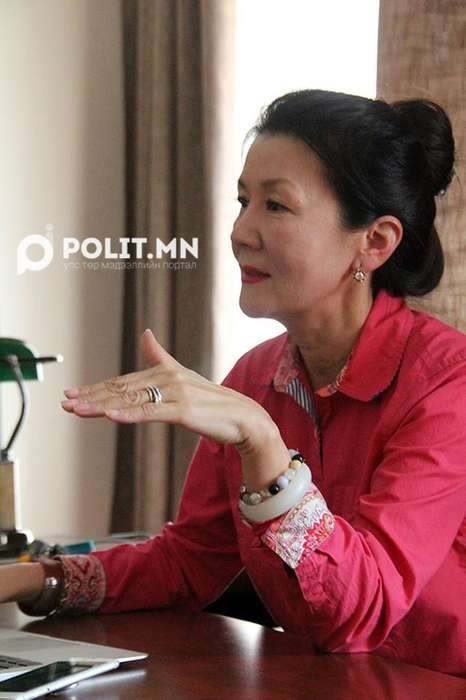

# Д.Оргилмаа: Гадаад хэлний бодлогоо тодорхойлж, сургалтын төвүүдийг БСШУСЯ-ны харьяанд авах хэрэгтэй

**БОЛОВСРОЛЫН ЧАНАРТ БОДИТ СУДАЛГАА ХИЙХ ЦАГ БОЛСОН**

**\**-Боловсрол бол хувь хүний төдийгүй улс орны нийгмийн хөгжлийн үндэс. Эдийн засгийн өсөлт тогтворгүй, ард түний амьжиргааны түвшин доогуур байгаа бол тухайн орны боловсролын салбар чанаргүй, хоцрогдож байгаагийн илрэл юм. Иймд бодит судалгаа хийх зайлшгүй шаардлагатай.

Боловсролыг хүмүү­ний гурав дахь нүд гэж нэрлэдэг. Хүн төрөлхтөний нээн илрүүлж, зохион бүтээсэн агуу их зүйлсийг бид боловсролын хүчээр танин мэдэж, энэ насандаа ч очиж үзэх боломжгүй байгаль орчин, гариг эрхэс, сансар огторгуй, бусад улс орны тухай зөвхөн боловсролоор дамжуулж мэдлэг хуримтлуулдаг. Аливаа үзэгдэл юмсын үнэн, худал, зөв бурууг бид боловсролынхоо ачаар шинжлэх ухааны үндэслэлтэйгээр ойлгон, хувьсган өөрчилж, шинэчлэн өөрийн итгэл үнэмшил, таамаглал, үнэт зүйлээ болгож байдаг. Боловсролын чанар улс орны эдийн засагт шууд нөлөөлж ядуурлыг бууруулах, эдийн засгийн өсөлтийг нэмэгдүүлэх хүчин зүйл болж байдгийг бусад улс орны жишээнээс харж болно. Өөрөөр хэлбэл, ард түмний боловсролд хөрөнгө оруулахгүйгээр улс орны эдийн засаг тогтвортой хөгжих ямар ч боломжгүй. Боловсролын чанарын шинэчлэл бол манай орны хөгжлийн тулгуур юм.

Засгийн газар боловсролын салбарт нүүрлэсэн доголдол, алдагдаад байгаа чанарын залгамж холбооны асуудалд бодитой шийдвэр гаргахдаа маш удаан байна. Бид хариуцлагатай, улс орноо удирдах чадвартай улстөрчдийг төрүүлье гэж бодож байгаа бол боловсролд анхаарах хэрэгтэй. Улс орны эдийн засагт нэмэр болохуйц нэмүү өртөг шингээсэн үндэсний үйлдвэрлэгчдийг дэмжиж, гадаад дотоодын бизнес эрхлэгчдэд бизнесийн таатай, эрүүл орчин бүрдүүлж тэдний шаардлагад нийцэхүйц чадварлаг боловсон хүчнийг бэлтгэе гэж байгаа бол боловсролын чанарт л анхаарахаас өөр гарцгүй. Өнөөдөр бид бизнесээ мэргэжлийн түвшинд удирдахад ухаалаг удирдлагын тогтолцоо, стратеги төлөвлөлт, хэрэглэгч, зах зээл рүүгээ хандсан судалгааг хийж явах чадвартай манлайлагчдыг бэлдэхгүй бол дэлхийн зах зээлд өрсөлдөх нь битгий хэл олон улсын зах зээлийн ширүүн шуурганд бүдрэхэд амархан болсон байна. Аль ч улс орны хөгжлийг харахад боловсролын чанарын тогтолцоо сайтай улс орны эдийн засаг хүчтэй, ард түмэн нь улс төрөөс хараат бус амар амгалан амьдарч байна.

# АНГЛИ ХЭЛИЙГ СУРАХГҮЙГЭЭР ХӨГЖЛИЙН ТУХАЙ ЯРИХ НЬ ӨРӨӨСГӨЛ

Блиц\
БОЛОВСРОЛ:\
-1983-1989 он: Орос Хэлний Багшийн Дээд Сургууль, Орос хэлний багш, бакалавр\
–1990-1992 он: Монгол Улсын Их Сургууль, Англи хэлний багш, орчуулагч, магистр\
-1999-2000 он: Шинжлэх Ухаан Технологийн Их Сургууль, Хэл шинжлэлийн магистр\
–2014 он: Боловсролын Их Сургуулийн докторант\
АЖИЛЛАСАН БАЙДАЛ: \
-1990-1995 он: Анагаах Ухааны Дээд Сургууль, Гадаад харилцааны референт\
–1999-оноос: “Сантис” Боловсролын Төвийн Ерөнхий захирал\
–2008-оноос: Швейцарь улсын Инлингуа олон улсын хэлний сургуулийн Монгол дахь салбарын захирал, лиценз эзэмшигч\
–2010-оноос: CELPA, Англи Хэлний Хөтөлбөрийг Магадлан Итгэмжлэх Холбооны Тэргүүн\
–2017 оноос: BPN Мэргэжлийн Бизнес Эрхлэгчдийн Нийгэмлэгийн Тэргүүн\
–2018 оноос: Монгол дахь Шри Ланк улсын Өргөмжит Консул

-Даяаршлын эргэлт буцалтгүй эрч хүч, далайцын дор дэлхий нийтээр нэг харилцаа, нэгдмэл, цогц байдалд шилжиж байгаа өнөө үед хүн ам цөөтэй, жижиг үндэстний хувьд бид дэлхий нийтийн харилцааны хэл болсон англи хэлийг сурахгүйгээр хөгжлийн тухай ярих нь өрөөсгөл. Дэлхийн 195 орноос 50 гаруй оронд англи хэл тэдний төрөлх хэл эсвэл албан ёсны хэл нь болсон байна. Тэгвэл 140 гаруй орон үндэсний хэмжээнд бидний мэддэг TOEFL Primary, TOEFL Junior, TOEFL iBT, TOEIC зэрэг англи хэлний олон улсын стандарт шалгалтуудыг ашиглаж байна. Гэтэл манай улсын англи хэлний боловсролын салбарын бодлого, хэрэгжилт бахь байдагтаа байна. Жишээлбэл, ЭЕШ-ын англи хэлний шалгалтын материалыг хэдхэн багшаар бэлтгүүлдэг. Тэднийг хэд хоногоор зочид буудалд байрлуулж, гадаад орчинтой харилцах холбоог нь тасалж буйгаа нууцлалын зэрэгтэй даалгавар, шалгалтын материал бэлтгэж байна гэж үзэж байгаа нь үнэхээр өрөвдөлтэй. Тоон үзүүлэлтэд шилжсэн нь дэвшил боловч 400, 500, 600 онооны цаана англи хэлний мэдлэг, ур чадварыг найдвартай, нарийвчлалтай тогтоож чадахгүй, олон улсын стандарт түвшинд хүрэхгүй байгаа нь их дээд сургуулийн элсэгчдийн чадавхиас харагдаж байгааг эрдэмтэн багш, судлаачид шүүмжилдэг. Төрийн өмчит ерөнхий боловсролын сургуулийн англи хэлний хөтөлбөрт, англи хэлийг тавдугаар ангиас үзэж эхлээд арванхоёрдугаар анги төгсөхөд 800 орчим цаг үзсэн байхаар заасан байдаг. Дээд боловсролын англи хэлний хөтөлбөрт бакалавраас докторын сургалтад 612 цаг тавигдсан байгаа нь багагүй тоо боловч тооны цаана чанар байхгүй байгаа нь англи хэлний хөтөлбөрийн стандарт олон улсын стандарт түвшингээс хэтэрхий доогуур байгааг харуулж байгаа юм.

Боловсролын шинэ тогтолцооны шинэчлэлд хурдацтай шилжиж чадсан хувийн ерөнхий боловсролын дунд сургуулиуд олон улсын шаардлагад нийцсэн төгсөгчдийг бэлтгэхийн тулд олон улсын стандарт сургалтын хөтөлбөрийг нэвтрүүлж, шалгалтын материалыг нь ашиглаж байна. Боловсролын үнэлгээг үндэсний хэмжээнд нийгмийн бүх давхаргад зориулж хүүхэд бүрийн эрх ашгийн төлөө олон улсад хүлээн зөвшөөрөгдсөн үнэлгээний системийн дагуу авдаг болгох хэрэгтэй. Олон улсын шалгалтаас айдаг сэтгэлгээнээс багш, оюутан, сурагчдаа гаргах цаг болсон. Олон улсын шалгалтыг үндэсний хэмжээнд нэвтрүүлж төрийн өмчит сургуульд суралцаж байгаа мянга, мянган хүүхдүүдээ дэлхийд өрсөлдөх боломжоор хангаж, дэлхийн монгол иргэн болох үүд хаалгыг нь адилхан нээж өгөх хэрэгтэй.

Өнөөгийн бодит байдалд ЕБС болон их, дээд сургуулиудын чанарын залгамж холбоо зарим хэсэгт тасарсан. Ерөнхий боловсролын түвшинд, хувийн дунд сургуулиуд англи хэлний сургалтын хөтөлбөрийн чанар чансаагаа тодорхойлж шинжлэх ухааны сүүлийн үеийн ололт амжилтад тулгуурлан хөгжүүлж олон улсын шаардлагад нийцүүлэн хөгжүүлж байхад дээд боловсролын шинэчлэл яст мэлхий шиг удаан байна. Англи хэлний багш бэлтгэдэг их, дээд сургуулиуд ядаж л ажлын байрны англи хэлний ур чадварыг тогтоож, баталгаажуулж байдаг олон улсын TOEIC шалгалтын 650 оноотой төгсөгчдийг гаргах хэрэгтэй. Үүнээс доош оноотой төгсөгчдийг дадлагажигч багшийн үнэмлэхээр ажиллуулж, зохих оноогоо авсан үед нь дипломыг нь өгдөг тогтолцоог нэвтрүүлэх ерөнхий боловсролын сургуулийн багшийн стандартад зааж өгмөөр байдаг юм. Иймэрхүү аргачлалыг маш олон орон хэрэгжүүлж байна.

**ТӨРӨЛХ ХЭЛНИЙ ДАРХЛАА, ГАДААД ХЭЛНИЙ БОДЛОГОО ТОДОРХОЙЛОХ ЦАГ БОЛСОН**

-Аливаа хэл соёл нэг талаасаа хэрэглээ мэт харагдаж байгаа боловч нөгөө талаараа улс орны аюулгүй байдал, тусгаар тогтнол, улс төр, эдийн засгийн хараат бус байдал, ард түмний соёлыг хамгаалж, нийгмийг өөрчилж чаддаг хүчит зэвсэг юм. Европын орнууд хилийн зааггүй оршин тогтнож байгаа хэрнээ төрөлх хэлний дархлаа, гадаад хэлний бодлогыг маш ухаалгаар боловсролын системтэйгээ уяж, тогтоож чадсан болохоор эх орныхоо тусгаар тогтнол, ард түмний соёл, ёс заншлаа хадгалсаар байгааг бид харж байна.

Монгол хүн гадаад хэлийг маш хурдан сурч шинэ орчинд дасан зохицох онцгой авьяастай нь анзаарагддаг. Энэ онцлог чанараараа сурч байгаа хэл, соёл, тухайн орны ёс заншилд амархан уусч чаддаг байх. Англи хэлийг албан ёсны хоёрдогч хэл болгох нь манай улсын тусгаар тогтнол, эдийн засгийн эрх чөлөө, ирээдүй хойч үеэ дэлхийн иргэн болгоход түлхэц болох нь дамжиггүй. Нэг орны хэл, соёл ноёрхоход хөгжлийн ямар замыг туулдгийг бид сайн мэднэ. Швейцарь улсын 50 жилийн түүхтэй, олон улсын гадаад хэлний сүлжээ Инлингуа сургуулийн лицензийг манай “Сантис” эзэмшдэг. Эдгээр олон улсын хэлний сургуулиуд дэлхийн 30 гаруй оронд тухайн орныхоо Боловсролын яамны харьяа үйл ажиллагаагаа явуулж байхад манай орны хувьд гадаад хэлний сургалтыг Хөдөлмөр, Нийгмийн Хамгааллын яамны харьяанд байлгаж, албан бус сургалтын байгууллагын статуст оруулаад явж байна. Манай оронд гадаад хэлний бодлого байхгүй байгааг энэ жишээнээс тод харж болно. Бусад улс орнууд гадаад хэлийг боловсролын салбарын салшгүй хэсэг болгож чадаж байна.

Англи хэлний бодит хэрэгцээ шаардлага өсч байгааг тодорхой харуулах нэг үзүүлэлт нь өдөр тутмын сонинд гарч байгаа ажлын байрны нээлттэй зар, тендерийн шалгаруулалт, тэтгэлэгт хөтөлбөрүүдийн зарууд англи хэлээр бичигдэж, англи хэлтэй хүмүүст чиглэж байна.Англи хэлний хөтөлбөрийг богино хугацаанд сайжруулах цорын ганц арга нь олон улсын стандарт шалгалтыг нэвтрүүлэх нь чухал байдгийг 180 гаруй орны туршлагаас харж болно. Шалгуур тодорхой байхад үе шаттайгаар эцсийн үр дүнд хүрэх арга замыг нь тодорхойлж болдог.

Манай оронд боловсролын салбарт давхраа үүсч асар их заагтай болж байна. Энэ ялгааны цаана, соёлын том зөрүү байгааг анзаарах хэрэгтэй. Энгийн иргэдийн хүүхдийн дунд үнэт зүйл, итгэл үнэмшил, хууль журмаа ойлгох ойлголт, ертөнцийг үзэх үзэл, хандлагын ялгаа асар зөрүүтэй байгаа нь сошиал ертөнцөөс харагддаг. Ном ертөнцийг харах цонх гэдэг бол одоо Англи хэл ертөнцийг харах цонх болчихжээ. Англи хэлтэй бол хүссэн мэдээллээ ухаалаг утаснаасаа авч болно. Иймд бид нийгмээрээ хүлээж буй “тэр амжилтын түлхүүр зорилтуудын нэг” яах аргагүй боловсролын шинэчлэлтэд хурдаа нэмэх хэрэгтэй байна.

**ХУВИЙН ХЭВШЛИЙН БОЛОВСРОЛЫН БАЙГУУЛЛАГЫН ОЛОЛТЫГ ТӨРИЙН ӨМЧИТ СУРГУУЛЬД НЭВТРҮҮЛЖ ХАМТЫН АЖИЛЛАГААГ САЙЖРУУЛАХ ЭРХ ЗҮЙН ОРЧИНД АНХААРАХ ХЭРЭГТЭЙ**

-“Сантис” алсын хараагаа Монголын англи хэлний боловсролын салбарыг эрчимтэй хөгжүүлж, олон улсын стандартад нийцүүлэн сайжруулахад төрийн болон төрийн бус боловсролын байгууллагатай хамтран ажиллаж олон нийтэд хүртээмжтэй болгох үйлсэд чиглүүлж өөрсдийн хувь нэмрээ оруулахаар зорин ажиллаад 20 жил болжээ. Үүний үр дүнд “Сантис”-ийн эрчимжүүлсэн англи хэлний IEP хөтөлбөр АНУ-ын Боловсролын яамны итгэмжлэгдсэн төлөөлөгч CEA (Commission on English Language Program Accreditation) байгууллагаар магадлан итгэмжлэгдсэн нь Монголын боловсролын салбарт гарсан ололт амжилт гэж хэлж болно. Яагаад гэвэл мэргэжлийн боловсрол болон дээд боловсролын сургалтын байгууллагуудын дундаас англи хэлний хөтөлбөрөө олон улсын түвшинд магадлан итгэмжлүүлсэн байгууллага одоогоор “Сантис”-аас өөр байхгүй. Засгийн газрын үйл ажиллагааны хөтөлбөрийг хэрэгжүүлэхээр 2008 онд батлагдсан “ Англи хэлний боловсролын үндэсний хөтөлбөр”-т англи хэлний боловсролын хурдацтай хөгжил нь хэлний боловсрол олгох үйл ажиллагааны удирдлага, зохион байгуулалтыг боловсронгуй болгох, англи хэлний боловсролын стандарт, хөтөлбөр, сурах бичиг, сургалтын орчныг сайжруулах, багшлах боловсон хүчин бэлтгэх, мэргэжил дээшлүүлэх ажлыг олон улсын жишигт нийцүүлэх, зайлшгүй шаардлага байгааг онцлон тэмдэглэсэн байдаг. 10 жилийн өмнө баталсан хөтөлбөрийг хэрэгжүүлэх эрх зүйн орчин тодорхой бус, нийгмийн хөгжил хурдацтай шинэчлэгдэж чадаагүй тул энэхүү үндэсний хөтөлбөрийн тухай ярьж байгаа хүн цөөхөн байна. Юуны түрүүнд боловсролын байгууллагууд харилцан итгэлцлэлийн үндсэн дээр хамтран ажиллаж өөрсдийн хөтөлбөрийг таних, жиших, хөтөлбөрийн агуулгаа олон улсын стандартад нийцүүлэх, хөтөлбөрт тавигдах шаардлагын түвшингээ дээшлүүлэх бололцоогоор хангаж өгөх хэрэгтэй. Боловсролын чанарт дэвшилт хийчихвэл зах зээлээс арчигдах гээд дэнжигнэж байгаа сургалтын байгууллагуудад таатай нөхцөл бүрдэнэ. Харамсалтай нь тэдний золиос нь мэдээллээр дутмаг, санхүүгийн боломж багатай иргэдийн хүүхдүүд өртөж байгааг анхаарч тэдний эрх ашгийг хамгаалсан эрх зүйн таатай орчныг бүрдүүлэх цаг болжээ.

**Эх сурвалж: “Зууны мэдээ” сонин**
