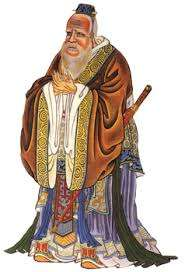

# Дорнын гүн ухаантны, ордуудад өгсөн зөвлөгөө

Суут ухаантнууд, сод билэгтэнүүд, бурханаас заяагдсан, мэргэн ухаан, оюун билэг, онцгой чадваруудтай байдаг. Ийм хүмүүс, бидэнд зөв зам заах, үйлдэл, бодлыг маань зөв зүйл рүү чиглүүлэх үүрэгтэй энэ дэлхийд ирдэг гэдэг. Дорнын нэрт сэтгэгч, гүн ухаантан Конфуций, хүмүүст, орд тус бүрээр, тус тусад нь, амьдралаа хөнгөн, амжилттай болгох, өөрийгөө таних, өөрийнхөө анхаарууштай талыг мэдэхэд тустай дараах зөвлөгөөг өгсөн байдаг аж. Товч боловч тодорхой, гүн гүнзгий утга агуулсан, биднээс хүссэн эдгээр зүйлийг уншаад, бодол төрөх нь лавтай.

#### Хонь

Сэтгэлдээ таарсан ажилыг л эрхэлж бай, тэгвэл, нэг ч өдөр ажиллаагүй юм шиг амьдарна. Учир нь дуртай зүйл тань танд, таашаал өгдөгөөс ажиллаж байгаагаа анзаарахгүй.

#### Үхэр

Өөрийгөө эрхэмлэдэг хүн, бусдын явсан мөрөөр алхахгүй.

#### Ихэр

Араас чинь хүмүүс нулимж байгаа мэдрэмж төрвөл, чи бусдаас түрүүлж явж байна гэсэн үг.

#### Мэлхий

Зорилгодоо хүрэх үйл хөдлөлийн чинь хурд хамаагүй, гол нь зогсохгүй байх хэрэгтэй.

#### Арслан

Хэрэв чи хэн нэгнийг үзэн ядаж байгаа бол, чи ялагджээ.

#### Охин

Өөртөө хатуу байж бусдад зөөлөн ханд. Ингэх нь, бусдын таагүй хандлагуудаас өөрийгөө чөлөөлнө.

#### Жинлүүр

Зорилго чинь хүршгүй мэт санагдвал, зорилгоо бүү өөрчил, харин, үйлдүүдээ өөрчил.

#### Хилэнц

Уулыг хөдөлгөх гэж байгаа бол эхлээд, бэлийн чулуунуудыг зайлуулах ёстойг сана.

#### Нум

Ухаантай хүн, өөртөө хэрэгтэй зүйлсийг хүнээр хийлгэхийн тулд, хүний хүсээгүй зүйлийг бусдад хийдэггүй.

#### Матар

Хэзээ ч унаж үзээгүй хүн агуу байдаггүй, харин унаад боссон хүн агуу байдаг.

#### Хумх

Сайн хүн өөртөө шаардлага тавьна, харин дорой хүн бусдад шаардлага тавьдаг.

#### Загас

Таныг хуурч, мэхэлдэг байсан нь аймшигтай биш, харин та, түүнийг үргэлж санадаг нь аймшигтай
