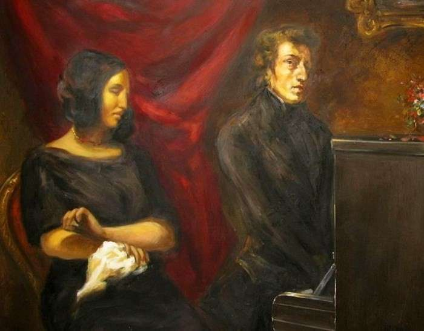
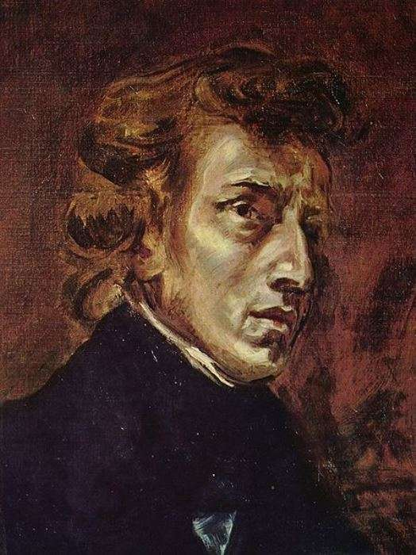
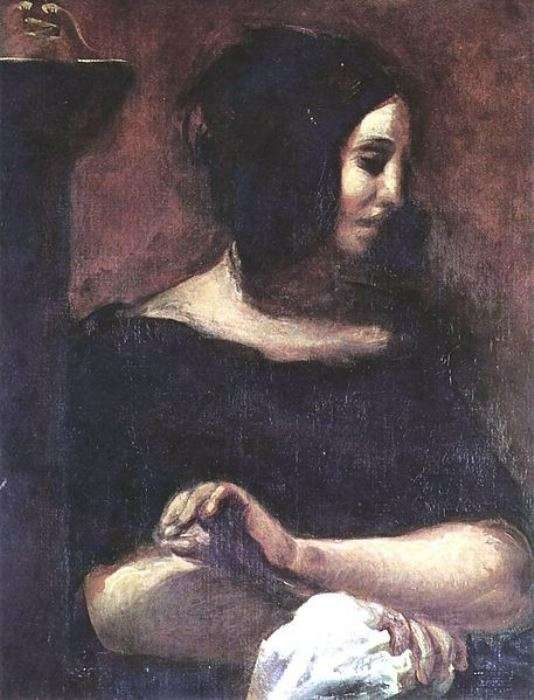

# Дундуураа хайчлагдсан зураг буюу Шопен, Жорж Санд хоёр

Нэрт зураач Эжен Декларуа, зохиолч Жорж Сандтай, найз нөхрийн холбоотой, байнгын зочин нь байсан бөгөөд, хөгжмийн зохиолч Шопеныг бишрэн шүтдэг байв. Тэр үедээ, энэ хоёр алдартангуудыг, хамтад нь зурж мөнхөлсөн юм. Гэхдээ энэ зураг, голоороо хайчлагдсан байдлаар, тус тусдаа, нэг нь Копенгагены урлагийн музейд, нөгөөх нь, Парисын Луврын музейд хадгалагддаг.\
1836 онд, Шопен, Жорж Санд хоёр анх уулзжээ. Шопенд Жорж Санд, анх, огт таалагдаагүй гэдэг. Жорж Сандын чөлөөт сэтгэлгээ, эр хүний хувцаслалт, тамхи татдаг зэрэг нь айлгаж байсан биз ээ. Гэвч, Жорж Сандын, эрэмгий зан, авъяас билгийн өмнө нугарч, энэхүү хоёр хосгүй авъяастанууд 9 жил хамт амьдарчээ. Энэ үедээ, Шопен, бүх, хамгийн алдартай бүтээлүүдээ бичсэн гэдэг. 1847 онд салцгааж, 2 жилийн дараа Шопен нас нөгчжээ. Амьсгаа хураахын өмнө “би түүний тэврэлтэнд үхэх болно, гэж тэр надад, амалсан шүү дээ”гэж хэлээд өөд болсон байна. Ийнхүү алдартнуудын, хамтын амьдрал төгссөн бөгөөд харин, хамт зурагдсан зураг яагаад салав гэдэг нь, тун ч ойлгомжгүй байсаар өдий хүрчээ. Зарим нь Жорж Сандын хүсэлтээр салгаж хайчилсан гэдэг боловч, уг зургийг зэмшиж байсан хүн , их үнэ хүргэхийн тулд, хайчилж, салган худалдсан гэсэн таамгийг илүү үнэний хувьтай гэж үздэг ажээ.

---

