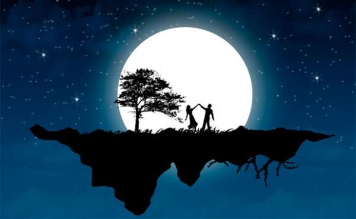

# Дурлал бол хамгийн эмзэг сайхан зүйл

Дурлал нь, хиймлээр үүсгэж болдоггүй, оролдлогуудаар бүтээдэггүй, үргэлж өөрөө гэнэт ирж, хүний хамгийн нарийн нандин мэдрэмжийг сэргээн, сэтгэл зүрхийг нь бүрэн эзэмддэг, хүсэлд баригдахгүй сэтгэлийн эрх чөлөөгөөр нөхцөлддөг, нарийн эмзэг, гайхалтай сайхан Бурханы бэлэг юм.

. Дурлал хэзээ ч бай болдоггүй, түүн рүү зорьж, чиглэлтэйгээр хүрч болдоггүй. Үргэлж гэнэтийн байдаг. Дурлал гэхээр хүмүүс, ичингүйрлийг далдлах түнэр харанхуйг сүүмийн гийгүүлэх, нууцад дуудах саран авхайг хамтдаа ширтэн, догдлон цохилох зүрхний цохилт нь нэгэн хэмнэлд орж, орчины нам гүмээс цасан ширхэгийн лавсах чимээ эсвэл ургамал цэцэгсийн ургахыг хүртэл сонсдог тэрхүү агуу, сонор соргог мэдрэмжийг хүртэл сэргээдэг, сэтгэлийн дээд халил гэдгээр нь мэддэг. Дурлалыг хүмүүс яаруулах нь олонтаа. Дурлал гэтэл алгуур, аажимд дуртай, хүний үйлдэл, хүслээс гадуур байдгийг тэр бүр мэддэггүй. Дурлал хамгийн нарийн нандин урлаг бөгөөд төсөөлшгүй, баригдашгүй, танигдашгүй нэгэн хязгаараас тайлбарлашгүйгээр амар амарлингуй, аядуу зөөлнөөр сэвэлзэн, шууд утгаар харьцах боломжийг үгүйсгэн торгон мэдрэмжээр дүүргэн байдаг. Хоёуланг тань нэгэн бүхэл тэнгэрлэг орхимжоор ороон, газар дэлхийн биш сэтгэлд хөвүүлдэг нь гайхалтай. Хамтдаа зэрэгцэн алхах зуур, гар нь шүргэлцэн, улмаар хөтлөлцөн, ширүүнээр үлээх, хацар шавхуурдах салхийг сөрөн алхах зуур ч, гэнэт дурлал ирж чаддаг. Дурлал орчин нөхцөлийн сайхныг сонгодоггүй. Тийм ээ, дурлал үргэлж гэнэт ирдэг.
