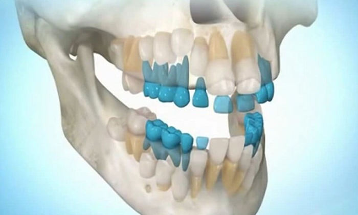
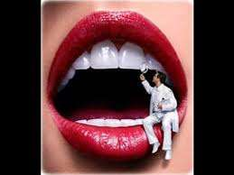

# Дуулиан! Бүх насныханд шүд ургах боломжтой боллоо

АНУ-н Колумбийн их сургуулийн шүд эмчилгээний тэнхимийн профессорын нээлт, шинжлэх ухааны ертөнцөд дуулиан тарьж байна. Шүдийг ямар ч насанд ургуулж болно гэнэ. Олон дахин явж, өвдөлт зовиуртай хийлгэдэг, хиймэл шүд болон үнэтэй имплантууд хэрэггүй болох нь. Профессор Мао энэ аргыг, шүдгүй буйлан дээр хийх замаар туршин үр дүнд хүрчээ. Хүний шүдтэй адил каркас хийж, түүндээ ургалт дэмжих зүйл хийж, түүнийгээ суулгахад, сийрэг сүвэрхэг материалаар хийгдсэн каркас организмын эд эсүүдтэй нэгдэж, 9 долоо хоногийн дараа, шүдний зангилаанууд сэргэн шүд ургадаг болохыг туршилтаараа баталж энэ салбарын хувьд хувьсгалын хэмжээний нээлт хийжээ. Мао профессорын аргад хэрэглэгддэг каркасны капролактан, гидросиапатит материалууд нь хүний эд эстэй нэгддэг шинж чанартай бөгөөд гурван хэмжээст аргаар хэвлэгдэн, урьдчилан тооцоологдсон 200мкм диаметртэй эд эсийн ургалтыг дэмждэг /stromal-derived factor-1, SDF/, зориулалтын бодисоор дүүргэгдсэн олон сувгуудын тусламжтай ургуулдаг юм байна. Эдгээр нь хүний өөрийн эд эсийг өөрөөр нь, зөв хэлбэртэй, зөв чиглэлээр ургуулах боломж олгодог аж.
