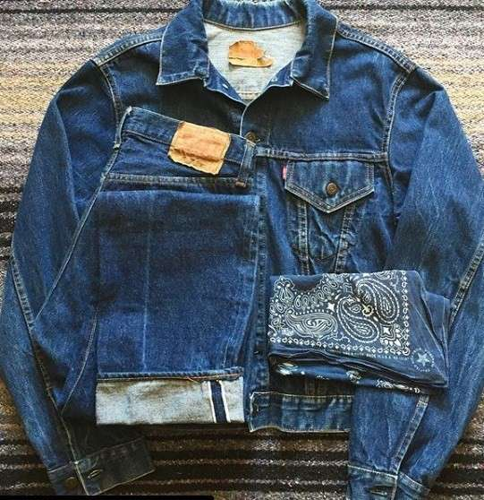

# Джинс

Аливаа хүмүүс, алдартангууд, урлаг, спортын одуудыг шүтэн бишрэх гэсэн ойлголтын зэрэгцээ мөн сонирхдог эд зүйлсээ бишрэх, шүтэх ойлголт хүмүүсийн дунд байсаар иржээ. Энэ удаад, джинсний тухай мөн түүнийг сонирхогчид, бишрэн шүтэгчид, цуглуулагчидын талаар сонирхуулъя. Шинэ джинсэн өмдийг өмсөөд ваннтай бүлээн усанд орж, түүнийгээ тайлалгүйгээр биеийнхээ хэлбэрийг оруулан хатааж өмсдөг инээдтэй гэмээр хачин үе байсан гэх бөгөөд зарим хүмүүс санаж байж ч магадгүй гэнэ. Орчин үед джинс элбэг болж төрөл бүрээр үйлдвэрлэгдэх болсон бөгөөд харин джинсний тухай мэдлэгтэнгүүд хуучны ховор загваруудыг хамгийн их үнэлж, бүр олон улсын үнэ хаялцуулах худалдаан дээр үнэ хаялцан өрсөлдөн авч байдаг гэнэ. Джинс сонирхогч, цуглуулагчидын хамгийн том төлөөлөгчийг Томми Хилфигер гэдэг. Тэрээр 1999 онд Мэрилин Монрогийн 3 джмнсэн өмдийг 37 мянган доллараар худалдан авч байв. Харин джинс анх үүсэж байсан эхний үед, Ливай Страус анхны джинсээ Сан Францискод, алт эрэгч энгийн нэгэн эрд 6 доллараар зарж байжээ. 1970-д онд анх джинс Парисын загварын ертөнцийн томоохон төлөөллүүд загварын үзүүлбэрүүддээ ашиглах болсноор одоогийн хүмүүсийн салшгүй, хамгийн их дэлгэрсэн хувцасны тоонд оржээ. Үүнээс өмнө зоогийн газар, албан байгууллагууд, сургууль соёлын газарт джинс өмсөхийг хүлээн зөвшөөрдөггүй байсан гэхэд гайхмаар. Монголд анх1970-д онд, гадаадад сурдаг оюутнууд, элчингийнхэн, зөвлөлтийн мэргэжилтнүүд, мөн дамын наймаачидаар дамжин хүчтэй түрэн орж ирсэн гэдэг. Тэр үед, оросод энэхүү загварын давалгааг ашиглан джинсийг хуурамчаар үйлдвэрлэж, жинхэнэ джинс гэж мэдэхгүй хүмүүст ердийн даавууг будаж, ПВА цавуунд дүрж дарайлган зарж зальдаж байсан гэнэ. Мөн хуванцар боловсруулан хийсэн Нью-Ойркийн нэгэн үйлдвэрийн хэдхэн зуун ширхэг джинс байсан нь өмсөхөд өвдөг шалбалчихдаг байсан гэж нэгэн цуглуулагч ярьсан байдаг. Энэ өмдний нягтшил 26 унц, харин джинсний дундач нягтшил 16 байдаг аж. Орчин үеийн джинсний даавууны утасны ээрэлт өөрчилөгдсөн, урдныхтай харьцуулшгүй гэж цуглуулагчид үздэг байна. Гэсэн ч, одоогийн үйлдвэрлэгчид урдны джинсэн хувцасны загвар, оёос, даавууны чанарыг алдагдуулахгүй байхыг эрхэмлэн ажилладаг байна.
