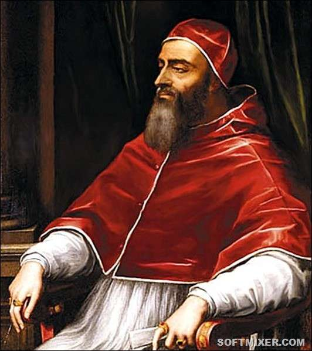
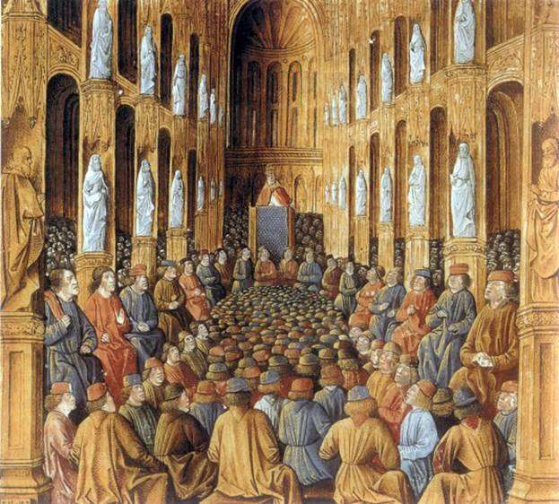

# Джулио Медичи,  Римийн Пап болохдоо гаргасан бяцхан заль

Алдар нэртэй хүмүүсийн намтар түүх, өвөрмөц замналуудаараа сонирхол татсаар байдаг. Энэ удаад авилгатай холбоотой, Римийн Пап Климент VII, Папын суудлыг авахын тулд, өрсөлдөгчиддөө авилгалаа мэдэгдэхгүй, зальжинаар ашигласан нэгэн сонирхолтой түүхийг өгүүлье.

Авилга эрт дээр үеэс эхтэй ба хүмүүс асуудлуудаа шийдэхийн тулд хахууль өгөх, санал худалдаж авах, аливаа зүйлийг нь илчлэхээр айлгах зэрэг төрөл бүрийн аргуудыг зуун зууныг дамнуулан ашигласаар ирсэн байдаг. Джулио Медичи, Помпео Колонна нар Римийн Папын ширээнд санал тэнцүү өрсөлдсөөр, сонгууль хэд дахин явагдаж, алийг нь ч сонгох аргагүй байдалд орсоноор, гуравдах хүнийг гарган сонгох асуудал тавигдан ширүүн өрсөлдөөн болж байх үед, Джулио Медичи гар өргөн бууж өгсөнгүй харин элдэв арга сүвэгчилсээр, таван хүний саналыг авбал ялалт гарцаагүйг ойлгон нэгэн өвөрмөц арга мэх хийжээ. Тэрээр өөрийн талын таван дагагчаа, өрсөлдөгч талын таван санал өгөх эрх мэдэлтэнтэй мөрий тавиулах арга сэдэж, хэрэв Медичи ялвал, мөрийгөө алдсан тал нь 100 мянган дукат, хожсондоо өгөх мөрий тавиулжээ. Ийнхүү сүүлчийн боломж болох давтан сонгууль явагдахад өнөөх таван хүн хамгийн түрүүнд Медичид саналаа өгсөн бөгөөд ялсан Медичи өнөөх мөнгийг, хүмүүсээрээ дамжуулан тэдгээр хүмүүст гардуулсан гэдэг. Ийм маягаар ямар ч санал худалдан авах хууль бус үйлдэл хийлгүй зүгээр л мөрий бооцоо байдлаар мэх хэрэглэн ялсан аж. Джулио Медичи ялмагцаа Климент VII хамба гэж өөрийгөө нэрлэн, 1523-с 1534 онд хамбын суудалд заларсан бөгөөд сониноос, тэр, хамба лам сахалгүй байх ёстой гэсэн дүрмийг зөрчсөн, бүх Римийн хамба лам нар дотроос сахал тавьсан ганц хамба лам байжээ. Үүнийгээ Римийн уналтад гашуудсан гашуудлын билэгдэл минь гэж тайлбарладаг байжээ.\
Энэ түүх, ердийн зүйлийг өөрөөр харах, ашиглах арга нь хүссэн үр дүнгээ ойртуулах нэгэн боломж болдогийг харуулна бус уу.
