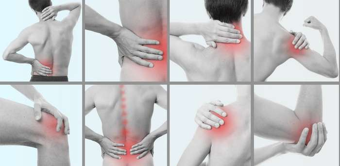
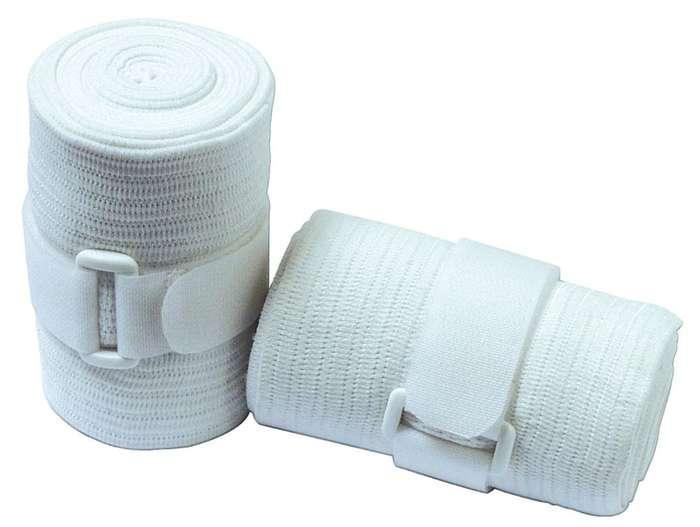

# Үе мөчний өвчнийг, эмгүйгээр эмчлэх, орос арга

Үе мөчний өвдөлтийг, хуучны орос аргаар түрхлэг бэлтгэн эмчлэх хялбар, аргыг танилцуулъя.

#### Орц:

Зөгийн бал – 2 хоолны халбага\
Нунтаг горчица буюу гич – 1 цайны халбага\
Далайн давс - 1/2 цайны халбага\
Хүнсний сод -1 хоолны халбага

#### Бэлтгэх:

Зөгийн балан дээрээ, сод хийж хутгах явцдаа, хуурах маягаар халаасан, горчицоо нэмж, дараа нь далайн давсаа холино. Эдгээрийг хутгахдаа зөвхөн модон халбага хэрэглэх хэрэгтэй. 

#### Хэрэглэх заавар:

Өвдөлттэй хэсэг дээрээ түрхлэгээ түрхээд, гялгар уутаар ороож, унахааргүй боож тогтоож өгнө. 2-с доошгүй цаг байлгах хэрэгтэй. Сулраад уначихгүйгээр тогтоосон тохиолдолд, орой түрхлэгээ тавих нь, шөнийн турш үйлчлэх тул, үр дүнтэй гэдэг. Өглөө нь, тавьсан хэсгээ бүлээн усаар угаана.

2 долоо хоногийн турш, орой бүр тавиарай. Өвчин илааршилт, илт анзаарагдах ёстой юм байна.
