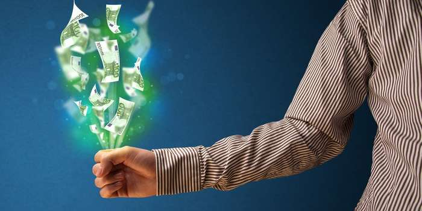

# Эд баялагийн энерги ба ядуурлын энерги

Элбэг хангалуун амьдрал эсвэл ядуурал нь тус тусын онцгой энергийг ялгаруулж байдаг аж. Эдгээр энерги хоёр эсрэг тэсрэг байх нь ойлгомжтой бөгөөд хэрэв ядуу, эд хөрөнгөгүй хүн, мөнгөний гачигдалд орсон байсан ч баян хүн шиг биеэ авч яваад эхлэхэд, түүний энерги, мөнгө татах үелзэл үүсгэж эхэлдэг гэдгийг судалгаагаар тогтоосон байдаг байна. Ядуурлын энергийг зогсоон, эд баялагийн энергийг татахын тулд яах ёстой вэ? Үүний тулд, дараах зүйлсийг уншин, хүлээн авч хэрэгжүүлэхийг зөвлөж байна.

**#### Ядуурлын энерги:**

#### 1. Бохир замбараагүй гэр орон, байр байдал

Хаана, бохир заваан байна тэнд үргэлж ядуурал байдаг бөгөөд угаасан саруулхан цонх, эмх цэгцтэй байдал, эв найртай орчин мөнгийг дуудаж тогтоодог. Мөнгө цэвэр цэмцгэр байдалд дуртай учраас дээрх зүйлс байхгүй газар тогтдоггүй

#### 2. Хуучин эд эдлэл, новш

Хуучин хэрэглэгддэггүй эд хэрэглэл, новш хураагдах нь эд баялагийн энергийг хаан, мөнгөний урсгалыг зогсоодог. Ийм хэрэггүй зүйлс цугларах нь, “дараа, гэнэт хэрэг болох ч юм билүү” гэсэн ирээдүйд орж ирэх эд мөнгөндөө итгэлгүй ханддагаас мөн эдгээр хэрэгцээгүй зүйлсээ “новш” гэж тооцохоо больсноос болдог байна.

#### 3. Эрүүл бус тооцоо

Энэ бол, их, бага илүү гарсан мөнгөө “хар өдөр”-т зориулан хадгалахыг хэлдэг. Урагдсан хувцас хунараа тартагт нь тултал өмсч, хүнд харагдахгүй юм чинь гэж сэмэрч гандталаа угаагдсан дотуур хувцас мөн өмсч, хадгалж буй мөнгөө өөрөөсөө дээгүүр тавин, хэзээ ч юу ч болоо билээ гэсэн дорой сэтгэлгээ тээх нь ядуурлыг дуудаад зогсохгүй таагүй үйл явдлуудыг дагуулж байдаг байна.

#### 4. Мөрөөдлөө хорих

Энэ нь, дэлгүүрт байх үнэтэй, сайхан хувцас эд зүйлсийг хараад, дурлаж шохоорхон өөрөө өмссөн мэтээр төсөөлөн сонирхохын оронд, “ үүнийг яаж авах вэ дээ”, “ тийм боломж байхгүй” гэх мэт сөрөг бодол агуулах, амралт, аялалд явах талаар яриа үүсэх үед, “тийм боломж байхгүй, түүний оронд...” зэрэг ирээдүйн ядуу байдлыг зөгнөсөн бодол ядуу зүдүү байдлыг програмддаг байна. Өнөөдөр хүн мөнгөгүй байлаа гэхэд, хагас жилийн дараа мөнгөтэй байх магадлалаа өнөөдөр үгүйсгэх нь буруу учраас ирээдүй нь хэзээ ч сайхан байдаггүй. **#### Эд баялагийн энерги**

#### 1. Цэвэр цэмцгэр гэр орон, албан тасалгаа

Мөнгө орлого, гэрийн үүдээр орж ирдэг учраас, үүдний хэсэг маш эмх цэгцтэй, цэвэрхэн, мөн мөнгө төгрөг хадгалагдах гэр орон цэвэр цэмцгэр байх ёстой байдаг. Угааж арчсан цэвэрхэн тунгалаг цонхыг метафизик түвшний ирээдүйн үүд хаалга гэж үздэг. Цэвэрлэж ариутгасан ванн, угаалтуур, суултуур гарлагыг хаадаг гэнэ.

#### 2. Ашигтай хэрэгцээтэй зүйлс

Жилд ядахдаа нэг ч атугай хэрэглэдэг зүйлийг ашигтай зүйл гэж авч үздэг. Хэрэв гэртээ байгаа номнуудаа дахин унших тань ховор боловч үгүй хийхэд хайран байдаг бол жилд нэгээс доошгүй удаа үзэж ялган, тоос шороог нь нямбайлан арчиж байх ёстой аж. Ингэснээр, таагүй энергийн хуралдалт үгүй болдог.

#### 3. Зөв бодлууд

Хүн бүр, хүссэн бүх зүйлсээ хэрэглэх эрхтэй: үнэтэй сайхан эд зүйлс, шинэ машин, алс холын аялал, амралт, бүр хамгийн үнэтэй, баячуудын амардаг газар ч яагаад амарч болохгүй гэж? Хүн, энэ бүхнийг өөртөө байгаагаар чин сэтгэлээсээ төсөөлөн бодож сурч, ирээдүйдээ эргэлзэхгүй амьдрах нь, Ертөнцийн нууцлаг хүчийг ашиглан, мөрөөдлөө биелүүлэх, бодит болгох боломжтой болж байдаг байна.

#### 4. Сайн үйлс хийх

Өгөх- авах тэнцсэн, ижил түвшний солилцоон дээр эд баялагийн энерги суурилж байдаг байна. Хэрэв хүн, мөнгө орлогоо, зөвхөн өөртөө хураан, өөрийн хэрэгцээнд зарцуулдаг бол өгөө-авааны тэнцвэр алдагддаг аж. Нэртэй баячуудын хандив тусламж, буяны үйлсийн талаар байнга мэдээлж байдаг. Тэд, энэхүү үйлдлээрээ, өгөө-авааны тэнцвэрээ хадгалж байдаг. Энгийн хүмүүсийн хувьд, хэн нэгэн хэрэгцээтэй хүнд туслах, буяны өргөл өргөх зэрэг нь уг тэнцвэрийг хадгалах боломж болж өгдөг байна.

Та дээрх зүйлсийг хүлээн авч хэрэгжүүлснээр эд баялагийн энергийг өөртөө татах боломжтой болох бөгөөд гэхдээ мөнгийг хэт бурханчлах нь түүнийг түлхдэг гэдгийг санах хэрэгтэй. Мөнгө бол хүнийг зорилгод нь хүргэх хэрэгсэл, харин амьдралын зорилго биш юм. Мөнгөтэй байж бүхнийг бүтээнэ гэдэг бодлыг алдаатай гэдэг бөгөөд сэтгэл зүтгэлийн үрээр зорилго биелж, зорилго бүтсэнээр орлого мөнгө ундардаг байна. Эд материалын хангалуун байдал нь хүнд зориулагдан заяагддаг. Харин хүн материаллаг байдалд зориулагдаагүй гэдгийг санаж, зүрх сэтгэлдээ жинхэнэ үнэт зүйлс болох баяр баясгалан, өөдрөг сэтгэл, энэрэнгүй сэтгэл, өгөөмөр зан, хайр, итгэл гэсэн сайхан чанаруудаа хадгалж яваарай.
