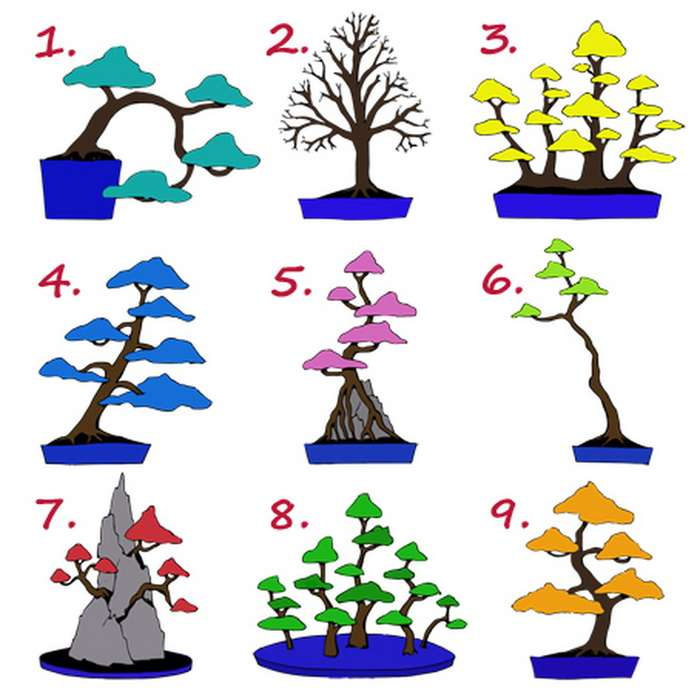

# Эдгээр модны зургуудаас сонгон, ажил мэргэжилийн чадвар, давуу талуудаа  олж мэдээрэй

Английн, хууль эрх зүйн, тэргүүлэх 5 компанийг нэгтгэсэн, Magic Circle корпораци, ажилтнууд тус бүрийн чадвар, давуутай талуудыг нь тодорхойлохын тулд, нэртэй сэтгэл зүйчдэд, тест боловсруулахыг захиалснаар, хүмүүсийн мэргэжлийн чадавхийг тодорхойлох энэхүү сонирхолтой экспресс-тест бүтжээ. Үүнийг ашиглан, ажилтнуудынхаа, ажил үүргийн хуваарилалт хийсэн нь амжилт дагуулсан бөгөөд 94%-н үнэн гэсэн дүгнэлтэд хүрсэн ажээ. Энэхүү тест нь хялбар, дараах модны зургуудаас харж сонгоод, зураг тус бүрд харьцах тайллыг уншаарай.

#### Мод № 1

Та, бүх зүйлд манлайлахыг зорьдог. Хүссэндээ хүрэхийн тулд, юугаа ч өгөхөөс буцдаггүй. Ер нь, ихэнхдээ, мөнгө, ашгийн тулд бус, үзэл санааныхаа төлөө ажилладаг. Өөртөө болон бусдад шаардлага тавих дуртай, амиа боддоггүй, бусадтайгаа мэдлэг туршлагаа хуваалцдаг сайхан чанартай. 

#### Мод № 2

Хамгийн нэгдүгээрт, санхүү, ашиг орлогоо тавьдаг. Өндөр цалингийн төлөө таатай нөхцөлтэй, таалагддаг ажлаа ч орхино. Хамт олон чинь, таныг, хатуу, шударга хүн гэж хүлээн авдаг. Таны удирдлага дор ажиллаж байгаа хүмүүст, та таалагддаг, учир нь, та, зорилгоо маш сайн тодорхойлдог, үүний зэрэгцээ, ажилтнуудаа хэнээр ч гомдоолгохгүй өмгөөлдөг. 

#### Мод № 3

Нийтэч зан тань таны юугаар ч сольшгүй чанар. Хамт олон, харицагчид, бүгдтэй гайхалтай хэл амаа ололцдог. Том газар ажиллах таалагддаг, тэрхүү хамт олныхоо “зүрх” нь болж чаддаг. 

#### Мод № 4

Та, маш бүтээлч хүн. Жинхэнэ санаачлагч, үүнийг чинь ч хамт олон чинь үнэлдэг. Өөрийгөө бүх талаар дайчилдаг, мөн бусдын туршлагыг ашиглан “Төгс төгөлдөр”-т хүрэхийн төлөө үргэлжид, тэмүүлж тэмцэж байдаг.

#### Мод № 5

Таны, хамгийн хүнд бэрх үед ч “хад чулуу” мэт байж чаддаг зан чанар, жинхэнэ “ололт”. Таны, тогтвортой байдлыг чинь ганхуулж чадах зүйл бараг үгүй. Ажил дээр чинь асуудал үүсч, аюул, эрсдэл болох гэж байсан ч, энэхүү зан чанарынхаа хүчээр, тайван, сэргэг ухаанаар гарц олж асуудлыг шийдэж чадна. Таныг, баримталж буй зорилго, замаас чинь ухраах хүч энэ дэлхий дээр байхгүй гэж хэлж болно. 

#### Мод № 6

Юуны өмнө, хамт олон чинь таныг, хариуцлагатай хүн гэж хүлээж авдагийг дуулгах нь зүйтэй. Тантай хамт ажиллагсдад, та, тэднийг, хэзээ ч “хулхидахгүй” учраас хамт ажиллах, тааламжтай байдаг. Та тусч, халамжтай хүн. Тэд, танд ямар ч үед итгэж болно гэж боддог. 

#### Мод № 7

Та, бусдад хүндлэгддэг, мөн нэр төртэй, бусдаар хүлээн зөвшөөрүүлж чаддаг зан чанар болон хэмжээлшгүй урам зоригынхоо хүчээр аливааг маш сайн бүтээдэг. Хамт олон чинь, ямар ч зүйлийг бүтээдэг энэ занг чинь үнэлдэг.

#### Мод № 8

Та оюуны хөдөлмөрийн хүн. Хариулж чадахгүй ямар ч асуулт байхгүй. Хамт олон чинь, танаас зөвлөгөө туслалцаа авахдаа баяртай байдаг. Биеийн хүчний ажилд дургүй, аливаа үр дүнд, ухаанаар л хүрнэ гэж боддог.

#### Мод № 9

Та, маш сониуч, ямар ч өөрчлөлтөөс айдаггүй. Тиймээс, та, тэс өөр мэргэжлийн ажил ч байсан, хэн нэгнийг орлон гүйцэтгэж чаддаг. Таны энэ, олон талын чадварыг хамт олон чинь үнэлдэг.
