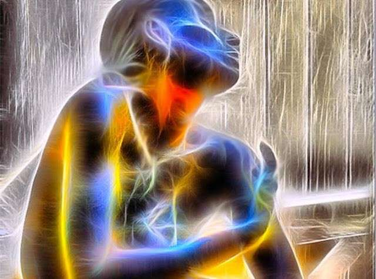

# Эдгээр зүйлсийг бүү өмс.

Эдгээр хувцасыг өмсөх нь, биеийн эрч хүчийг алдагдуулдаг гэнэ. Хувцас бол хүний дүр төрхийг илэрхийлэх, мөн өөртөө итгэлтэй байх, амжилттай байхад тустай, таагүй байдалд орохоос сэргийлдэг эд зүйл юм. Өөрийн эрч хүчийг хамгаалах, мөн сөрөг, таагүй байдлаас зайлсхийхийн тулд дараах хувцаснуудаас салах хэрэгтэй гэж зөвлөдөг байна.

Хүний хувцас өмсөхийг тун таагүй гэдэг. Хувцас нь, өмсөж байгаа хүнийхээ зан чанарыг шингээн авах чадвартай байдаг гэнэ. Хууччуул, үүнд их дургүй байдгийг мэдэхгүй хүн үгүй биз ээ. Хувь тавиланг нь давтна гэдэг ба мөн өөрийнхөө энерги, био талбайг эвднэ гэж үздэг байна.\
Бүх зөн билэгтэнгүүд, нас барсан хүний хувцас, эдлэлийг шатаахыг зөвлөдөг. Талийгаачдын хувцасыг өмсөх нь таагүй гэдэг. Удам дамжсан эд зүйлсийн хувьд, зохих дом засал хийлгэж хэрэглэдэг.\
Хувцас зан чанарыг шингээх чадвартай тул, амьдралын таагүй үеүд болох өвчин, осол, таагүй тохиолдлуудын үеэр өмсч байсан хувцасуудыг дахин өмсөхгүй байхыг зөвлөдөг. Давтагдна гэж үздэг гэнэ. Түүнчлэн, тэдгээр дурсамжийг сануулдаг нь ч сайн биш, бодол булингартуулна гэдэг байна.\
Эрүүл мэндийг хөлний улнаас хамааралтай гэж үздэг. Тиймээс, урт наслах, залуу насаа хадгалахын тулд өөртөө эвтэй, өөрөө тааруулан авсан гутал өмсөх хэрэгтэй гэдэг байна. Иймд, хэмжээ таараагүй, хөлд эвгүй гутлыг өмсөх хэрэггүй гэнэ.\
Хувцасны өнгийг хар, саарал, цагаан өнгөөр зонхилсон байвал таагүй гэдэг. Ийм өнгийн хувцаснууд, хүний өнгийг дарна, өөрийгөө үгүйсгэх мэдрэмжид хүргэнэ гэж үздэг. Өнгө бүр өөр өөрийн увидастай байдаг тул тод, өнгө өнгийн хувцас өмсөж, амьдралдаа өнгө нэмэхийг зөвлөдөг.\
Хувцас сонгон авах нь, мөрөөдөлдөө хүрэхэд тустай, амьдрал, эрүүл мэндийг ч хөндөх хариуцлагатай зүйл тул, анхааралтай хандах хэрэгтэй бөгөөд санаандаа таараагүй зүйлийг өмсөхгүй байхыг зөвлөдөг.
