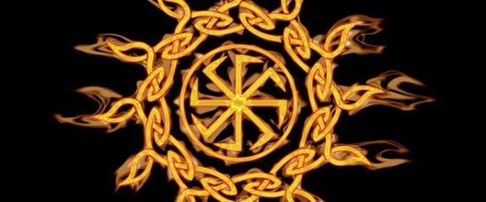

# Эерэг эрчимтэй өдрүүд тохиож байна

Өнөөдрийн 12 цаг 59 минутаас, маргаашийн 9 цаг 25 минутын хооронд, нар, сар, жилд ганц тохиодог байрлалд байх хугацаа үргэлжлэх нь, энэ үедээ, хамгийн таатай, хүчтэй, эерэг энергийг дэлхийд илгээдэг,. Энэ хугацаанд, аливаа ажил үйлсийг шинээр эхлэхэд маш тааламжтай, мөн энэ өдөр олон сайхан гэнэтийн бэлгүүдээр дүүрэн өдрүүд болдог гэж үздэг. Хэрэв, таагүй зүйл тохиолдвол, энэ нь амьдралаа буруу өрнүүлж байгааг тань заасан дохио гэж хүлээж авах ёстой гэнэ. Маш хүчтэй энергитэй өдрүүд байх учраас, сайн сайхан хүсэл мөрөөдлөө бодох, бие биедээ урам зориг өгөх, сайн үйлс бүтээхийг эрмэлзэх, ойр дотныхноо баярлуулах, буян хийх зэргээр хамгийн эзрэг бодол санаатай өнгөрүүлэх ёстой байдаг. Түүнчлэн, нар, сарны энэ байршил хувь заяаг ч өөрчлөх хэмжээний хүчтэй энергитэй өдөр аж.
