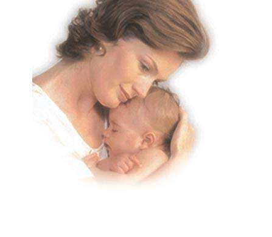

# Ээж нарын хүүхэддээ хэлдэггүй 10 зүйл

Ээжүүд, хүүхэддээ хэлдэггүй эдгээр зүйлсийн тухай уншаад нэгийг бодно биз ээ.

1. Чи түүнийг олон удаа уйлуулсан. Тэр, чамайг олсоноо мэдээд баярын нулимс унагасан. Тэр чамд амьдралыг өгөн төрүүлэхдээ уйлсан. Чамайг анх гартаа тэврээд, жаргаж нэг уйлсан. Чиний төлөө айх сандрах бүртээ тэр уйлсан. Чиний амжилт, ялалтаар бахархан уйлсан. Чиний өвдөх зовох бүрт тэр уйлсан. Тэр чамайг алс хол байхад санан уйлж байдаг. Тэр чамтай тохиолдож буй бүх зүйлийг мэдрэн уйлдаг чадвартай.\
2. Тэр, хамгийн дуртай зүйлээ өөрөө идмээр байсан ч өөрт чинь өгдөгөө хэлдэггүй. Чамайг түүнийг нь идэхэд тэр, жаргаж байдаг.\
3. Тэр, чиний бяцхан гар үснээс нь зулгааж, самардаж, хөхний толгойг нь ханзартал хазаж байхад, өвддөг ч, өвдөж байна гэж хэлээгүй. Есөн сар гэдсэндээ тээн, чамайг төрүүлэх үеийн аймшигтай өвдөлтийн тухай тэр хэлдэггүй.\
4. Тэр байнга айдаг байсан. Тэр чамайг төрснөөс эхлэн хамгийн их хамгаалах ёстойгоо мэдрэн айдаг байснаа хэлдэггүй. Өөрөө л тэвэрч байх үедээ аюулгүйд нь итгэдэг байснаа хэлээгүй. Анхны алхамуудаа хийн, явж сурах үед чинь зүрх нь, хэд дахин илүү түгшдэг байсныг хэлээгүй.\
5. Тэр, өөрөө өөрийнхөө хамгийн хатуу шүүмжлэгч байдаг. Тэр өөрийн дутагдлуудыг мэддэг, үр хүүхдийнхээ төлөө, түүнийгээ бүр үзэн яддаг, одоо ч буруутган зовсоор байж ч магад. Түүнд өнгөрсөнд очиж бүхнийг засах чин хүсэл байдаг ч, харамсалтай нь, энэ болохгүй гэдэгт гуньдаг.\
6. Тэр чамайг унтуулах гэж нүд нь анилдаж байсан ч бүүвэйлэн суудаг байсан. Харин чамайг унтмагц, хайрлаж энхрийлэн, хайраар бялхан ядарсан нь ч мартагдан харж суудаг байсан.\
7. Та хоёр, бие биегүйгээр байж чаддаггүй байсан. Тэр чамайг тэврээстэй юмаа эмхэлж, бараг унтаагаараа юм идэж сурсан. Гар нь өвдөж, нуруу нь хөшиж байсан ч, чамайг тэврэн тайтгаруулдаг байсан. Яагаад гэвэл чи, түүнтэй ойр байхыг хүсч наалдаж, салах дургүй энхрийлүүлэхийг хүсдэг байсан. Чи, зөвхөн түүний гар дээр аюулгүйг мэдэрч, хайрыг нь авдагаа мэддэг байсан.\
8. Чамайг уйлахад зүрх нь шимширч өвддөг ганц хүн гэдгээ хэлдэггүй. Чиний хацрыг даган урсах нулимсыг зогсоохын тулд юу ч хийхээс буцахгүй хүн. Хэрэв, нулимсыг чинь зогсоож чадахгүй бол зүрх нь хэдэн хэсэгт хуваагдах мэт өвдөн шаналж байдаг\
9. Тэр, чиний төлөө нойр хоолыг хойш нь тавьдаг байсан. Тэр, чиний бүх хүсэл сонирхлыг өөрийнхөөс дээгүүр тавьдаг. Түүний хувьд чи, үргэлж нэгдүгээрт тавигддаг байсан. Өдөржин чамайг анхаарч, үдэш нь өөртөө тавих цаг гаргаж чаддаггүй ядардаг байсан.\
10. Тэр, энэ бүхнээ дахин эхлэх хүсэлтэй, хаширдаггүй. Эх хүн байх хамгийн хариуцлагатай ажил бөгөөд ээж нар зэрэгцүүлэн, ажиллаж, сурч, аливааг амжуулж, бүхнийг зохицуулах гэж хичээн ядардаг ч, тэр, чамаас ирэх, чамд өгөх төсөөлшгүй их хайраараа амьдардаг. Ээж чинь, чиний төлөө, өвдөлт, нойргүй өнгөрүүлсэн шөнө зэрэг эдгээр бүх зүйлийг үл тоон, чиний төлөө, энэ бүхнийг дахин эхлүүлэхээс буцахгүй. Учир нь чи, түүний хувьд хамгийн ДЭЭД хүн, тэгээд ч тэр, энэ бүхнээ жаргалд тооцдог юм.\
Та, ээжтэйгээ уулзахдаа, эсвэл ээжтэйгээ хамт байдаг ч байсан ээжийгээ өөрөөр харж, хичнээн хайртайгаа мэдрүүлэхийг хичээгээрэй. Ээж ганц, хүүхдүүд олон байх ч, ээжийн хувьд хүүхэд тус бүр ийм л байдаг.
