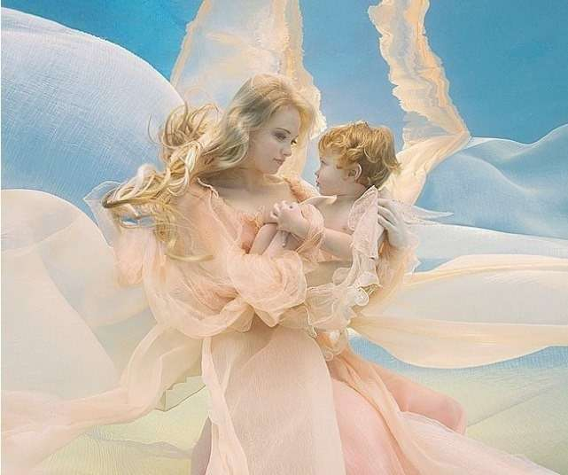

# ЭЭЖ-сахиусан тэнгэр

Төрөхийнхөө өмнө, хүүхэд, Бурханаас, -“Маргааш намайг дэлхий рүү явуулна гэж ярьцгааж байна. би тэнд яаж амьдрах юм бэ? Би жаахан байна, тэгээд ч өөрийгөө хамгаалж чадахгүй”, гэхэд нь Бурхан, -“Би чамд, чамайг хүлээж авах, чамайг хамгаалж, асрах сахиусан тэнгэр бэлэглэнэ” гэлээ. Хүүхэд, хэсэг бодлогоширсоноо, “Энд тэнгэр дээр, би, дуулж инээгээд жаргалтай л байгаа даа” гэв. Бурхан инээмсэглээд,\
-“Чиний сахиусан тэнгэр, чамд дуулж өгөн, мөн инээмсэглэж, чи түүний хайрыг мэдрэн аз жаргалтай байх болно”.\
–“Өө, би хэлийг нь ойлгохгүй яана аа. Би яаж Тантай харьцаж байх юм бэ бас?” Бурхан, толгойг нь илээд,\
-“Чиний сахиусан тэнгэр, алгыг чинь хавсруулж, залбирахад сурган, чи надтай харьцах болно”.\
–“Би дэлхий дээр, уур хилэн, муу зүйл байдаг гэж сонссон, хэн намайг хамгаалах юм бэ?”\
-“чиний сахиусан тэнгэр, чамайг амиа ч хайрлахгүй чамайг хамгаална аа”\
-“Би, таныг дахин харахгүй гэхээр гунигтай байна”\
-“Чиний сахиусан тэнгэр, миний тухай ярьж, бүхнийг зааж, үргэлж хамт байх болно”. Энэ үед дэлхийгээс, үг, дуу яриа сонсогдож эхлэв. Хүүхэд, сандран,\
-“Бурхан минь! Би тэр сахиусан тэнгэрийн нэрийг мэдэхгүй шүү дээ”, гэхэд, Бурхан:\
-“Нэр нь хамаагүй ээ, түүнийг ЭЭЖ гэдэг юм” гэжээ.
