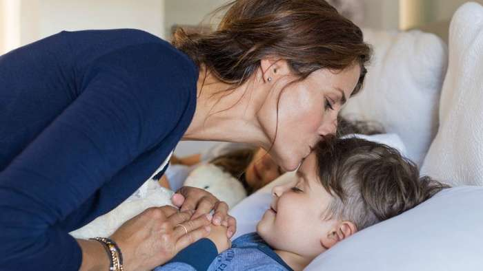
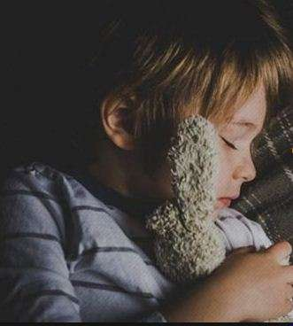

# Ээжээ! Тантай хамт жоохон хэвтье

Бид хүүхдүүдээ бага байхад тэр бүр цаг заваа зориулж чаддаг билүү? Харин том болсон хойно нь хүлээж, ойр ойрхон ирээсэй гэж хүсэмжлэн суух болдог нь тэдэндээ, тухайн үед нь цаг гаргадаггүй байсных биш үү? Хүүхэд нас хамгийн эмзэг, хамгийн их дурсамж үлдээдэг үе юм.

Өдөр тутмын ахуй амьдралаа хүүхдийнхээ хүсэл сонирхлоос дээр тавьж хамт байх хугацаагаар хомс байлгах нь, хожим өтлөхийн цагт, өөрсөддөө анхаарал халамж нэхэх эрхээ хасуулна гэсэн үг юм. Хүүхэд төрүүлж, асрах нь хүмүүжил өгч байгаа асуудал биш, мөн хэрэгцээтэй бүхнээр нь хангах нь хүмүүжил бас биш. Тэгээд ч, ер нь хүүхдүүд хүмүүжлээр дутагддаггүй, харин хайраар гачигддаг гэдгийг та мэдэх үү? Хайр бол хамгийн агуу хүмүүжил. Хүүхдүүд бүгд ээжтэйгээ хамт цагийг өнгөрүүлэхийг хүсч байдаг бөгөөд “Ээжээ, тантай хамт жоохон хэвтье, 5-хан минут” гэсэн гуйлтыг сонсоогүй ээжүүд байхгүй биз ээ. Харин ээжүүд, -“Зөндөө ажилтай байхад, за, ганцхан секунд шүү, ядраад байна, зав алга, чамтай манатай” гэх мэт хариулж бултсаар байдаг. Хамт хэвтвэл, дахиад жоохон хэвтье гэхээр нь түвэгшээнэ. Гэтэл хүүхдүүдийн хувьд, ээжтэйгээ хэвтэж байх үедээ хамгийн их жаргалтай, мөн нээлттэй байж, хүсэл сонирхол болон болсон тохиолдсон зүйлээ ярих дуртай байдаг гэнэ. Хүүхдүүддээ хэрэгтэй байгаа дээрээ тэднээрээ жарга, хүүхдүүдтэйгээ цагийг өнгөрүүлэх боломжийг аль болох их гаргаж байхыг хичээ, ээжүүдээ! Хүүхэдтэйгээ хамт хэвтээд, ярихыг нь сонсож элгэндээ тэврэн эрхлүүлэх үед тань, таны хүүхдээ хайрлах хайранд бялуурсан зүрх тань –“Өнөөдөр, яг одоо чи миний хамгийн гол, чухал хүн шүү” гэж өөрийн эрхгүй сэтгэлийн угаас хэлүүлдэг юм. Хэлээгүй ч, хүүхэд тань мэдэрдэг юм. Хэдэн жилийн дараа, хүүхэд тань өсч том болоод, энэ үгсийг танд мөн хэлэх болно. Хүүхэд насанд нь өгсөн анхаарал халамж, өтөл насанд тань эргэж ирдэг юм шүү. Юу тарина, түүнийгээ л хураана гэдэг дээ.
