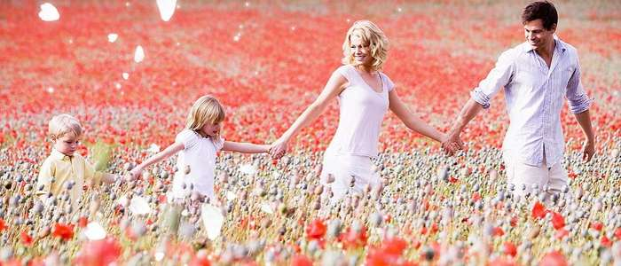
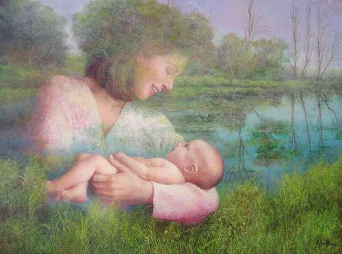

# Ээжийн адислал

Хүн төрөхөд 100% амьдралын энерги өгөгддөг бөгөөд, энэхүү энергээ хэрхэн, юунд зарцуулж буйгаас ирээдүйн амьдрал нь шалтгаалдаг байна. Нялх бага хүүхдүүд, өөрсдөө амьдралын хариуцлагаа үүрч чадахгүй тул, энергийнхээ 90%-г ээждээ өгч, 5-10%-г өөрийгөө анзааруулахад зарцуулдаг гэнэ.

Хүүхэд өсөх тусмаа хариуцлагад суралцан, энергийн хувиа нэмэгдүүлж эхэлдэг ба 8 нас хүрэхдээ, бүрэн хариуцлагаа авахуйц энергээ хураасан байдаг байна. Энэ үед, ээж нь, адислалын хэмжээний амьдралын олон зүйлд, мөн амьдралын энергээ хэрхэн зарцуулахад 14 нас хүртэл нь сургаж байдаг. Энэ насанд хөвгүүд, өөрийгөө хамгаалах болон бусдыг хамгаалах аргуудад суралцаж, харин охид, гэр орон цэвэрлэх, гэр орны ажилд суралцдаг. Яг энэ үе, 8-14 насны хооронд, хүүхдүүд, амьдралд хариуцлагатай хандах, энергиэ зөв зарцуулах, эрсдэлийг үнэлэхэд суралцдаг гэж үздэг ажээ. 14 насанд, хүүхэд өөрийгөө хүлээн авах, хүлээн зөвшөөрүүлэх үе нь эхлэх ба 21 нас хүртэлх энэ хугацаанд, эцгийн үүрэг маш чухал гэж үздэг. Энэхүү 14-21 насны хооронд, эцэг хүн, хүүхдээ хүмүүжүүлэхэд илүү түлхүү оролцож, зааж зааварлах хэрэгтэй гэх бөгөөд ээжийн оролцоо, хувь заяанд нь таагүй нөлөөлдөг гэх нь бий. Тухайн 8-14 насны хооронд өгөгдөх хариуцлагыг ээж нь дутуу дулимаг өгсөн бол, ээж нь өөрөө хүүхдийнхээ амьдралаар амьдарч эхэлдэг бөгөөд, хүүхэд нь хичнээн том болсон ч, өөрийнхөөрөө амьдардаггүй, энергээ төрөл төрөгсөддөө өгч амьдардаг “бяцхан” том хүн болж өсдөг ажээ. Ийнхүү, зохих үедээ амьдралын адислал болох ээжийн хүмүүжлийг буруу авсан хүүхдүүд, хариуцлагын ойлголтгүйгээс, 13-14 насандаа, “шилжилтийн нас” гэж нэрлэдэг, гэр бүлдээ таарамжгүй асуудлыг үүсгэж эхэлдэг. Үүнийг, өгсөн энергээ нэхэх тэмцэл ч гэж үздэг. Ээжийн адислал болох, хамгийн чухал энэ үед, ээж нар хүүхдээ тойруулсан хамгаалалтын орчинг бүрдүүлж, таагүй зүйлд өртөхөөс сэргийлж, өөрийн заасан үйлдэл, үйл хөдлөл бүрээ зөв зүйлсрүү чиглүүлж, хариуцлагыг ухамсарт нь суулгаж, нэгэн төрлийн адислал явуулан биеэ даасан хүнийг төлөвшүүлдэг байна. Ээжийн адислал буюу энэхүү хүүхдээ хүмүүжүүлэх, түүний ирээдүйн аз жаргалыг нь тогтоох асар хариуцлагатай үйлсийг ээж хүн хийдэг гэх бөгөөд ээжийнх нь адислал, хайр, хүний, насан туршийн хамгийн хүчтэй хамгаалах сахиус болж өгдөг ажээ.
