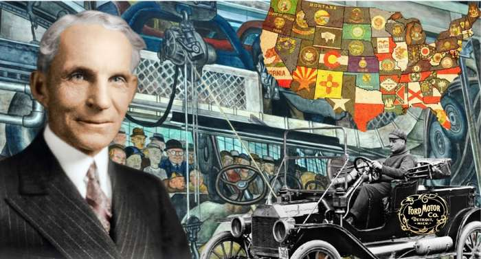
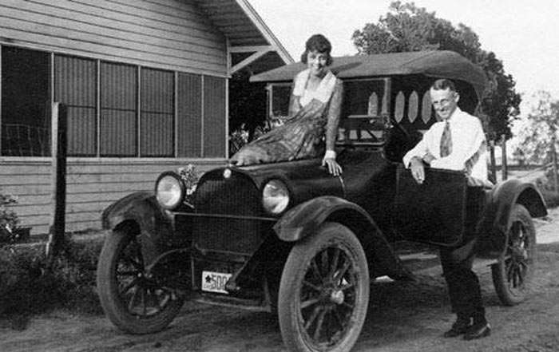

# Эхнэр минь л хажууд минь байвал юуг ч хийнэ

XIX зууны 90-д онд, Детройтын цахилгааны компанид, нэгэн залуу долоо хоногийн 11 долларын цалинтай, өдөрт 10 цагаар ажилладаг байв. Ажилаасаа ирээд, гэрийнхээ дэргэд орших пиндээ, шинэ төрлийн хөдөлгүүр бүтээхээр оройжин ажилладаг байсан бөгөөд, аав нь цагаа дэмий үрлээ гэж үглэн, хөршүүд нь, түүнийг солиотойд тооцдог, энэ хийдэг зүйлээс нь ямар нэг үр дүн гарна гэдэгт хэн нь ч итгэдэггүй байжээ. Харин ганцхан хүн итгэдэг байсан нь эхнэр нь байсан гэдэг. Эхнэр нь, түүнд оройд туслан шөнө дөл хүртэл хамт байж, гараа даарч хөхөртөл керосин дэнлүүг нь барьж өгөн, даарсандаа чичирч, дагжин өвдөтлөө зогсдог байжээ. Тэр нөхрийнхөө хийж буй зүйлд болон нөхөртөө ийнхүү эцэстээ хүртэл итгэдэг байсан аж. Тэгтэл, нэг жил өнгөрч, өнөөх пин дотор их чимээ гарснаар, гайхаж цочсон хөршүүд нь гүйж гарахад, гудамжаар, морьгүй тэргээр их чимээ гарган “Солиот” эхнэртэйгээ давхиж явсан бөгөөд энэхүү “Солиот”-ыг Генри Форд гэдэг байжээ.

Хожим нь, нэгэн сурвалжлагч, Фордоос ярилцлага авах үедээ, -Таныг, өөр зүйл хий гэвэл, та юу хийх байсан, ямар мэргэжил сонгох байсан бол гэсэн асуулт тавихад, -Ямар мэргэжил сонгох, юу хийх маань хамаагүй, хамгийн гол нь, эхнэр минь л хажууд минь байвал юуг ч хийнэ гэж, тэр хариулж байжээ.

