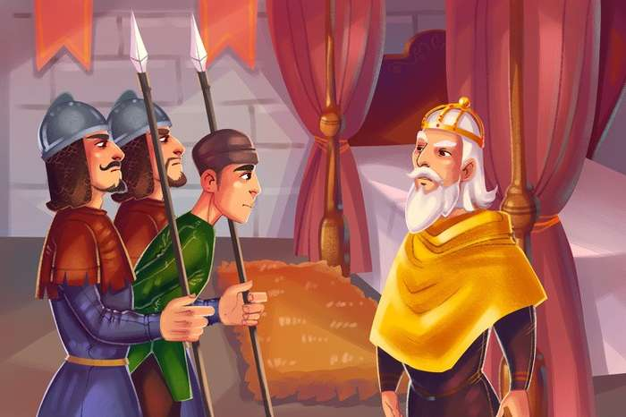
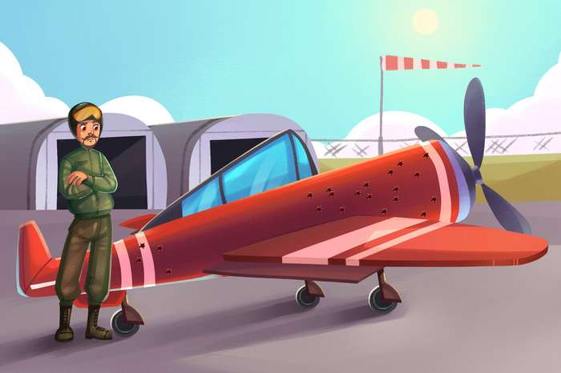

# Экстрим нөхцөл байдалд, таны логик сэтгэхүй хэрхэн ажиллахыг харуулах 3 таавар

Аюултай нөхцөл байдлаас гарахад тустай энэхүү таавруудад хариулж өөрийгөө шалгаарай.

1. Цааз\
Дундад зууны үеийн хаант улс. Та хааны ордонд элбэг хангалуун амьдарч байна. Нэг өдөр, хаан таныг урвагчид тооцон, цаазлахаар шийдэн баривчилж, хааны өмнө таныг авчирахад, хаан, ямар үхлээр үхэхээ сонго, түүнийг чинь биелүүлнэ гэлээ. Та амьд үлдэхийн тулд ямар үхлээр үхэхийг хүсэх вэ?\
2. Дөрвөн ширхэг эм\
Та, халуун орны нэгэн арал дээр амрахаар очжээ. Азгүй явдал болж та, могойд хатгуулснаар арал дээр байдаг ганц эмч, алс холоос ирж үзээд танд, хор тайлах 2 эм, мөн хор тайлах эмний үйлчилгээг хурдасгагч 2 эм өгөөд явав. Хор тайлагч ба хорны эсрэг үйлчилгээг хурдасгагч хоёрыг зэрэг уух маягаар хоёрыг нь одоо, хоёрыг нь орой унтахын өмнө уух ёстой гэсэн бөгөөд гэтэл та санамсаргүй эмнүүдээ хольсноор ялгахгүй болсон байна. Дөрвүүлэнг нь зэрэг ууж болохгүй үхэлд хүргэнэ. Ижил хоёрыг ууж болохгүй үр дүнгүй. Ийм тохиолдолд та, яаж асуудлыг шийдэх вэ?\
3. Нисэгч\
Та бөмбөгдөгч онгоцны нисэгч. Тулаанд орчихоод иртэл, танаас онгоцны их биеийн аль хэсэгт нь нэмэлт хуяг хийх шаардлагатай болохыг асуусан судлаачид угтав. Та онгоцоо хартал, урд хэсгээрээ илүү их суманд цоорсон, харин түлшний сав, хөдөлгүүрийн хавьд бага нүхнүүд байгааг анзаарав. Ингээд, нисэгчидээс асуусаар таны ээлж ирэхэд, та аль хэсэгт нэмэлт хуяг хийх хэрэгтэй гэсэн санал оруулах вэ?

---

Хариулт:\
1. Хаанаас өөрийн үхлээрээ буюу хөгширч үхэхийг гуйна\
2. 4 ширхэг эмээ нунтаглаад хоёр хувааж ууна\
3. Онгоцны урд хэсгийн олон сумны нүх, онгоц эргэж ирэхэд саад болоогүй учираас хөдөлгүүр, түлшний савны хэсэгт нэмэлт хуяг хийхийг санал болгоно
