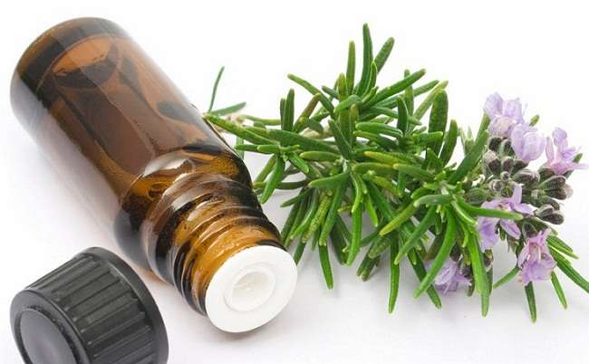

# Эмчилгээ, гоо сайхны өндөр үр дүнтэй, арцны эфирийн тос

Арц, их хэмжээний фитонцид хэмээх бодисыг ялгаруулдагаас. 1 гектарт суулгасан арц, томоохон хотын бохирдсон агаарыг цэвэрлэх чадалтай гэж үздэг бөгөөд энэ ургамал, түүний үнэр, ялалт, урам зоригт дуудахаас гадна, гоо сайхан, эм, үнэртэнг орлох хүчтэй үйлчилгээтэй байдаг. Арцны үнэрийг, энерги, эрч хүч, амар амгалан, амарлингуй, эрх мэдэл, ялалтын үнэр гэдэг. Арц ургаж буй газрын ойр, агаар илүү цэвэр байдгаас, өвдөж сульдсан ан амьтад ирж эдгэрээд явдаг талаар олон жишээ баримтууд байдаг. Арцны үнэр сүрьегийн төрөл бүрийн хэлбэрийн өвчинийг эмчилдэг гэж үздэгээс арц ургасан газарт сууж үнэрээр нь эмчилдэг, мөн тахал халдварын үед ариутгалд хэргэлдэг байжээ. Эрт дээр үеэс арцны үнэрийг гайхалтай “Зөвлөгч”-ийн хэмжээнд авч үздэг байв. Түргэн, алдаа мадаггүй шийдвэр гаргахад тустай гэх ба апельсины эфирийн тостой хамт хэргэлэхэд гайхалтай анхилуун үнэр гаргадаг нарны энергийн тос гэж үздэг бөгөөд эрч хүч, оюун ухаан, амжилт, хамгаалалт, илааршилт, онгодын тос юм. Аураг сэргээж хамгаалахаас гадна худал хуурмагийг таних, шийдвэр гаргах, сөрөг сэтгэл хөдлөлүүдийг дарах увидастай мөн, дотоод сэтгэлийн зохилдлогоог өсгөж билгийн мэлмийг нээдэг. Буяны сэтгэл үүсгэх, оюунлаг байх, гэгээрэлд хүрэхэд тустай. Залхуурал, нойрмог байдал, шалтгаангүй айдсаас чөлөөлж, сэтгэл санааг түвшитгэнэ. Эмчилгээний дараах чанаруудыг агуулдаг бөгөөд үрэвслийн эсрэг, бие цэвэрлэх, хоргүйжүүлэх, нойр тэнцвэржүүлэх, үе мөчний өвчин, хөлс хөөх, шарх эдгээх, шээс хаван хөөх үйлчилэлтэй. Цистит дарж /5-8 дусал арцны эфирийн тосыг багахан усанд хийж самбай даавуунд шингээн жин тавих/, сарын тэмдэгийн мөчлөгийг тогтворжуулж, нян, халдвараас хамгаалж, дархлаа өсгөдөг. Амьсгалын замын өвчиний үед, үрэвслийн эсрэг, цэр ховхлох, ханиалга дарах зэрэг давхар үйлчилэл үзүүлдэг. Судасны хананы уян чанарыг сэргээдгээс, атесклероз, даралт ихсэхээс сэргийлж, цусан дах сахарыг бууруулдаг. Гоо сайхны хэрэглээ: арьсны эд эсийг сэргээж, арьс унжих, арьсны өнгө сэргээх, арьсны язралтын үед хэрэглэх үр дүнтэй. Ямар ч төрлийн арьсанд таардаг ба тослог, батга, тууралттай арьсанд гойд сайн нөлөө үзүүлдэг. Арьсыг цэвэрлэж, үрэвслийн эсрэг үйлчилэл үзүүлэн, арьсны бүх төрлийн өвчинг эмчилэх үр дүнтэй.

#### Хэрэглэх арга:

**Жин хасах зориулалтаар:** Энэ эфирийн тос, арьсны гүн рүү нэвчих өндөр чанартай байдгаас, арьсан дорхи өөхийг шимэгдүүлэх чадвартай гэж үздэг. Мөн илүүдэл шингэнийг гадагшлуулан, арьсыг чангалж, арьсны биржрүүг арилгадаг. Суурь тосондоо нэмэх эсвэл цэврээр нь түрхэж массаж хийх, ороолт хийх, тураах ванн бэлтгэж усанд орох маягаар хэргэлдэг байна.\
Үнэртүүлэгч зүүлтэнд 3-с илүү дусал хийхгүй\
Үнэртүүлэгч сууринд 5-с илүү дусал хэргэлж болохгүй. Үнэртүүлэх үед, орон гэр өрөө тасалгааны агаарыг халдвараас сэргийлж ариутгахын зэрэгцээ гэр орны уур амьсгалыг эерэгжүүлж, сөрөг харилцаа, сэтгэл хөдлөлийг дардаг. \
Мөн өрөө тасалгааны агаарыг халдваргүйжүүлж, чийгшүүлэхийн тулд 300 мл усанд, 2-5 дусал арцны эфирийн тос хийж, ус шүршигч савыг ашиглан шүршиж ариутгадаг\
Ваннд, 6 дусал хийж орно. Далайн давстай хамт хэргэлж болохгүй. Утлагад, 3 дуслыг хийнэ. 7-с илүү минут утаж болохгүй. \
Жин тавих, мөн массажинд, суурь тосондоо 5-с илүү дусал хэргэлдэггүй\
Тослог үсэнд, 2-3 хоолны халбага бүлээн ургамлын тосонд, 4-6 дусал арцны эфирийн тос хийж үсэндээ уртааш түрхэж цагийн дараа шампуниар сайтар угаах\
**Хагнаас салах.** 1 халбага шампуньд 3 дусал арцны эфирийн тос нэмж үсээ угаах. Модон саманд хоёр дусааж үсээ самнах\
Тослог арьсыг цэвэрлэхдээ, 1 өндөгний шард, 3-4 дусал арцны эфирийн тос нэмж уг холимгоо нүүрэндээ түрхээд 15 минутын дараа бүлээн усаар угаана\
Асуудалтай арьсанд 200 мл газгүй аршаан усанд 3-4 дусал арцны тос хийж, түүгээрээ өдөрт 2 удаа нүүрээ арчиж цэвэрлэж байх\
1 халбага оливын тос, 2 дусал арцны эфирийн тос, 2 дусал лимоны эфирийн тосыг хольж хөлдөө түрхэн оймс өмсч унтахад хөлний эвэр арилна

#### Хориглох:

Харшлын тест арьсандаа тавьж үзэх. Бугуйн дотор талд түрхэх. 3 минутын дотор үйлчилэл нь мэдэгднэ\
Жирэмсэн хөхүүл үед хэргэлэх хэрэггүй. \
Бөөрний хурц үрэвсэл, хэт өндөр даралттай үед хэргэлэхгүй\
Сараас илүү хугацаагаар дагнан хэргэлэх хэрэггүй. Өөр эфирийн тостой ээлжлэн хэргэлдэг.
