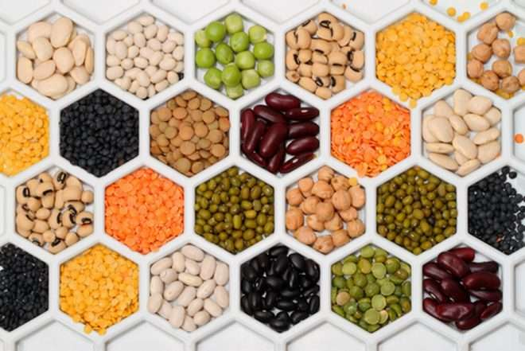

# Эмэгтэй хүний гоо үзэсгэлэн, залуу насаа хадгалахад тустай эстроген дааврын агууламжтай хүнсний бүтээгдэхүүнүүд.

Эмэгтэйчүүд сэтгэл татам гоё сайхан байхыг үргэлжид эрхэмлэж ирсэн байдаг. Гоо үзэсгэлэн нь дотроос буюу эрүүл мэндээс, ялангуяа организм дах эмэгтэйчүүдийн даавар хэмээн нэршсэн эстроген дааврын агууламжаас ихээхэн шалтгаалдаг байна. Энэ дааврыг бэлгийн дур таашаалын даавар гэх нь ч бий. Мөн энэхүү даавар, эмэгтэй хүний зөөлөн булбарай, гоолиг бие, сайхан хөх бүр, сэтгэл гижигдэм инээх дуу хоолойн өнгийг хүртэл зохицуулж байдаг гэж үздэг. Энэ дааврын дутагдал, сэтгэл санааны огцом өөрчлөлт, хямрал, бухимдуу байдал, биеийн жин нэмэх, амархан ядарч сульдах, өөрийгөө үнэлэхээ болих, биеэ хаях, бэлгийн дур хүсэлгүй болох зэрэг олон таагүй зүйлд хүргэдэг аж. Үүнээс үүдэлтэй залуу насны даавар гэж мөн үздэг. Ургамлын гаралтай 3 төрлийн эстрогенууд байдаг бөгөөд изфлавоноид, лигнан, куместан гэж нэрлэдэг байна. Эдгээр нь дараах хүнснүүдэд ихээр агуулагддаг:

Маалингын үр.\
Ургамлын гаралтай дааврын тоо хэмжээгээр 1 номерын бүтээгдэхүүн юм. Дааврыг тэнцвэржүүлэх, нөхөх үйлчлэлээс гадна, бие цэвэрлэх, антиоксидант чанар, хорт хавдраас сэргийлэх, дарах зэрэг олон сайн үйлчлэлийг үзүүлдэг байна. Маалингын үрийг үр хэлбэрээр нь идэх, хандлах, маалингын гурилыг будааны агшаамал, зөгийн бал, тараг, йогурттай хольж хэрэглэх, маалингын тосыг өдөр бүр 2 граммыг уух зэргээр хэргэлдэг. Дозыг хэтрүүлэхээс болгоомжлох ёстой байдаг.\
Буурцагт ургамал.\
Ногоон вандуй, шош, шар буурцаг эстрогенээр баялаг бөгөөд эдгээр буурцагт ургамлуудаас чечевица /сэвэг зарам/ фитоэстрогены төрөл изофлавоноидын өндөр агууламжаараа илүү, ургамлын гаралтай уургаар баялаг, сэтгэл хямрах байдлаас хамгаалдаг серотониныг үүсгэдэг триптофаны агууламжтай байдаг тул эмэгтэйчүүдэд нэн тохиромжтой гэж үздэг. Түүнчлэн, сүүлийн үед шар буурцагийг 90% генийн өөрчлөлттэй гэж тооцдог болоод буйг анхааралдаа авах нь зүйтэй.\
Ургамлын гаралтай даавар фитоэстроген болох лигнан, наран цэцгийн самар, гүнжидийн үрэнд ихээхэн хэмжээгээр агуулагддаг.\
Кофе.\
Эмэгтэйчүүдийн дунд явуулсан судалгаагаар өдөр бүр өглөөд 500 мл кофе уудаг эмэгтэйчүүдийн 90%-н организм дах эстроген дааварын түвшин 70%-с дээш байгаа нь ажиглагдсан бөгөөд эдгээр эмэгтэйчүүд, харьцангуй жингийн илүүдэлгүй болох нь харагджээ.\
Чангаанз.\
Лигнаны өндөр агууламжтай жимсгэнэ. Шинэ болон хатаасан аль ч хэлбэрээр идэхэд ашигтай.
