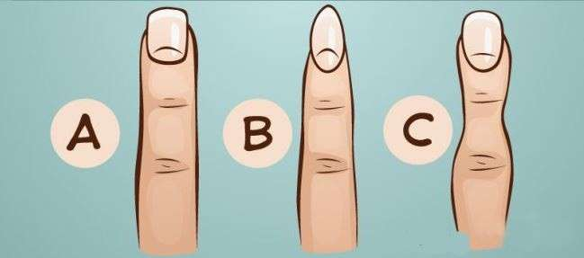

# Эмэгтэй хүнийг дунд хурууны хэлбэрээр шинжих нь

Хүнийг гарын хэлбэр, алгаар шинжих асуудлыг сүүлийн үед ихээхэн сонирхдог болжээ. Ерөнхийдөө, гарын хэлбэр үзэмж, хүний зан чанарыг илэрхийлдэг гэж үздэг байна. Та бүхэнд гарынхаа дунд хурууны хэлбэрээр өөрийгөө таних аргыг танилцуулъя.

#### А. Шулуун, дөрвөлжиндүү дунд хуруу

Та өөрийн бие даасан байдлаа үнэлдэг. Сэтгэлийнхээ гүнд маш мэдрэмтгий, сэтгэл хөдлөлтэй ч өөрийн мэдрэмжээ тэр бүр илэрхийлэхгүй, байнгын үйл хөдлөлийг эрхэмлэдэг. Таны сэтгэл зүрх агуу, хайртай ойр дотныхныхоо төлөө өөрийгөө золиослоход бэлэн байдаг. Та, шударга, сайхан сэтгэлтэй, хошин шогийн мэдрэмжтэй, сайн хүн.

#### Б. Үзүүр нь нарийссан дунд хуруу

Та, үнэнч, хариуцлагатай хүн. Нэг хүнд дурлавал нэг мөсөн дурлана. Мөн зорьсондоо заавал хүрдэг сайхан чанартай. Та, итгэж найдаж болох хүн. Маш бүтээлч. Харин таны итгэлийг авахад хэцүү. Итгэлийг тань авч чадвал, үүрдийн холбоо тогтдог.

#### С. Ясархаг, том дунд хуруу

Та, асуудлуудад дарагддаггүй, чөлөөт, өөдрөг хүн. Өөрийн хариуцлагаа багасгах, эрсдэлтэй асуудлуудаас зайлсхийхийг үргэлж оролдож байдаг. Хэрэв таныг тавлаг орчиноос тань салгаж чадвал, олон асуудлыг үр дүнтэй шийдвэрлэх гайхалтай чадвартай. Мөн та, хүмүүстэй харилцах хэлэлцээр хийх сайхан чадвартай.
