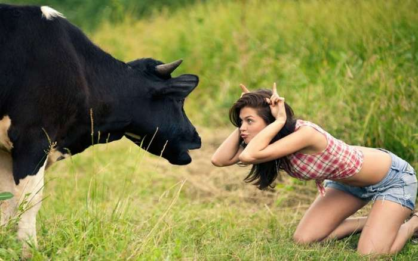

# Эмэгтэйчүүд, эрэгтэйчүүдийн доромжлол хэмээн үздэг дургүй, тэвчдэггүй зүйлс

**Эмэгтэйчүүд дараах зүйлсийг доромжлол гэж үздэг:**\
-түүн рүү хашгирч, дуугаа өндөрсгөвөл\
-анхаарал тавихгүй байвал\
-өөр бусад эмэгтэйчүүдийг магтвал\
-өөрийг нь магтахгүй бол\
-өөр эмэгтэй дээр харц тогтоовол\
-гадаад төрхийг нь шүүмжилвэл\
-нэрийг нь санахгүй андуурвал\
-оройтож, удахаа сануулаагүй бол\
-халамж тавихгүй бол /хувцас, гоо сайхны хэрэглэл, амттан авч өгөхгүй байх/\
-хүнд зүйл өргөхөд нь туслахгүй бол\
-гоёж гангалсан үед нь явган явуулах, нийтийн тээврийн хэрэгслээр зорчуулвал\
-дэргэд нь хэхэрвэл, мөн өмхий тавивал\
-хараал хэлвэл\
-бүдүүлэг сэдэвтэй зүйл дэргэд нь яривал\
-хийсэн хоол ундыг нь үнэлэхгүй бол\
-шинээр авсан хувцасыг нь ойшоож, анзаарахгүй бол\
**Харин эрчүүд:**\
-түүнтэй маргалдах\
-яриаг нь таслах\
-орж ирэхэд нь баярлахгүй байх \
-амьдралыг зааж сургах\
-салан задгай байдалтай, муухай хувцастай харагдах\
-муухай сав суулганд хоол аягалж өгөх\
-дэргэд нь орилж хашгирах\
-ихэрхэн, ёгтолсон яриа гаргах\
-хялайж цэхэлзэн харах\
-уурлаж бухимдах үед нь тайтгаруулахгүй байх\
-уурандаа уйлж бархирах\
-найз нөхдийг нь муулах
