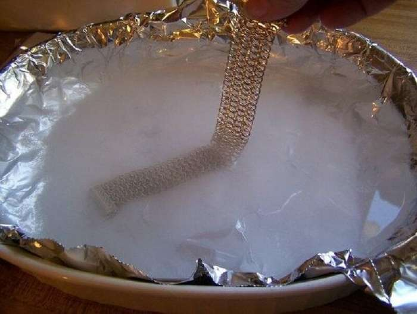
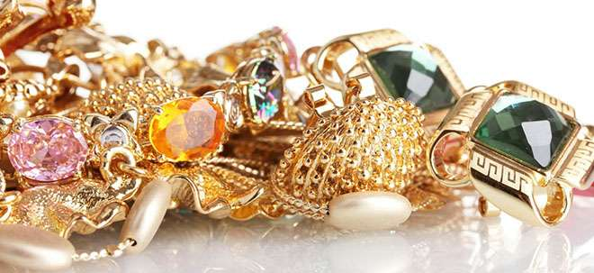

# Энэ арга алт, мөнгөн эдлэлийг шинэ мэт болгон гялалзуулна

Алт, мөнгөн гоёлын зүйлсээ шинэ мэт гялалзуулахад, айл бүрт байдаг дараах гарын дорх зүйлс хэрэг болно.

1 хоолны халбага давс\
-1 хоолны халбага сода\
-1 хоолны халбага ачга таваг угаагч шингэн\
-1 стакан ус\
-Багахан тугалган цаас\
Усаа халааж, ёроолоос нь дээш тугалган цаасаа дэвсэж өгсөн саванд юүлнэ. Үүн дээрээ, дээр заагдсан зүйлсээ хийж хутгаад, гоёлын зүйлсээ дотор нь хийж 5-10 минут байлгаад гарган, бүлээн усаар зайлан, зөөлөн даавуугаар арчина. Дэлгүүрээс авсан шинэ зүйл шиг гялалздаг байна.
