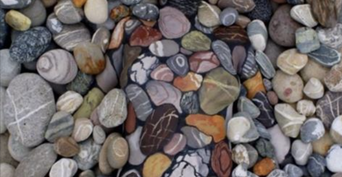
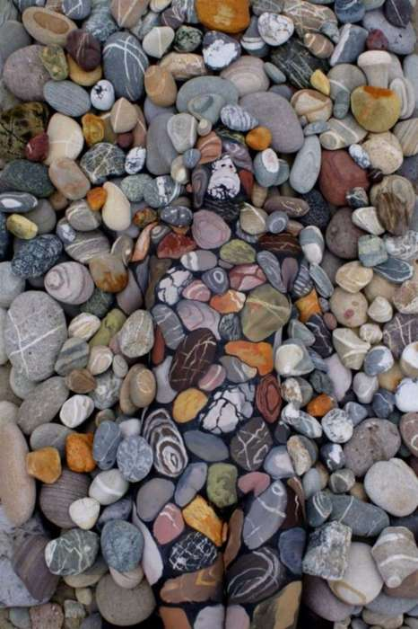

# Энэ чулуунууд дунд, нэг бүсгүй амарч байгаа, олж харав уу?

Австрийн зураач, Йоханнес Стёттер бодиартын уран зургийн дэлхийн үзэсгэлэнд бүтээлээрээ алдаршсан хүн юм. Йоханнес, аливааг гайхалтай толгой эргүүлэм, нууцлагаар, олж харахад түвэгтэйгээр зурдаг. Дараах зургийг, “Чулуун дунд амарч буй бүсгүй” гэж нэрлэжээ. Ажиглах, анхаарах чадвар маань хир байгаа бол?

Та, олж харж чадав уу?
